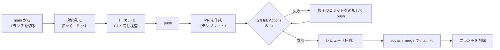

# 開発の進め方（CONTRIBUTING）

RealTennis の開発フローのルールです。**対応内容ごとに細かくコミットを作り、ブランチを push して PR を作成し、CI（GitHub Actions）を通してから `main` にマージします。** （元のリポジトリでは、Claude Code 向けの要約を別の開発ルール集にまとめています。公開版には含めていません。）

---

## 1. 流れ



## 2. ブランチ

| 接頭辞 | 用途 | 例 |
|---|---|---|
| `feat/` | 機能の追加 | `feat/ball-physics-step` |
| `fix/` | 不具合の修正 | `fix/tiebreak-server-order` |
| `docs/` | 文書 | `docs/ai-detail` |
| `ci/` | CI・自動化 | `ci/strict-link-check` |
| `chore/` | 設定・雑務 | `chore/enable-poseSearch-plugin` |
| `refactor/` | 動作を変えない整理 | `refactor/split-rule-judge` |
| `test/` | テストだけの追加 | `test/score-property-tests` |
| `art/` | アセット | `art/court-hard-mesh` |

- 1 つのブランチには、1 つの目的の変更だけを入れる
- **こまめに main へ反映する**：小さい単位（半日以内・差分 400 行以内が目安）で PR を出し、CI が通ったらすぐマージする（開発ルール集 §1-8。公開版には未収録）
- `main` に直接コミット・push しない（リポジトリの初期化のコミットだけは例外として直接 push した）

## 3. コミット

- **1 コミット = 1 つの論理的な変更**。レビューする人が、コミットごとに意図を追えるようにする
- メッセージの形式：

```
<種類>: <日本語の要約（50 文字程度まで）>

<何を変えたか・なぜ変えたか。関連する要件 ID やテスト ID>

Co-Authored-By: ...（共同作者がいる場合）
```

- 種類：`feat`・`fix`・`docs`・`ci`・`chore`・`refactor`・`test`・`art`
- 良い例：`feat: FTennisScoreRules にタイブレークのサーブ順を追加`、`test: タイブレークのサーブ順のテスト（ルール仕様 §7 例 4）`
- 悪い例：`update`、`いろいろ修正`、無関係な複数の変更を 1 コミットにまとめる

## 4. PR

- [PR テンプレート](.github/pull_request_template.md) に従って書く（目的・変更点・関連 ID・確認したこと）
- タイトルは、主なコミットの要約と同じ形式（`<種類>: <要約>`）
- 大きすぎる PR は分ける（目安：レビューに 30 分以上かかるもの）
- 設計と実装が食い違う場合は、先に設計書を更新する PR を出す

## 5. CI（GitHub Actions）

公開版のワークフローは [`.github/workflows/ci.yml`](.github/workflows/ci.yml) の 1 つ（文書・設定の検査。GitHub のホストのランナーで動き、秘密情報を使わない）。元のリポジトリには、C++ のビルドと `Tennis.` の自動テストを UE を入れたセルフホストのランナーで実行するワークフローがあるが、公開リポジトリでフォークの PR から任意のコードが実行されるのを避けるため、公開版には含めない。検査の一覧・ローカルでの実行の方法・ランナーの準備は [Tools/CI/README.md](Tools/CI/README.md) にまとめている（ここに重複して書かない）。

- **CI がすべて成功するまでマージしない**。失敗を無視・スキップしない
- C++ の自動テスト（CQTest・Automation Spec）は、PR の前に Unreal MCP の `AutomationTestToolset` でも実行し、結果を PR に貼る（開発ルール集 §7 の 2）

## 6. ローカルでの検査

[Tools/CI/README.md](Tools/CI/README.md) を参照。push の前に必ず実行する。

## 7. マージ

- squash merge（PR の単位で 1 コミットになる）
- マージ後はブランチを削除する
- `main` は常に CI が通る状態に保つ

## 8. 開発原則・品質特性・セッション

ルールの本体は、元のリポジトリの開発ルール集にある（公開版には含めない。下の表の § はその番号）。

| 内容 | 開発ルール集 |
|---|---|
| 開発原則（SOLID・KISS・YAGNI・DRY）、不要なコードの削除、ファイル分け・フォルダ分け | §4 |
| 品質特性（脆弱性・堅牢性・運用性・保守性）の確認項目 | §5 |
| セッション（サブエージェント）の分け方 | §2 |
