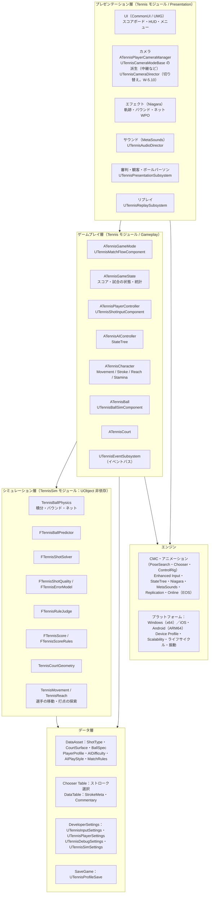
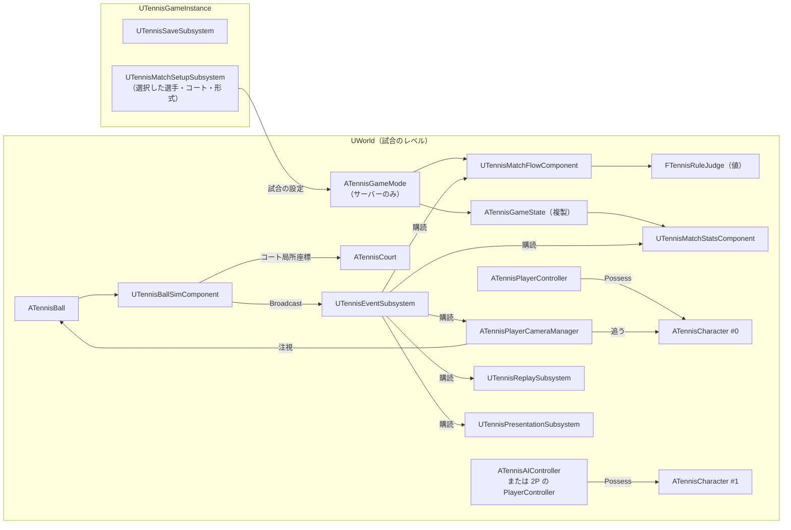
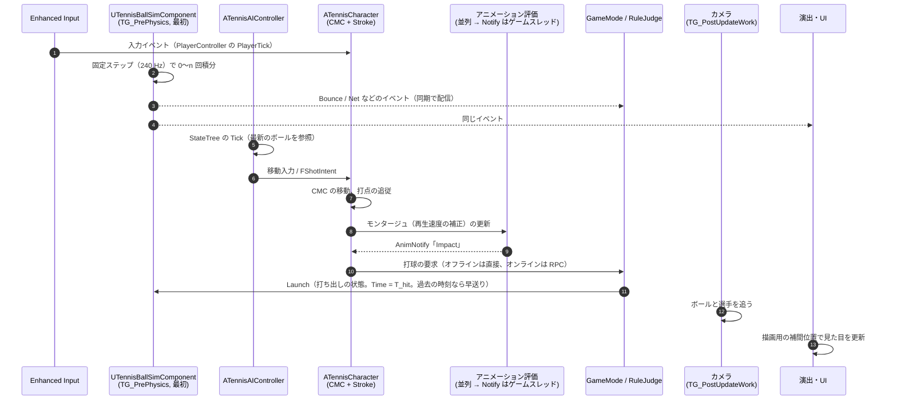
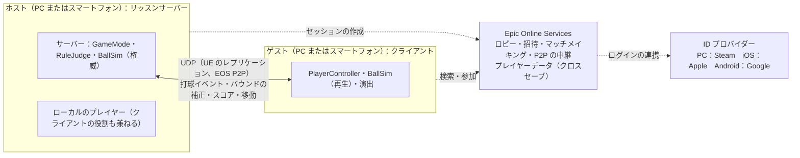

# システム構成設計書（System Architecture）

| 項目 | 内容 |
|---|---|
| 文書 ID | ARCH-01 |
| 版 | 1.0（2026-11-04） |
| 関連 | [モジュール設計](02_Module_Package_Design.md)、[クラス図](../03_UML/02_Class_Diagrams.md)、[シーケンス図](../03_UML/03_Sequence_Diagrams.md) |

---

## 1. 設計の原則

| # | 原則 | 具体的には |
|---|---|---|
| A1 | **シミュレーションと表現を分ける** | ボール物理・ソルバ・ルール・スコアは `TennisSim` モジュールの純粋な C++。Actor や Component は、その結果を表示・入力するだけ |
| A2 | **1 つの物理を共有する** | 本番の積分・予測・ソルバ・ネットワークの再生・リプレイが、同じ `TennisBallPhysics::Step()` を呼ぶ |
| A3 | **イベント駆動** | ボールと試合の出来事は `UTennisEventSubsystem` から発行する。演出（音・エフェクト・カメラ・UI・観客）は購読するだけで、ゲームの進行に影響しない |
| A4 | **サーバー権威** | ルールの判定と打球の確定はサーバー（オフラインでは自分自身）だけが行う |
| A5 | **データ駆動** | 調整の値は DataAsset／DataTable／Chooser／DeveloperSettings に置く |
| A6 | **プレイヤーと AI は同じ経路で打つ** | どちらも `FShotIntent`（意図）を作り、同じストローク・品質・誤差・ソルバを通る |

## 2. レイヤー構成

**依存の向きの規則**：上の層は下の層に依存してよい。逆は禁止。`TennisSim` は `Core`・`CoreUObject`（USTRUCT のため）にだけ依存し、`Engine` に依存しない（[モジュール設計](02_Module_Package_Design.md) §2）。

## 3. ランタイムのオブジェクト構成

| オブジェクト | 存在する場所 | 役割 |
|---|---|---|
| `ATennisGameMode` | サーバー | 試合の進行（`UTennisMatchFlowComponent`）。ルールの判定（`FTennisRuleJudge`）。打球の確定。今は選手のポーン（`ATennisCharacter`）とコントローラー（`ATennisPlayerController`）の既定を決めるだけ（ほかは M5） |
| `ATennisGameState` | 全員（複製） | スコア（`FTennisScore`）、試合の段階、ラリー番号、打球イベントの配信（Multicast） |
| `ATennisCourt` | 全員 | 寸法・座標変換・判定区域・面のデータ・恒久施設の登録 |
| `ATennisBall` | 全員 | 見た目（メッシュ・軌跡・音）。`UTennisBallSimComponent` が状態を持つ |
| `ATennisCharacter` | 全員（複製） | 移動（CMC）、ストローク、打点の探索、スタミナ、能力値、見た目（メッシュとラケット。アセットは `UTennisPlayerSettings`） |
| `ATennisPlayerController` | 所有者 | 入力（移動はコートに対する向き：`NetwardYawDegrees`・`StickToWorldDirection`。球種は `UTennisShotInputComponent`）、カメラ（`PlayerCameraManagerClass` に `ATennisPlayerCameraManager`）、HUD |
| `ATennisPlayerCameraManager` | 所有者 | 操作する選手・コート・ボールから文脈（`FTennisCameraContext`）を作り、カメラのモードに視点を決めさせる。今は中継（`UTennisCameraMode_Broadcast`）だけ（[クラス図 §7](../03_UML/02_Class_Diagrams.md)） |
| `ATennisAIController` | サーバー | StateTree による判断。`FShotIntent` を作る |
| `UTennisEventSubsystem` | 全員（World Subsystem） | イベントの配信（購読者に順に通知） |
| `UTennisReplaySubsystem` | 全員 | ポイントの記録と再生 |
| `UTennisPresentationSubsystem` | クライアント | 主審のコール・観客・ボールパーソン |
| `UTennisMatchSetupSubsystem` | Game Instance | メニューで選んだ試合の設定を、レベルをまたいで渡す |
| `UTennisSaveSubsystem` | Game Instance | セーブとロード |

- **今の実装（M3）**：あるのは `ATennisGameMode`・`ATennisCourt`・`ATennisBall`（`UTennisBallSimComponent`）・`ATennisCharacter`・`ATennisPlayerController`・`ATennisPlayerCameraManager` と、開発用の打球ツール `ATennisShotTester`（テストマップに置く。FR-DBG-003）。ほかは使うマイルストーンで足す（[WBS](../09_Project/01_Roadmap_WBS.md)）

## 4. 1 打のデータの流れ

```mermaid
flowchart LR
    IN["入力<br/>（ボタン・スティック）"] --> SIC["UTennisShotInputComponent"]
    AI["AI（StateTree）"] --> INT
    SIC --> INT["FShotIntent<br/>球種・溜めの始まり・離した時刻<br/>狙い・修飾（M4）"]
    INT --> STK["UTennisStrokeComponent<br/>打点の選択・ストロークの選択<br/>モンタージュの再生と時刻合わせ"]
    PRED["予測軌道（キャッシュ）"] --> STK
    STK -- "AnimNotify Impact" --> QLT["FTennisShotQuality<br/>タイミング × 打点 × 体勢 × 球威"]
    QLT --> ERR["FTennisErrorModel<br/>着地点に誤差（シード付き乱数）"]
    ERR --> REQ["FShotRequest<br/>打点・目標点・球種・目標の速さ"]
    REQ --> SOL["FTennisShotSolver"]
    SOL --> LAUNCH["FBallState（打ち出し）"]
    LAUNCH --> SIM["UTennisBallSimComponent::Launch"]
    SIM --> EV["イベント：Launch"]
    EV --> PRED
    EV --> NET["GameState：MulticastLaunch"]
    EV --> FX["演出（音・軌跡・観客）"]
    SIM --> EV2["イベント：Bounce・NetTouch・BodyHit…"]
    EV2 --> RJ["FTennisRuleJudge"]
    RJ --> PR["FPointResult"]
    PR --> SC["FTennisScore::AwardPoint"]
    SC --> GS["GameState（OnRep_Score）"]
    GS --> UI["UI・主審のコール"]
```

## 5. フレーム内の処理順（Tick）

**順序の保証**：

- `UTennisBallSimComponent` は `TG_PrePhysics`。キャラクターの CMC・メッシュ・打点の探索（`UTennisReachComponent`）に `AddTickPrerequisiteComponent(BallSim)` を付け（`ATennisCharacter::FollowBall`）、ボールより後に処理する
- AnimNotify「Impact」はフレームの境目で届く。**インパクトの正確な時刻**はモンタージュの時間から計算し、その時刻のボールの状態を予測軌道から取り出して判定する（フレームより細かい精度。[ボール物理 詳細](../04_DetailedDesign/01_BallPhysics_Detail.md) §6）

## 6. イベント一覧（`UTennisEventSubsystem`）

| イベント | 発行元 | 主な購読者 | ペイロード |
|---|---|---|---|
| `OnBallLaunched` | BallSim | 予測・AI・軌跡・音・観客・リプレイ・ネットワーク | `FBallLaunchEvent` |
| `OnBallBounce` | BallSim | ルール・音・エフェクト・統計 | `FBallEvent`（`Type = Bounce`）：位置、v_n、接地の半径。側・面・イン／アウトの距離は、まだない |
| `OnBallNetTouch` | BallSim | ルール・音・ネットの揺れ | `FBallEvent`（`Type = NetTouch`）：部位（`NetPart`）。強さ・越えたかは、まだない |
| `OnBallPostHit`／`OnBallFixtureHit`／`OnBallBodyHit` | BallSim | ルール・音 | `FBallEvent`（`Type = PostHit`）：部位（`SinglesStick`／`Post`）。`FixtureHit`・`BodyHit` の種類は、恒久施設と体の衝突を作る作業（DD-01 §5.4・§6）で足す |
| `OnStrokeStarted` | Stroke | 音（衣擦れ）・AI（相手の構えを読む） | ストロークの種類、予定の打点 |
| `OnImpact` | Stroke | 音・振動・エフェクト・UI（タイミングの判定） | 品質、タイミングの判定、球速 |
| `OnPointStarted` | MatchFlow | UI・観客（静かに）・カメラ | サーバー、サイド、第 1／第 2 サーブ |
| `OnServeResult` | MatchFlow | 主審（Fault／Let）・UI | 結果 |
| `OnPointEnded` | MatchFlow | 主審・観客・UI・統計・リプレイ・カメラ | `FPointResult`（勝者、理由、条番号、ラリーの長さ） |
| `OnScoreChanged` | GameState | UI・主審 | `FTennisScore` |
| `OnGameEnded`／`OnSetEnded`／`OnMatchEnded` | MatchFlow | UI・観客・セーブ | — |
| `OnChangeEnds` | MatchFlow | カメラ（反転）・キャラクター（移動） | — |
| `OnMatchPhaseChanged` | MatchFlow | 入力（コンテキストの切り替え）・UI | `ETennisMatchPhase` |

- C++ のネイティブなマルチキャストデリゲートで配信する。ブループリント用に `BlueprintAssignable` の版も用意する
- **今の実装**：`UTennisEventSubsystem` はまだない。ボールのイベントは、`UTennisBallSimComponent::OnBallEvent`（`FBallEvent`。種類は `Type`。`TennisSim/Public/Ball/BallEvents.h`）で 1 つずつ配信している（[DD-01 §3.3](../04_DetailedDesign/01_BallPhysics_Detail.md)）
- 演出は**イベントを受けるだけ**で、ゲームの状態を変えない（A3）。これにより、AI 対 AI の高速実行（FR-DBG-006）で演出を外せる

## 7. 配置図（オンライン・クロスプレイ）

- 専用サーバーは使わない（1 対 1 で、帯域も計算も小さい）
- ホストの有利（遅延 0）は、打つ側の遅延補償（[ネットワーク 詳細](../04_DetailedDesign/06_Network_Detail.md) §4）で小さくする
- スマートフォンがホストになる場合、アプリが中断されると試合が止まる。**クイックマッチでは PC を優先してホストにする**。スマートフォンどうしの場合は、どちらかがホストになり、中断は切断として扱う（FR-MATCH-007）
- x64 と ARM64 では浮動小数点の結果が完全には一致しない。クライアントは、サーバーが送るバウンドのイベントで軌道を補正する（NFR-DET-007）

## 7.1 プラットフォームの差を吸収する場所

| 差 | 吸収する場所 | 内容 |
|---|---|---|
| 入力機器（ゲームパッド・キーボード・タッチ） | `UTennisShotInputComponent`、`UTennisSwipeRecognizer` | どれからでも同じ `FShotIntent` を作る |
| 画面の大きさ・セーフエリア | CommonUI、`UTennisHUDLayout`（PC 用とタッチ用の 2 種） | タッチ用の HUD はボタンを含む |
| 描画の品質 | Device Profile、Scalability | 「Mobile」の段を追加する |
| アプリの中断 | `UTennisPlatformSubsystem`（Game Instance） | `FCoreDelegates::ApplicationWillEnterBackgroundDelegate` などを受け、試合をポーズ・保存する |
| 振動 | `UTennisHapticsService` | ゲームパッドの Force Feedback と、スマートフォンの振動 API を同じ呼び出しにする |
| オンラインの ID | Online Subsystem EOS ＋ 各プラットフォームの ID | ログインの方法だけが違う |
| 物理・ルール・AI | **差を作らない** | 固定ステップなので、描画の性能に影響されない |

## 8. スレッドとパフォーマンス

| 処理 | スレッド | 予算（推奨環境） |
|---|---|---|
| ボールの積分（240 Hz、1 フレームあたり 4 ステップ） | ゲーム | 0.05 ms |
| 軌道の予測（打球ごとに 1 回） | ゲーム | 0.3 ms／回 |
| ショットソルバ（打球ごとに 1 回） | ゲーム | 1.0 ms／回（P99） |
| AI の判断 | ゲーム | 0.3 ms／フレーム |
| ルールの判定・スコア | ゲーム | 0.01 ms |
| アニメーション | ワーカー（エンジンの並列評価） | 2 体で 1.5 ms |
| 描画 | レンダー／RHI | [性能予算](../08_QA/02_Performance_Budget.md) |

AI が「もし自分がこう打ったら」を多数試す場合（ショット選択の評価）は、ソルバを使わず、事前に計算した**ショットの表**（球種 × 打点の高さ × 目標の深さ → 打ち出しの近似値）を引く。打つときにだけソルバを使う（[AI 詳細](../04_DetailedDesign/05_AI_Detail.md) §4）。

## 9. 状態の持ち方（どこに何があるか）

| 状態 | 持ち主 | 複製 |
|---|---|---|
| ボールの状態（位置・速度・スピン・時刻） | `UTennisBallSimComponent` | 打球イベントで同期（毎フレームは送らない） |
| 予測軌道 | `UTennisBallSimComponent`（キャッシュ） | 各自で計算 |
| スコア | `ATennisGameState::Score` | `ReplicatedUsing=OnRep_Score` |
| 試合の段階 | `ATennisGameState::Phase` | 複製 |
| ラリーの判定の内部状態 | `FTennisRuleJudge`（GameMode 内） | 複製しない（サーバーのみ） |
| 選手の位置・移動 | CMC | 標準の複製（クライアント予測） |
| ストロークの状態 | `UTennisStrokeComponent` | 開始時に Multicast（相手の画面で先にアニメを始める） |
| スタミナ | `UTennisStaminaComponent` | 複製（ポイント間だけ更新を送る） |
| 統計 | `UTennisMatchStatsComponent` | ポイント終了時に複製 |
