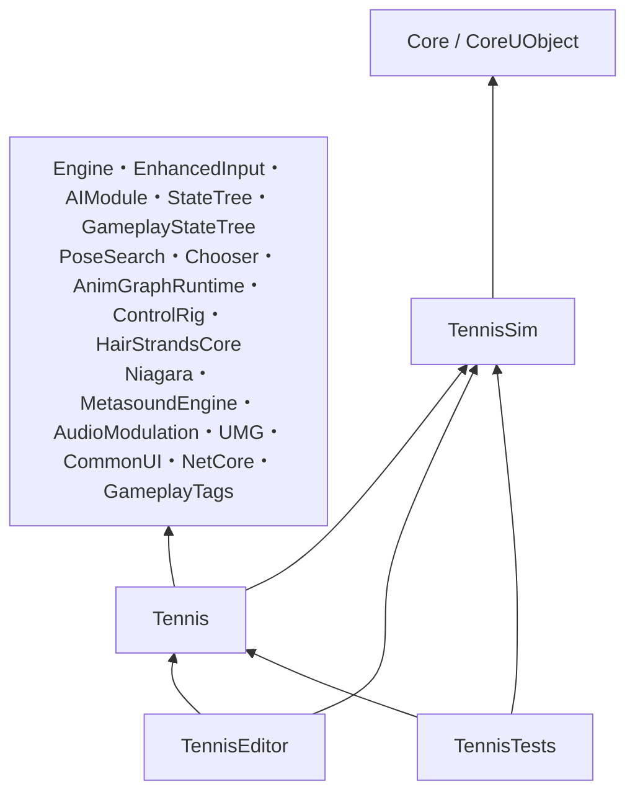

# モジュール・パッケージ設計書

| 項目 | 内容 |
|---|---|
| 文書 ID | ARCH-02 |
| 版 | 1.0（2026-11-04） |
| 関連 | [システム構成](01_System_Architecture.md)、[クラス図](../03_UML/02_Class_Diagrams.md)、[コーディング規約](03_Coding_Standards.md) |

---

## 1. モジュール一覧

| モジュール | 種類（Type） | 読み込み（LoadingPhase） | 役割 |
|---|---|---|---|
| **TennisSim** | Runtime | Default | 純粋なシミュレーション：コートの幾何、ボール物理、予測、ショットソルバ、品質と誤差、ルールの判定、スコア。**Engine に依存しない** |
| **Tennis** | Runtime | Default | ゲーム本体：Actor、Component、GameMode、AI、入力、カメラ、演出、UI、セーブ |
| **TennisEditor** | Editor | PostEngineInit | エディタのツール：ストロークのメタデータの生成、仮想 CPR 試験、コートの検証（打球ツールは物理が動く PIE で使うので Tennis の `Debug/` に置く） |
| **TennisTests** | DeveloperTool | Default | 自動テスト（CQTest／Automation Spec）。出荷ビルドには含めない |



## 2. 依存関係（Build.cs）

> **今の実装（M3）**：依存は、使うマイルストーンで足す（YAGNI。各 Build.cs が正）。今の `Tennis` は Public に `Core`・`CoreUObject`・`Engine`・`DeveloperSettings`・`TennisSim`、Private に `InputCore`・`EnhancedInput` だけ。`TennisTests` は `Core`・`CoreUObject`・`Engine`・`AssetRegistry`・`CQTest`・`TennisSim`・`Tennis`・`EnhancedInput`・`InputCore`・`Chooser`・`HairStrandsCore`、エディタのビルドのときだけ `TennisEditor`・`PoseSearch`（unity build を使わない）。下の §2.2〜§2.4 は、すべてのマイルストーンが終わったときの形。

### 2.1 TennisSim.Build.cs

```csharp
using UnrealBuildTool;

public class TennisSim : ModuleRules
{
    public TennisSim(ReadOnlyTargetRules Target) : base(Target)
    {
        PCHUsage = PCHUsageMode.UseExplicitOrSharedPCHs;
        PublicDependencyModuleNames.AddRange(new[] { "Core", "CoreUObject" });
        // Engine に依存しない（FVector・FRandomStream・USTRUCT は Core / CoreUObject にある）
        // 浮動小数点の最適化：決定論のため、MSVC の /fp:fast を使わない（既定の /fp:precise のまま）
    }
}
```

### 2.2 Tennis.Build.cs

```csharp
using UnrealBuildTool;

public class Tennis : ModuleRules
{
    public Tennis(ReadOnlyTargetRules Target) : base(Target)
    {
        PCHUsage = PCHUsageMode.UseExplicitOrSharedPCHs;
        PublicDependencyModuleNames.AddRange(new[] {
            "Core", "CoreUObject", "Engine", "InputCore", "EnhancedInput",
            "TennisSim", "GameplayTags", "NetCore", "DeveloperSettings"
        });
        PrivateDependencyModuleNames.AddRange(new[] {
            "AIModule", "StateTreeModule", "GameplayStateTreeModule",
            "AnimGraphRuntime", "PoseSearch", "Chooser", "ControlRig",  // PoseSearch：M3 は .uproject でプラグインを有効にするだけ（軌跡はエンジンの FTransformTrajectory。DD-03 §6.5）
            "HairStrandsCore",  // 選手の髪（Groom。DD-03 §7）。プラグイン HairStrands を .uproject で有効にする（W-0.2）
            "Niagara", "MetasoundEngine", "AudioMixer", "AudioModulation",
            "UMG", "Slate", "SlateCore", "CommonUI", "CommonInput",
            "OnlineSubsystem", "OnlineSubsystemUtils", "OnlineSubsystemEOS"
        });

        // プラットフォームごとの依存（振動・ライフサイクルなど）
        if (Target.Platform == UnrealTargetPlatform.IOS)
        {
            PrivateDependencyModuleNames.Add("OnlineSubsystemIOS");
        }
        else if (Target.Platform == UnrealTargetPlatform.Android)
        {
            PrivateDependencyModuleNames.Add("OnlineSubsystemGooglePlay");
        }
        else if (Target.Platform == UnrealTargetPlatform.Win64)
        {
            PrivateDependencyModuleNames.Add("OnlineSubsystemSteam");
        }
    }
}
```

### 2.3 TennisEditor.Build.cs（抜粋）

```csharp
PrivateDependencyModuleNames.AddRange(new[] {
    "Core", "CoreUObject", "Engine", "UnrealEd", "Slate", "SlateCore",
    "EditorSubsystem", "Blutility", "AnimationModifiers", "AssetTools",
    "Chooser",                    // CHT_StrokeSelect を UStrokeData から作る（DD-03 §5.3）
    "AnimationBlueprintLibrary",  // StrokeMetaBaker：UAnimPoseExtensions（RES-06 G-16）
    "PoseSearch", "AssetRegistry",  // PSS_Locomotion・PSD_Locomotion を作る（DD-03 §6.5）
    "Tennis", "TennisSim"
});
```

上は最終的な形。今の依存は `Core`・`CoreUObject`・`Engine`・`AssetRegistry`・`Chooser`・`AnimationBlueprintLibrary`・`PoseSearch`・`Tennis`・`TennisSim` だけで、ツールを足すときに必要な分を足す（YAGNI）。`TennisTests` は、エディタのビルドのときだけ `TennisEditor`・`PoseSearch` に依存する（表・ロコモーションのデータベースを作る道具と、焼く道具のテスト）。

### 2.4 TennisTests.Build.cs（抜粋）

```csharp
PrivateDependencyModuleNames.AddRange(new[] {
    "Core", "CoreUObject", "Engine", "CQTest", "TennisSim", "Tennis",
    "HairStrandsCore"  // 選手の髪の付け方のテスト（T-CHR-001）
});
```

## 3. ソースのフォルダ構成

```
Source/
├─ Tennis.Target.cs / TennisEditor.Target.cs
├─ TennisSim/                         … 純粋なシミュレーション（UObject 非依存のロジック。USTRUCT は可）
│  ├─ Public/
│  │  ├─ TennisConstants.h            … 規格値（ITF 2026 のコート・ネット・ボール）と物理の定数（SimDt など）。調整しない値だけ
│  │  ├─ TennisSimTypes.h             … FBallState, FBallParams, FSurfaceParams, FAirParams, FMatchConditions, FBallSimContext
│  │  ├─ TennisUnits.h                … 単位の変換（RpmToRadPerSec。ARCH-03 U-3）
│  │  ├─ TennisSimLog.h               … LogTennisBall・LogTennisShot・LogTennisStroke（ARCH-03 §5.1）
│  │  ├─ FixedStepClock.h             … FFixedStepClock（フレームの時間 → 240 Hz のステップの数）
│  │  ├─ Court/CourtGeometry.h        … TennisCourtGeometry（NetHeightAt, HasNetAt, HasNetBodyAt。寸法は TennisConstants.h）
│  │  ├─ Calibration/CourtCalibration.h … 仮想の CPR 試験・ドロップテスト（面とボールの校正。自動テスト Tennis.Game.Data が使う：W-1.9）
│  │  ├─ Ball/TennisBallPhysics.h     … Step(), AdvanceTo(), ComputeAccel(), IntegrateFlight(), ResolveGroundBounce()（ネット・ポストは Private）
│  │  ├─ Ball/TennisBallPredictor.h   … FTrajectory（240 Hz の States と Events）, FPredictOptions, Predict(), GetStateAt()
│  │  ├─ Ball/BallEvents.h            … FBallEvent（EBallEventType：Bounce・NetCross・NetTouch・PostHit）, ENetPart。恒久施設・体は M1 の残り
│  │  ├─ Shot/ShotTypes.h             … ETennisShotType, ETennisHandedness, FShotIntent, FShotRequest, FShotSolveResult, ESolverConstraint, EShotFallback
│  │  ├─ Shot/ShotTypeParams.h        … FShotTypeParams（球種の値。DA_Shot_* が持つ）
│  │  ├─ Shot/ShotRequestMapping.h    … 球種の値・溜め・利き手から FShotRequest を作る、インパクトでの溜め ChargeAtImpact()
│  │  ├─ Shot/ShotSpin.h              … 回転の軸（利き手の反転・横の入力の傾き）
│  │  ├─ Shot/TennisShotSolver.h      … FTennisShotSolver
│  │  ├─ Shot/TennisShotQuality.h     … FShotQualityInputs, FTennisShotQuality（M4）
│  │  ├─ Shot/TennisErrorModel.h      … FTennisErrorModel（M4）
│  │  ├─ Movement/TennisMovement.h    … FMovementParams, FMovementState, FMovementStepper, FAutoMoveTarget, Step(), AdvanceFrame(), AutoMoveInput(), ClampToArea(), PredictPath()（選手の水平の移動。CMC から固定の刻みで呼ぶ。軌跡の予測：DD-03 §6.5）
│  │  ├─ Reach/TennisReach.h          … FReachQuery, FReachParams, FHitCandidate, TimeToReach(), FindCandidates(), RefineForStroke()（打点の探索。DD-03 §4）
│  │  ├─ Stroke/TennisStrokeSelect.h  … EStrokeHeightBand, EStrokeReach, EStrokeFamily, EStrokeStance, HeightBandOf(), FamilyOf(), ReachOf()（ストロークの選択の入力の決め方。DD-03 §5.1）
│  │  ├─ Stroke/TennisStrokeTiming.h   … FStrokeSyncParams, WrapAngle(), NeutralAim(), PlanStart(), CorrectPlayRate(), FacingYaw(), BodyTarget(), ReturnYaw()（モンタージュの同期の計算。DD-03 §6.1・§6.2・§6.5）
│  │  ├─ Stroke/TennisStrokeImpact.h   … HandedOffset(), BodyAt(), SweetSpotAt(), IsWithinReach()（インパクトの判定。DD-03 §6.4）
│  │  ├─ Stroke/TennisStrokeStepper.h  … EStrokeState, FStrokeClip, FStrokeStepper, FStrokeStepEvents, TennisStrokeStep::Begin()/Advance()/Cancel()/LowerBodyLocomotionAlpha()（ストロークの進行を固定の刻みで。DD-03 §6.6。下半身の重み：§6.5）
│  │  ├─ Rules/TennisRuleJudge.h      … FTennisRuleJudge, FPointResult, ETennisPointReason（M5）
│  │  ├─ Rules/TennisScore.h          … FTennisScore, FMatchRules, FTennisScoreRules（M5）
│  │  └─ Stats/MatchStatsTypes.h      … FPlayerMatchStats（W-7.9）
│  └─ Private/  （.cpp）
├─ Tennis/                            … ゲーム本体
│  ├─ Public/
│  │  ├─ Core/        TennisGameInstance, TennisGameMode, TennisGameState, TennisMatchFlowComponent,
│  │  │               TennisEventSubsystem, TennisMatchSetupSubsystem, TennisSimSettings・TennisInputSettings・TennisPlayerSettings・TennisDebugSettings（UDeveloperSettings）
│  │  ├─ Court/       TennisCourt（Actor）, TennisFixtureComponent
│  │  ├─ Ball/        TennisBall（Actor）, TennisBallSimComponent, TennisBallDebugDraw（デバッグの描画）
│  │  ├─ Player/      TennisCharacter, TennisMovementComponent, TennisStrokeComponent, TennisReachComponent,
│  │  │               TennisStaminaComponent, TennisPlayerAttributesComponent, TennisRacketComponent（ラケットのメッシュ。UStaticMeshComponent 派生）, TennisStrokeSelection（Chooser の表の入力と評価。DD-03 §5）,
│  │  │               TennisPlayerAppearance（見た目のデータ：体と、体に追従する顔・服と、髪の Groom の Binding。DD-03 §7）,
│  │  │               TennisAnimInstance（ABP_TennisPlayer の親：Motion Matching の軌跡と下半身の重み。DD-03 §6.5）
│  │  ├─ Input/       TennisPlayerController, TennisShotInputComponent, TennisShotInputMachine（ST-05）, TennisInputPhase,
│  │  │               Touch/（TennisTouchLayer, TennisVirtualStickWidget, TennisSwipeRecognizer）
│  │  ├─ Platform/    TennisPlatformSubsystem（ライフサイクル）, TennisHapticsService, TennisDeviceProfileHelper
│  │  ├─ Animation/   TennisAnimInstance, TennisAnimNotifies（UAnimNotify_TennisImpact・UAnimNotify_TennisRecoverStart）, AnimNotifyState_TennisSwing
│  │  ├─ AI/          TennisAIController, StateTree/（タスク・評価器・条件）, TennisShotTable
│  │  ├─ Camera/      TennisPlayerCameraManager, TennisCameraModeBase, TennisCameraMode_Broadcast（モードは 1 つ 1 ファイル）,
│  │  │               TennisBroadcastCamera（中継の計算：FTennisBroadcastCameraParams・FTennisCameraSpring）, TennisCameraDirector（切り替え。W-5.10）
│  │  ├─ Presentation/TennisPresentationSubsystem, TennisUmpireComponent, TennisCrowdComponent, TennisAudioDirector
│  │  ├─ Replay/      TennisReplaySubsystem, TennisReplayTypes
│  │  ├─ Stats/       TennisMatchStatsComponent
│  │  ├─ TennisGameLog.h … LogTennisMove・LogTennisInput・LogTennisCamera（ARCH-03 §5.1）
│  │  ├─ Data/        ShotTypeData, CourtSurfaceData, BallSpecData, PlayerProfileData, AIDifficultyData,
│  │  │               AIPlayStyleData, MatchRulesData, StrokeData, VenueData
│  │  ├─ UI/          TennisHUD, Widgets/（CommonUI の基底クラス）
│  │  ├─ Save/        TennisSaveSubsystem, TennisProfileSave, TennisUserSettings
│  │  ├─ Net/         TennisNetTypes（FBallLaunchEvent ほか）
│  │  └─ Debug/       TennisShotTester（打球ツール：PIE でクリックした地点に打つ。テストマップに置く開発用のアクタ）
│  └─ Private/
├─ TennisEditor/                      … エディタ専用のツール。TennisStrokeChooserBuilder（CHT_StrokeSelect を UStrokeData から作る。DD-03 §5.3）, TennisStrokeMetaBaker（モンタージュから焼いた値を書く。DD-03 §5.4）, TennisLocomotionDatabaseBuilder（Motion Matching のスキーマとデータベースを作る。DD-03 §6.5。PoseSearch に依存する）
│  └─ CourtValidator（ラインと寸法の検証）
│     （面の校正のツールは作らず、自動テスト Tennis.Game.Data で確かめる：W-1.9）
└─ TennisTests/                       … テスト名は Tennis.<Sim|Game>.<分類>（ARCH-03 T-2）
   ├─ Private/Sim/   Tennis<対象>Tests.cpp（ボール・ネット・予測・ソルバ・回転・移動・打点の探索・単位など。TennisSim を確かめる）
   ├─ Private/Game/  Tennis<対象>Tests.cpp（ボールのコンポーネント・コート・データアセット・入力・選手と見た目・カメラ・デバッグの設定・打球ツール・アートのアセット。Tennis を確かめる）
   ├─ Private/TennisTestHelpers.h（共通の補助）
   └─ Soak/          AIvsAISoakTest（Gauntlet から呼ぶ。M6）
```

**今の実装（M3）**：`Tennis/Public` にあるのは、`Core/` の TennisGameMode・TennisInputSettings・TennisPlayerSettings・TennisDebugSettings、`Court/` の TennisCourt、`Ball/` の 3 つ、`Player/` の TennisCharacter・TennisMovementComponent・TennisReachComponent・TennisStrokeComponent・TennisRacketComponent・TennisPlayerAppearance・TennisStrokeSelection・TennisAnimInstance、`Input/` の TennisPlayerController・TennisShotInputComponent・TennisShotInputMachine、`Animation/` の TennisAnimNotifies、`Camera/` の TennisCameraDirector 以外、`Data/` の ShotTypeData・CourtSurfaceData・BallSpecData・StrokeData、`Debug/`、`TennisGameLog.h`。ほかの名前は、使うマイルストーンで足す（[WBS](../09_Project/01_Roadmap_WBS.md)）。

## 4. Content のフォルダ構成

```
Content/Tennis/
├─ Core/            BP_TennisGameMode, BP_TennisGameState, BP_TennisPlayerController, DA_DefaultMatchSetup
├─ Data/
│  ├─ Shots/        DA_Shot_Flat, DA_Shot_Topspin, DA_Shot_HeavyTopspin, DA_Shot_Slice, DA_Shot_Lob, DA_Shot_SliceLob,
│  │                DA_Shot_Drop, DA_Shot_Volley, DA_Shot_HalfVolley, DA_Shot_Smash,
│  │                DA_Shot_ServeFlat, DA_Shot_ServeSlice, DA_Shot_ServeKick, DA_Shot_ServeUnderarm（名前は ETennisShotType の値）
│  ├─ Surfaces/     DA_Surface_Clay, DA_Surface_HardMedium, DA_Surface_HardFast, DA_Surface_Grass, DA_Surface_IndoorFast
│  ├─ Balls/        DA_Ball_Type1, DA_Ball_Type2, DA_Ball_Type3, DA_Ball_HighAltitude
│  ├─ Players/      DA_Player_001 … DA_Player_024
│  ├─ AI/           DA_AIDifficulty_Easy … Legend, DA_AIStyle_*
│  ├─ Rules/        DA_Rules_Tour, DA_Rules_GrandSlamMen, DA_Rules_GrandSlamWomen, DA_Rules_Short, DA_Rules_MatchTB, DA_Rules_Quick
│  ├─ Venues/       DA_Venue_*（コート面・球・標高・気温・風・屋根）
│  └─ Strokes/      CHT_StrokeSelect（Chooser Table）, DA_Stroke_*（メタデータ）
├─ Input/           IA_*, IMC_*
├─ Characters/
│  ├─ Base/         SK_TennisPlayer_Base（UE5 Mannequin の骨格。ラケットのソケット racket_attach_r・_l）, ABP_TennisPlayer, CR_TennisPlayer（Control Rig）
│  ├─ Players/      プレイヤーごとの外見（MetaHuman から作ったメッシュ）。Mannequin/ は仮の選手（Manny・Quinn）、Interim/ は Blender で作った仮の選手（男女。ART-01 A-CHR-004・005）。どちらも M9 で置き換える
│  └─ Animations/
│     ├─ Locomotion/  PSS_Locomotion（PoseSearch のスキーマ）, PSD_Locomotion（PoseSearch のデータベース）, AS_*。Mannequin/ はテンプレートの仮のロコモーション（W-3.6）
│     ├─ Strokes/     AM_FH_*, AM_BH1_*, AM_BH2_*, AM_SL_*, AM_VO_*, AM_SM_*, AM_SV_*（と、元のアニメーションの AS_*。仮のものは build_placeholder_strokes で作る：Tools/Unreal）
│     └─ Reactions/   AM_React_*
├─ AI/              ST_TennisAI（StateTree）
├─ Art/             Court/, Net/, Ball/, Racket/, Stadium/, Props/, Crowd/（メッシュと、取り込みで作られた仮のマテリアル M_*）, Dev/（FBX の軸の確認用の SM_AxisTest）
├─ Materials/       M_Court_*, M_Net, M_Ball, MF_*（マテリアル関数）
├─ FX/              NS_BallTrail, NS_Bounce_*, NS_ClayDust, NS_ImpactPerfect
├─ Audio/           MS_Hit, MS_Bounce, MS_Net, MS_Crowd, MS_Umpire, SoundModulation/
├─ UI/              W_Scoreboard, W_ServeMeter, W_AimMarker, W_Menu_*, ST_UI（String Table）
│  └─ Touch/        W_TouchLayer, W_VirtualStick, W_ShotButtons, W_TouchLayoutEditor, DA_SwipeTemplates
├─ Maps/            L_Frontend, L_Court_Practice, L_Stadium_<会場名>, L_TestCourt（PIE で確かめるテストマップ。build_test_court_level で作る：Tools/Unreal）
└─ Developers/      個人の作業用（出荷物に含めない）
```

## 5. C++ モジュールの追加手順

> **M0 の実施（2026-11-04）**：`TennisSim`・`Tennis`・`TennisTests` の 3 つを追加した。`TennisEditor` は、最初の C++ のエディタのツール（`StrokeMetaBaker` など）と同じ PR で追加する（YAGNI）。Unreal MCP 用のツールは C++ ではなく Python（`Tools/Unreal`。ARCH-04 §4）で作る。下の手順の `.uproject` の例は、4 つがそろったときの形。

1. エディタを閉じる
2. `Source/` を作り、§3 の構成でモジュールの `*.Build.cs`、モジュールのクラス（`IMPLEMENT_PRIMARY_GAME_MODULE` は `Tennis` のみ、ほかは `IMPLEMENT_MODULE`）、`Tennis.Target.cs`・`TennisEditor.Target.cs` を置く
3. `Tennis.uproject` に `"Modules"` を追加する

```json
"Modules": [
  { "Name": "TennisSim",    "Type": "Runtime",       "LoadingPhase": "Default" },
  { "Name": "Tennis",       "Type": "Runtime",       "LoadingPhase": "Default" },
  { "Name": "TennisEditor", "Type": "Editor",        "LoadingPhase": "PostEngineInit" },
  { "Name": "TennisTests",  "Type": "DeveloperTool", "LoadingPhase": "Default" }
]
```

4. `Tennis.uproject` を右クリック →「Generate Visual Studio project files」
5. Visual Studio 2026 で `Development Editor | Win64` をビルドする
6. エディタを起動し、Unreal MCP の `AutomationTestToolset` で `Tennis.` から始まるテストを実行して、雛形のテストが通ることを確認する
7. `.gitignore`（Binaries、Intermediate、Saved、DerivedDataCache、*.sln、.vs）と `.gitattributes`（Git LFS の対象）を追加する

## 6. C++ とブループリントの境界

| 区分 | C++ | ブループリント |
|---|---|---|
| ボール物理・ソルバ・ルール・スコア | すべて | 触らない |
| キャラクター・コンポーネント | ロジックの全体 | アセットの割り当て（メッシュ・ABP・データ） |
| アニメーション | AnimInstance の変数の計算、Notify、ワープの目標 | AnimGraph、Chooser Table、PoseSearch のデータベース |
| AI | StateTree のタスク・評価器・条件（C++） | StateTree のアセット（状態の構成） |
| UI | 基底クラス（データの受け渡し） | ウィジェットの見た目とアニメーション |
| 演出 | イベントの購読と、パラメータの受け渡し | Niagara、MetaSounds、カメラのカーブ |
| 調整 | — | DataAsset・DataTable の値 |

**理由**：決定論・テスト・ネットワークに関わる部分は C++ に置く。見た目と調整は、エディタで反復しやすいブループリントとデータに置く。

## 7. 主要な公開インターフェース（抜粋）

```cpp
// TennisSim/Public/Ball/TennisBallPhysics.h
namespace TennisBallPhysics
{
    // 1 ステップ（Dt 秒）進める。ステップ内の衝突（地面・ネット・ポスト）を順に解き、イベントを OutEvents に追加する
    TENNISSIM_API void Step(FBallState& State, double Dt, const FBallSimContext& Ctx, TArray<FBallEvent>& OutEvents);

    // TargetTime まで進める（過去の時刻からの打ち出しの早送り）。今より前か MaxAdvanceTime より先なら、状態を変えずに false
    TENNISSIM_API bool AdvanceTo(FBallState& State, double TargetTime, const FBallSimContext& Ctx, TArray<FBallEvent>& OutEvents);

    // 加速度（重力＋抗力＋マグヌス）。時刻 Time の風（突風を含む）を引いた相対速度で計算する
    TENNISSIM_API FVector ComputeAccel(const FVector& Vel, const FVector& Spin, const FBallParams& Ball, const FAirParams& Air, double Time);

    // 地面のバウンド（撃力）。e(v_n, T)、μ、e_t を使う
    TENNISSIM_API void ResolveGroundBounce(FBallState& State, const FBallParams& Ball, const FSurfaceParams& Surface, double TempC);
}

// TennisSim/Public/Ball/TennisBallPredictor.h
struct TENNISSIM_API FTennisBallPredictor
{
    static void Predict(const FBallState& Start, const FBallSimContext& Ctx, const FPredictOptions& Opt, FTrajectory& Out);
    static bool GetStateAt(const FTrajectory& Trajectory, double Time, const FBallSimContext& Ctx, FBallState& Out);  // 範囲の外なら false
};

// TennisSim/Public/Shot/TennisShotSolver.h
class TENNISSIM_API FTennisShotSolver
{
public:
    explicit FTennisShotSolver(const FBallSimContext& InContext);   // 突風は外す（ソルバが知る風は平均だけ）
    FShotSolveResult Solve(const FShotRequest& Request) const;   // 打ち出しの状態と、解けたかどうか・残差・試行回数
    FFlight SimulateToFirstBounce(const FBallState& Launch) const;
    static FBallState MakeLaunch(const FShotRequest& Request, double Azimuth, double Speed, double Elevation);
};

// TennisSim/Public/Reach/TennisReach.h（打点の探索。DD-03 §4）
namespace TennisReach
{
    TENNISSIM_API double TimeToReach(const FReachQuery& Q, const FVector2D& Target, const FMovementParams& M);
    // 点数の降順（同点は早い順）。Out の前の中身は消す
    TENNISSIM_API void FindCandidates(const FTrajectory& Trajectory, const FReachQuery& Q, const FMovementParams& M, const FReachParams& P,
        TArray<FHitCandidate>& Out);
}

// Tennis/Public/Camera/TennisCameraModeBase.h（カメラのモードは、この派生を足して増やす）
UCLASS(Abstract, DefaultToInstanced, EditInlineNew)
class TENNIS_API UTennisCameraModeBase : public UObject
{
public:
    virtual FMinimalViewInfo Evaluate(const FTennisCameraContext& Context, float DeltaSeconds);   // 視点（ワールド）
    virtual void Reset();                                                                       // 次の評価で目標にそろえる
};

// TennisSim/Public/Rules/TennisRuleJudge.h（M5。まだない）
class TENNISSIM_API FTennisRuleJudge
{
public:
    void BeginPoint(const FPointContext& Ctx);                   // サーバー・サイド・第 1/2 サーブ・ルールの設定
    ERuleVerdict OnHit(const FHitInfo& Hit);
    ERuleVerdict OnBallEvent(const FBallEvent& Ev);
    ERuleVerdict OnPlayerEvent(const FPlayerRuleEvent& Ev);
    const FPointResult& GetResult() const;
};

// TennisSim/Public/Rules/TennisScore.h（M5。まだない）
struct TENNISSIM_API FTennisScoreRules
{
    static FScoreDelta AwardPoint(FTennisScore& Score, int32 Winner, const FMatchRules& Rules);
    static FServeInfo  GetServeInfo(const FTennisScore& Score, const FMatchRules& Rules);   // サーバー・サイド
    static bool        ShouldChangeEnds(const FTennisScore& Before, const FTennisScore& After, const FMatchRules& Rules);
    static FText       GetCallText(const FTennisScore& Score, ECallLanguage Lang);
};
```

## 8. 命名規則

| 対象 | 規則 | 例 |
|---|---|---|
| クラス | UE の接頭辞＋`Tennis` | `ATennisCharacter`、`UTennisStrokeComponent`、`FTennisShotSolver` |
| 純粋な構造体（TennisSim） | `F`＋名詞 | `FBallState`、`FShotRequest` |
| 列挙型 | `E`＋`Tennis`＋名詞 | `ETennisShotType`、`ETennisPointReason` |
| DataAsset のクラス | `U`＋名詞＋`Data` | `UShotTypeData` |
| アセット | 接頭辞＋カテゴリ＋名前 | `DA_Shot_Topspin`、`AM_FH_Mid_Drive_Open`、`NS_BallTrail` |
| GameplayTag | `Tennis.<分類>.<名前>` | `Tennis.Shot.Topspin`、`Tennis.Event.Bounce`、`Tennis.Reason.DoubleFault` |
| CVar | `tennis.<分類>.<名前>` | `tennis.Debug.Trajectory` |
| ログのカテゴリ | `LogTennis<分類>` | `LogTennisBall`、`LogTennisRules`、`LogTennisAI` |
| テスト | `Tennis.<モジュール>.<分類>.<ケース>` | `Tennis.Sim.Rules.S07_NetThenReceiverBody_Let` |
