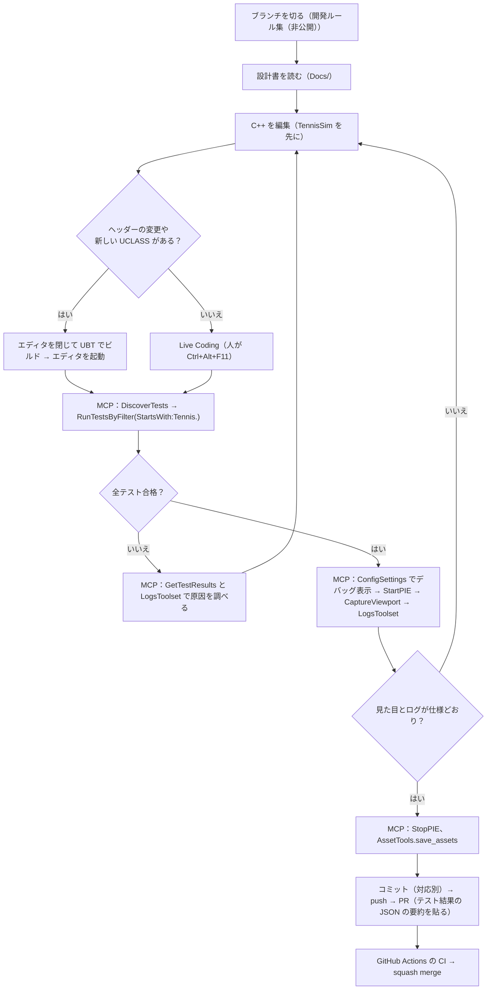

# ARCH-04：Unreal MCP を使った開発の設計

| 項目 | 内容 |
|---|---|
| 文書 ID | ARCH-04 |
| 版 | 1.0（2026-11-04） |
| 前提 | このプロジェクトは、Claude Code などのエージェントが **UE 5.8 の Unreal MCP**（ModelContextProtocol ＋ AllToolsets プラグイン、`http://localhost:8000/mcp`）を通じてエディタを操作しながら開発する |
| 調査 | 2026-11-04 に、エディタの `list_toolsets` と、主要なツールセットの `describe_toolset` を実行して、実際に使えるツールを確認した（§2） |
| 関連 | [RES-04 §5](../00_Research/04_UE58_Technology_Assessment.md)、[コーディング規約](03_Coding_Standards.md)、[テスト計画](../08_QA/01_Test_Plan.md)、[制作パイプライン](../07_Art_Animation/03_Pipeline_Blender_UE.md)、開発ルール集（非公開） |

---

## 1. 方針

1. **エディタの中の作業は、できるだけ MCP で行い、結果を MCP で確かめる**（テストの実行、ログ、ビューポートの画像、アセットの検査）
2. **MCP でできないことを、先に設計に組み込む**。できない作業は、(a) プロジェクト専用のツールセットで補う（§4）、(b) 手作業として手順書に書く（§5）、のどちらかにする
3. **エージェントが確かめられる形で作る**：デバッグの切り替えは Project Settings に出す、ログには検索しやすい形式で出す、テストの名前は前方一致で選べるようにする（§3）
4. MCP のプラグインは **Experimental**（RES-04）。ゲームの実行時のコードは MCP に依存させない。出荷物に含めない

## 2. 確認したツールの能力（UE 5.8.4）

| ツールセット | できること（確認済み） | できないこと・注意 | このプロジェクトでの使い方 |
|---|---|---|---|
| `AutomationTestToolset` | `DiscoverTests`、`ListTests`（名前・タグで絞り込み）、`RunTests`、`RunTestsByFilter`（`StartsWith:`・`^`・`$`・`Group:`）、`GetTestStatus`、`GetTestResults`（JSON）、`StopTests` | — | **PR の前に必ず実行する**（§6）。`RunTestsByFilter("StartsWith:Tennis.")` |
| `EditorAppToolset` | PIE／シミュレートの開始と停止（ウォームアップの秒数を指定できる）、ビューポートの画像（**メートル単位のグリッドとアクタのラベルを重ねられる**）、アセットのサムネイル、カメラの設定、選択、コンテンツブラウザの移動、CVar の**検索** | **CVar を設定するツール、コンソールコマンドを実行するツールがない** | 見た目の確認（コートの寸法・選手の位置）、PIE での動作確認 |
| `LogsToolset` | ログの取得（カテゴリ・正規表現・件数）、カテゴリの詳細度の取得と設定 | — | `LogTennis*` のログで、判定・打球・AI の動きを確かめる |
| `ConfigSettingsToolset` | Project Settings／Editor Settings のセクションの一覧・スキーマ・値の取得・**値の設定と保存**（2026-11-04 に `TennisDebug` で書き込み・読み戻しを確認） | 設定オブジェクトのあるセクションだけ。**`DefaultConfig` のクラスは、追跡対象の `Config/Default*.ini` に保存する**。`ResetSectionToDefaults` は DeveloperSettings のセクションでは使えない（"does not support reset to defaults"）→ 既定値は `SetSectionProperties` で書き戻す | **デバッグの切り替えとシミュレーションの設定をここから変える**（§3.1） |
| `AssetTools` | 検索、依存関係と参照、読み込み、保存、移動、複製、削除、フォルダの作成、メタデータのタグ、テキストファイルの読み書き（`/Game/`・プラグインの Content・`Saved/` の下だけ） | 取り込み（import）がない（取り込みは `StaticMeshTools.import_file`。下の行）。任意の場所のファイルは書けない | アセットの整理と検査 |
| `DataAssetTools` | DataAsset の作成（クラスを指定） | 値の設定は別のツール | 作成 → `ObjectTools` で値を設定（[パラメータ表](../05_Data/02_Parameter_Tables.md) から一括で作る） |
| `ObjectTools` | オブジェクトとクラスのプロパティの一覧・取得・設定、クラスとサブクラスの検索 | プロパティの名前は `list_properties` で確かめてから使う | DataAsset・Actor・Component の値の設定 |
| `StateTreeTools` | StateTree の**検査**（ルートの状態、子、タスク、遷移、入る条件、評価器、グローバルタスク、ノードの説明） | **作成・編集のツールがない** | 手で作った `ST_TennisAI` が、状態図 ST-06 と一致するかを検査する |
| `ProgrammaticToolset` | 複数のツールの呼び出しを、サンドボックスの Python スクリプトでまとめて実行する | 汎用の Python 実行ではない（使えるモジュールに制限） | 多数の DataAsset の作成、テスト → ログの取得 → 判定、などの一括処理 |
| `SceneTools`、`ActorTools`、`PrimitiveTools` | レベルの読み込み、アクタの配置・削除・Transform・親子、プリミティブの追加 | — | テストマップ `L_TestCourt` の構築 |
| `StaticMeshTools` | 境界（`get_bounds`）・三角形と頂点の数・LOD・マテリアルのスロット・コリジョン・Nanite、`import_file`（2026-11-04 に確認） | `import_file` は**新規の取り込みだけ**（同じ名前のアセットがあると失敗する。保存しない。旧 FBX ファクトリー） | 寸法の検査（`get_bounds`）。繰り返しの取り込みは §4 の専用ツール |
| `BlueprintTools`、`MaterialTools`、`MaterialInstanceTools`、`SkeletalMeshTools`、`TextureTools`、`DataTableTools`、`CurveTableTools`、`StringTableTools` | 各アセットの作成・検査・変更（詳細は使う時に `describe_toolset` で確認する） | — | マテリアルのインスタンス、ソケットの確認、String Table |
| `UMGToolSet` | ウィジェットの作成とツリーの操作 | プロパティは ObjectTools で | HUD の雛形 |
| Niagara の各ツールセット、`PCGToolset`、`ControlRigTools`、Sequencer の各ツールセット | 作成・編集・検査 | — | エフェクト、観客の配置、IK、リプレイの演出 |
| `PluginToolset` | プラグインの作成・編集・有効化・照会 | — | プラグインの有効化（RES-04 §4.3） |
| （なし） | — | **C++ のビルド、Chooser Table と PoseSearch のデータベースの編集、MetaHuman、パッケージ化** | §5 の手順 |

> 表の「確認済み」は `describe_toolset` の結果による。版が上がったら、この表を確認し直す（R-19）。

### 2.1 呼び出し方の注意（2026-11-05 に確かめた）

§2 の表のツールセットの名前は短く書いている。`call_tool` には、`list_toolsets` が返す**完全な名前**を `toolset_name` に、接頭辞のないツールの名前を `tool_name` に、引数を `arguments` に渡す。知らないツールは、先に `describe_toolset`（完全な名前）で引数の名前と必須の項目を確かめる（引数の名前は、ツールセットによって camelCase と snake_case が混ざる）。

| §2 の表の名前 | `toolset_name` |
|---|---|
| `AutomationTestToolset` | `AutomationTestToolset.AutomationTestToolset` |
| `EditorAppToolset`・`LogsToolset` | `EditorToolset.EditorAppToolset`・`EditorToolset.LogsToolset` |
| `ConfigSettingsToolset` | `ConfigSettingsToolset.ConfigSettingsToolset` |
| `ObjectTools`・`AssetTools`・`DataAssetTools`・`SceneTools` など | `editor_toolset.toolsets.<モジュール>.<名前>`（例：`editor_toolset.toolsets.object.ObjectTools`、`editor_toolset.toolsets.data_asset.DataAssetTools`） |
| 専用のツールセット（§4） | `Game.Tools.Unreal.tennis_toolset.tools.TennisTools` |

| ツール・作業 | 引数と注意 |
|---|---|
| `ObjectTools.get_properties` | `instance`（`{"refPath": "<オブジェクトのパス>"}`）と `properties`（名前の配列）。返り値は JSON の文字列 |
| `ObjectTools.set_properties` | `instance` と `values`。**`values` は JSON の文字列**で、オブジェクトではない |
| 配列のプロパティに要素を足す（例：`InputMappingContext` の `DefaultKeyMappings.mappings`） | `get_properties` で読んだ既存の要素を**そのままの形で**先に並べ、新しい要素を後ろに足して `set_properties` に渡す。既存の要素を変えながら数を変えると `ArrayAdd: elements changed alongside the size change` で失敗する。既存の要素の中の instanced のサブオブジェクト（Modifier など）は、読んだ `refPath` のまま渡せば保たれる |
| Input Action（`UInputAction`）を作る | `DataAssetTools.create`（`folder_path`、`asset_name`、`asset_type` に `{"refPath": "/Script/EnhancedInput.InputAction"}`）。`AssetTools` には作成がない。作った直後の値の型（`ValueType`）は Boolean なので、必要なら `set_properties` で直す |
| `AutomationTestToolset.RunTestsByFilter` | 引数は `filterExpression`（例：`"StartsWith:Tennis."`）。先に `DiscoverTests` をセッションごとに 1 回呼ぶ |
| `LogsToolset.GetLogEntries` | `pattern`（必須。正規表現。空文字ならすべて）・`category`・`maxEntries`（既定 1000）。**`category` を省くと既定の `LogsToolset` で絞られ、「Log category 'LogsToolset' not found」で失敗する**。すべてのカテゴリなら `""` を渡す（`GetVerbosity`・`SetVerbosity` の `category` の既定も同じ） |
| `EditorAppToolset.StartPIE` | `options` に `bSimulate`・`playMode`（例：`PlayMode_InViewPort`）・`warmupSeconds` が必須。PIE の実行中に呼ぶと失敗するので、先に `IsPIERunning` で確かめる |
| PIE にキーやクリックを送る | MCP にはない。`Tools/Screenshots/Send-WindowInput.ps1` を使う（フォーカスの与え方と、2 つのキーを同時に押す方法は [Tools/Screenshots/README.md](../../Tools/Screenshots/README.md)） |

## 3. MCP で確かめられるようにするための設計

### 3.1 デバッグの切り替えは Project Settings に出す

MCP からは CVar を直接設定できない。そこで、デバッグの切り替えを `UDeveloperSettings` のプロパティにし、コンソールからは**そのプロパティを毎回直接読み書きするコンソールコマンド**（`tennis.Debug.Trajectory [0..2]` など。引数なしで現在の値を表示）で操作する。値の置き場所が 1 か所なので、同期のコードが要らず、食い違いも起きない（DRY・KISS）。

> 当初は `meta=(ConsoleVariable="…")` で同期させる案だった。しかしエンジンのソース（`DeveloperSettings.cpp`）を確かめると、このメタデータは自動では同期しない。派生クラスが `ImportConsoleVariableValues()`／`ExportValuesToConsoleVariables()` を呼ぶ必要があり、しかもエディタのビルドでしか働かない。MCP で値を書いたときに同期が起きる保証もないため、採らなかった。次に試した `RegisterConsoleVariableRef`（CVar がプロパティを参照する）も、CVar が内部に値のコピー（`MainValue`）を持ち、読み出しはコピーから行うため（`ConsoleManager.cpp`）、MCP がプロパティを書いても CVar が古い値を返した（自動テストで発見）。そのため、コピーを持たないコンソールコマンドにした（2026-11-04）。

実装：`Source/Tennis/Public/Core/TennisDebugSettings.h`

| 決まり | 内容 |
|---|---|
| 置き場所 | Project Settings → Game → **Tennis Debug**（セクション名 `TennisDebug`）。**開発者ごとの設定**にし、`DefaultConfig` にしない（MCP で書いた値が `Config/DefaultGame.ini` に入ってコミットされるのを防ぐ。保存先は Git の対象外の `Saved/Config`） |
| コマンドの登録 | `Tennis` モジュールの起動時に登録する。出荷ビルドでは登録しない。不正な入力は受け付けない（値を変えずに使い方を表示する） |
| 範囲 | プロパティは private にし、コマンドの書き込みと読み出しの関数（`GetTrajectoryMode()` など）の両方で範囲に丸める。どの経路（コマンド・MCP・ini）で入った値でも安全にする |
| 名前 | コマンドの名前はクラスの公開定数（`TrajectoryCommandName` など）を、登録とテストの両方が参照する |
| 追加の規則 | 項目は、その機能を作るマイルストーンで足す（YAGNI）。M0 では `DebugTrajectory`・`TimeScale` だけ |

- MCP からは `ConfigSettingsToolset.SetSectionProperties(containerName="Project", categoryName="Game", sectionName="TennisDebug", propertiesJson="{\"DebugTrajectory\":1}")` で切り替える
- `UTennisSimSettings`（シミュレーションの設定）も同じく Project Settings に置く（[データモデル §3.9](../05_Data/01_Data_Model.md)）

### 3.2 ログの形式

MCP の `LogsToolset.GetLogEntries` で検索しやすいように、**1 行 = 1 つの出来事**、`[種類] key=value …` の形で出す（形式とカテゴリの一覧は [ARCH-03 §5.1・§5.2.1](03_Coding_Standards.md)）。今の実装で確かめられるもの：

| 確かめること | `category` | `pattern` の例 |
|---|---|---|
| 打ち出しとボールのイベント | `LogTennisBall` | `\[(Launch\|Bounce\|NetCross\|NetTouch\|PostHit)\]` |
| 打球ツールの結果（解けたか・外れ・反復の数） | `LogTennisShot` | `\[Tester\]` |
| 操作（球種の予約・溜め・離す、操作のアセットが見つからない） | `LogTennisInput` | `\[(Input\|ShotInput)\]` |
| 選手の移動（コートが見つからないなど） | `LogTennisMove` | `\[Move\]` |

- キーの名前は、テストと統計で使う名前と同じにする
- 1 ポイントの終わりに `[PointSummary]` の 1 行を出す（エージェントが 1 回の検索で結果を読めるように）

### 3.3 テストの名前

- すべて `Tennis.` から始める（`RunTestsByFilter("StartsWith:Tennis.")` で全件）
- 速いもの（L1）は `Tennis.Sim.`、ワールドを使うもの（L2）は `Tennis.Game.`、長いもの（L3）は `Tennis.Soak.`。PR の前は `Tennis.Sim.` と `Tennis.Game.` を実行する
- `Tennis.Soak.` を足して、全件と PR の前の範囲が分かれたら、グループ（`Group:TennisPR`）を `Config/DefaultEngine.ini` の AutomationControllerSettings に定義する。今は `StartsWith:Tennis.` が PR の前の範囲と同じなので定義していない（CI の C++ ビルド用ワークフロー（非公開） も `Tennis.` を実行する）

### 3.4 見た目の確認

- `EditorAppToolset.CaptureViewport` の注釈（グリッドの間隔を 100 cm、原点をコートの中心）で、ラインやネットの位置を画像の上で確かめる
- 確認用のカメラの位置を、`L_TestCourt` のブックマーク（真上・ベースラインの後ろ・ネットの横）として決めておく
- **M0 での実際（2026-11-04）**：`CaptureViewport` と `CaptureEditorImage` は、画像を base64 の文字列で返す。エージェントの文脈が大きく埋まるので、M0 では次の方法で確かめた。M1 以降の画面の記録も、`Tools/Screenshots/Capture-Window.ps1` で撮る（[Docs/Screenshots](../Screenshots/README.md) の決まり）。注釈のグリッドは、画像の上で位置を測る必要があるときに使う
  - 寸法：`StaticMeshTools.get_bounds` で数値を確かめる
  - 見た目：`SetCameraTransform` でカメラを置き、エディタの画面を撮影して縮小した画像で確かめる（真上は (0, 0, 2000 cm)・pitch −90、斜めは (−1400, −700, 350 cm)・pitch −12・yaw 26.6）

## 4. プロジェクト専用のツールセット（`Tools/Unreal`）

MCP の標準のツールセットにない作業を、**エディタの Python のツールセット**として追加する（2026-11-04 に実装・確認）。

- 本体は [`Tools/Unreal/tennis_toolset/`](../../Tools/Unreal/README.md)。`unreal.ToolsetDefinition` を継承したクラスに `@toolset_registry.tool_call` のメソッドを置く（エンジンの Python のツールセットと同じ方式）
- 登録：エディタの起動時に `Content/Python/init_unreal.py`（公開版には未収録） が `Tools/Unreal` をパスに加えて `register()` を呼ぶ。MCP での名前は **`Game.Tools.Unreal.tennis_toolset.tools.TennisTools`**
- ツールセットそのものに C++ のモジュールは不要。C++ の機能が必要なツール（Python から作れない Chooser の表など）は、C++ 側（エディタ専用なら `TennisEditor`）に `UFUNCTION(BlueprintCallable)` を用意して Python から呼ぶ
- 追加・変更は `reload_tennis_toolset()` で読み込み直す（エディタの再起動は不要。`init_unreal.py` を変えたときだけ再起動する）
- 入力の検証は `unreal` に依存しない純粋な関数に分け、CI で単体テストする

実装済みのツールは太字。ほかは予定で、使うマイルストーンで追加する（YAGNI）。名前は実装のときに Python の慣習（snake_case）にする。

| ツール | 内容 | 使う場面 |
|---|---|---|
| **`import_exported_fbx(file_names)`（実装済み）** | `Export/` の FBX を取り込む・再取り込みする（置き換えて保存）。受け付けるのはファイル名だけで、取り込み先と Nanite の設定はアセット名の接頭辞で決まる。Interchange の既定（Nanite が有効、再取り込みでマテリアルを更新しない）を直す（[Tools/Unreal/README.md](../../Tools/Unreal/README.md)） | Blender から UE（[ART-03](../07_Art_Animation/03_Pipeline_Blender_UE.md)） |
| **`build_test_court_level()`（実装済み）** | テストマップ `L_TestCourt` を作る・作り直す（標準の `SceneTools` には、レベルの新規作成と保存がない）。置く物は `court_level_layout.py`（純粋なデータ）：コート・ネット・練習コートの小物（フェンス・ベンチ・照明柱）のメッシュ、`ATennisCourt`、相手の側（+X）の `ATennisBall` と打球ツール `ATennisShotTester`、選手の側（−X）の `PlayerStart`、照明（PIE の視点は選手のカメラの中継カメラが決める）。作り直すときは、このツールが置いたアクタだけを入れ替える | M0 のテストマップ（W-0.5） |
| **`reload_tennis_toolset()`（実装済み）** | このツールセットを読み込み直して登録し直す | ツールを変えた後 |
| `ExecConsole(command)` | コンソールコマンドの実行（**許可リストに入っているものだけ**：`tennis.*`、`stat unit`、`r.ScreenPercentage` など） | 一時的な切り替え |
| `ApplyParameterTable(tablePath)` | パラメータ表（CSV に書き出したもの）から DataAsset を作り、値を設定する | DATA-02 の値の反映 |
| `RunCourtPaceCalibration(surface)` | 仮想 CPR 試験・ドロップテストを実行し、結果を JSON で返す。**W-1.9 では自動テスト `Tennis.Game.Data`（置いた `DA_Surface_*`・`DA_Ball_*` をすべて確かめる）を `RunTestsByFilter` で実行して代えた**。面ごとの値を返すツールが必要になったら加える（YAGNI） | 面の校正（FR-DBG-004） |
| `BakeStrokeMeta(montages)` | `StrokeMetaBaker` を実行して `UStrokeData` を更新し、エラーの一覧を返す。**仮のストロークは `build_placeholder_strokes` が焼く**。本番のモンタージュ（M9）を取り込むときに、取り込みから独立した道具にする | アニメの取り込みの後（FR-STRK-007） |
| **`shoot_ball(shot_type, target_x_m, target_y_m)`（実装済み）** | PIE・Simulate の間に、テストマップの打球ツール（`ATennisShotTester`）で、球種のアセット（`DA_Shot_*`）を指定してコート局所の地点へ打つ（打点は相手の側。X が負の地点を狙うと、選手に向かって球が来る）。打点と溜めは打球ツールの設定（詳細パネル）に従う。結果は `LogTennisShot` の `[Tester]` と画面に出る。入力は `shoot_rules.py`（純粋な関数）で確かめる | ソルバの確認（FR-DBG-003） |
| `RunAIvsAI(matches, rules, venue, difficulty)` | AI 対 AI の自動対戦を実行し、KPI の集計を JSON で返す | リアリティ KPI（QA-01 §6） |
| `GetMatchState()` | 試合の段階・スコア・ボールの状態を JSON で返す（PIE 中） | 動作の確認 |
| **`rebuild_stroke_chooser()`（実装済み）** | `DA_Stroke_*` の条件（`SelectRows`）から Chooser Table `CHT_StrokeSelect` を作り直す（`UTennisStrokeChooserBuilder::Rebuild`。DD-03 §5.3）。網羅（未定義の組み合わせがないか）は自動テストが確かめる | T-STRK-002 |
| **`build_locomotion_database()`（実装済み）** | Motion Matching のスキーマ `PSS_Locomotion`（PoseSearch の既定のチャンネル）とデータベース `PSD_Locomotion` を、なければ作り（`UTennisLocomotionDatabaseBuilder`。ファクトリーの設定とアニメーションの追加は Python から使えない）、データベースのアニメーションを M3 の仮のデータ（`locomotion_assets.PLACEHOLDER_ANIMATIONS`：待機と、歩き・ジョグの 8 方向ずつ）に入れ直して保存する。引数はない。このツールが作ったのでない既存のアセット（目印 `TennisTools.Owner` がない）があれば止まる | ロコモーション（W-3.6。DD-03 §6.5） |
| **`build_placeholder_strokes()`（実装済み）** | 仮のストローク（フォア・片手バックと、その低く打つ変種 `Dip`）を作る：`Export/AS_*.fbx` をアニメーションだけ既存の骨格に取り込み、モンタージュ `AM_*` に `AS_*.json` の時刻で Notify を入れ、`DA_Stroke_*` を作って `StrokeMetaBaker` で焼き（DD-03 §5.4）、表を作り直す。名前は `stroke_assets.PLACEHOLDER_STROKES` だけで、引数はない。JSON は大きさ・形・時刻の順序を確かめてから使う。上書きするのは、このツールが作ったアセット（`Export/` から取り込んだ `AS_*`、目印のある `AM_*`・`DA_Stroke_*`）だけ | M3 の同期の試作（W-3.4） |

- 返り値は JSON（エージェントが読みやすい形）。失敗の理由も JSON に含める
- 破壊的な操作（削除・上書き）は、引数で明示しない限り行わない

## 5. MCP でできない作業の手順

| 作業 | 方法 | 担当 |
|---|---|---|
| C++ のビルド | (a) **Live Coding**：エディタを開いたまま、エディタで Ctrl+Alt+F11（人が押す）。(b) **エディタを閉じて UBT**：`"C:\Program Files\Epic Games\UE_5.8\Engine\Build\BatchFiles\Build.bat" TennisEditor Win64 Development -Project="C:\UnrealEngineProject\tennis\Tennis.uproject" -WaitMutex`（エージェントが Bash から実行できる）。ヘッダーの変更・新しい UCLASS・**新しいモジュール**は (b) を使う。**エディタが開いていると、UBT は「Live Coding が有効な間はビルドできない」で止まる**（2026-11-04 に確認）。新しいモジュールは、エディタを再起動しないと読み込まれない | (a) 人、(b) エージェント（エディタを閉じるのは人の了承を得てから） |
| エディタの再起動 | (b) の後にエディタを起動し直す。MCP は再接続が必要 | 人（またはエージェントがコマンドラインで起動） |
| StateTree の作成・編集 | エディタで手作業。ロジックは C++ のタスクに置き、アセットの構造は小さく保つ。作った後に `StateTreeTools` で ST-06 と比べる | 人 → エージェントが検査 |
| Chooser Table・PoseSearch のデータベース | M3 の仮のものは MCP のツールで作る（`rebuild_stroke_chooser`・`build_locomotion_database`）。本番のものはエディタで手作業し、作った後に `ValidateChooser`（§4）で検査 | エージェント（仮）／人 → エージェントが検査（本番） |
| MetaHuman | MetaHuman Creator で手作業 | 人 |
| パッケージ化・実機のビルド | `RunUAT BuildCookRun`（エージェントがコマンドラインで実行できる） | エージェント |

## 6. 開発のループ（エージェントの手順）

- PR の本文には、`GetTestResults` の要約（合格／不合格の数と、テスト名の前方一致の条件）を貼る。CI の C++ ビルド用ワークフロー（非公開）（セルフホストのランナー。W-1.10、[Tools/CI/README.md](../../Tools/CI/README.md)）も、同じ `Tennis.` のテストを画面なしで実行する
- エージェントが MCP でアセットを変更したときは、`AssetTools.save_assets` で保存し、`.uasset` の差分（Git LFS）を、そのアセットの対応ごとのコミットにする

## 7. マイルストーンごとの MCP の使い方

| MS | MCP で行う作業 |
|---|---|
| M0 | `AutomationTestToolset` で雛形のテスト。専用のツールセット（§4）の登録と、`import_exported_fbx`・`build_test_court_level`（`SceneTools` にはレベルの作成がないため）で `L_TestCourt`。寸法は `StaticMeshTools.get_bounds`。プラグインの有効化（`PluginToolset`）は、使うマイルストーンに回した（YAGNI）。**実施の結果は [PM-01 §3 の M0](../09_Project/01_Roadmap_WBS.md)** |
| M1 | 物理のテストの実行。`ConfigSettingsToolset` で `DebugTrajectory`。軌道とバウンド点は `Tools/Screenshots` で撮る（§3.4）。面の校正は `RunTestsByFilter("StartsWith:Tennis.Game.Data")`（§4 の `RunCourtPaceCalibration` の代わり）。**実施の結果は [PM-01 §3 の M1](../09_Project/01_Roadmap_WBS.md)** |
| M2 | Simulate で `shoot_ball` を打ち、`LogsToolset` の `LogTennisShot`（`[Tester]`）で解けたか・外れ・反復の数を見る。軌道は `DebugTrajectory` と `CaptureViewport`（または `Tools/Screenshots`）。**実施の結果は [PM-01 §3 の M2](../09_Project/01_Roadmap_WBS.md)** |
| M3 | `import_exported_fbx`（ラケット・仮のモンタージュ）、`BakeStrokeMeta`、`ValidateChooser`、PIE でインパクトの距離（`DebugImpact`） |
| M4 | DataAsset の値の一括の変更（`ApplyParameterTable`）で打感を反復する |
| M5 | ルールのテスト（`Tennis.Sim.Rules.`）、`GetMatchState` で試合の流れ |
| M6 | `StateTreeTools` で `ST_TennisAI` の構造を検査、`RunAIvsAI` で KPI |
| M7 | Niagara・PCG・Sequencer のツールセットで演出、`UMGToolSet` で HUD |
| M8〜M10 | String Table（日英）、性能の計測（`ExecConsole("stat unit")`、ログ）、パッケージ化（コマンドライン） |

## 8. 安全のための規則

| 規則 | 内容 |
|---|---|
| 保存 | MCP で大きな変更をする前に、`AssetTools.save_assets([])` で未保存のアセットを保存する |
| 削除 | `AssetTools.delete` は、対象を `exists`・`get_referencers` で確かめてから使う。参照されているアセットは消さない |
| PIE | 変更の前に `IsPIERunning` を確かめ、PIE 中はアセットを編集しない |
| 出荷物 | MCP のプラグインと専用のツールセットはエディタ専用にする（専用のツールセットはエディタの Python で、C++ のモジュールを持たない：§4）。パッケージ化の設定で ModelContextProtocol・AllToolsets を外す |
| ネットワーク | MCP のサーバーは `localhost` だけで受ける（既定のまま）。ポートを外に開けない |
