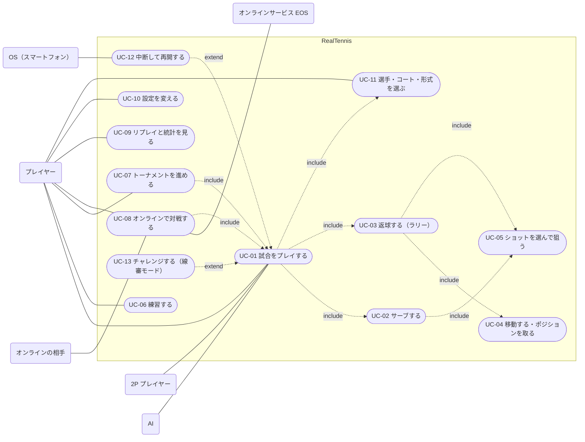
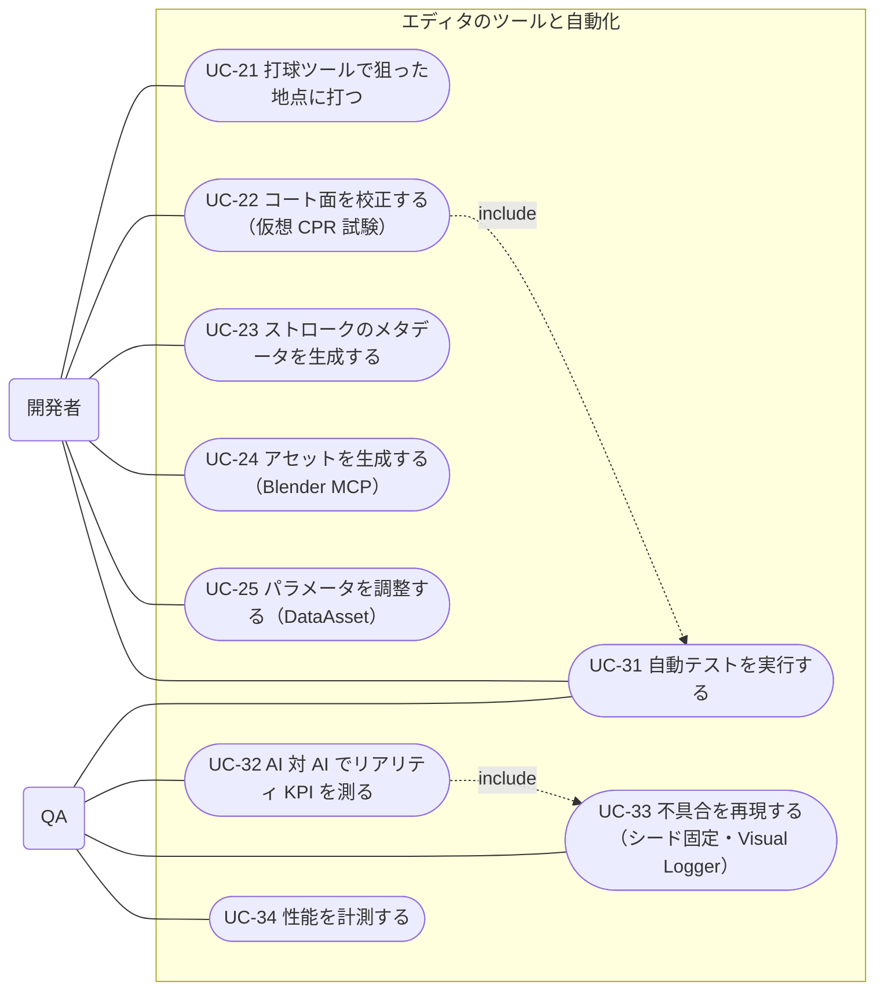

# UML-01：ユースケース図

| 項目 | 内容 |
|---|---|
| 文書 ID | UML-01 |
| 版 | 1.0（2026-11-04） |
| 表記 | Mermaid にはユースケース図がないため、flowchart で表す。**丸角の四角 = アクター**、**楕円（スタジアム形） = ユースケース**、点線 = 「含む（include）」「拡張（extend）」 |
| 関連 | [ゲーム仕様書](../01_Specification/01_Game_Specification.md)、[機能仕様書](../01_Specification/02_Functional_Specification.md) |

---

## 1. アクター

| アクター | 説明 |
|---|---|
| プレイヤー | ゲームを遊ぶ人（PC またはスマートフォン） |
| 2P プレイヤー | 同じ画面で対戦するもう 1 人（PC のみ） |
| オンラインの相手 | ネットワーク越しの人間の対戦相手 |
| AI | コンピューターの対戦相手（システムの一部だが、プレイヤーと同じ操作の経路を使うのでアクターとして扱う） |
| 開発者（デザイナー・プログラマー） | エディタのツールで調整・検証する人 |
| QA | 自動テストと自動対戦を回す人 |
| オンラインサービス（EOS） | ロビー・マッチメイキング・プレイヤーデータ |
| OS（スマートフォン） | アプリの中断と再開を通知する |

## 2. 全体のユースケース図（プレイヤー側）

## 3. 開発・QA のユースケース図

## 4. ユースケース記述（主要なもの）

### UC-01 試合をプレイする

| 項目 | 内容 |
|---|---|
| アクター | プレイヤー（主）、AI または 2P プレイヤー |
| 事前条件 | 選手・コート・試合形式・難易度を選んでいる（UC-11） |
| 事後条件 | 試合の結果と統計が保存される |
| 基本の流れ | 1. 入場（スキップできる） 2. コイントスで、サーブ／レシーブ／エンドを選ぶ 3. ポイントを繰り返す（UC-02、UC-03） 4. ゲーム・セットの区切りで、エンドチェンジとセットブレイクがある（統計の表示） 5. マッチの勝者が決まる 6. 結果の画面（統計・ハイライト） |
| 代替の流れ | 3a. ポーズする → 再開／リタイア／設定 3b. アプリが中断される（UC-12） 3c. 際どい判定 → 電子ラインコールの再現が流れる（スキップできる） |
| 関連する要件 | FR-MATCH-001〜007、FR-SCR-*、FR-RULE-* |

### UC-02 サーブする

| 項目 | 内容 |
|---|---|
| アクター | プレイヤー（サーバー） |
| 事前条件 | 試合の段階が「サーブ準備」で、自分がサーバー |
| 基本の流れ | 1. 立ち位置を左右に調整する 2. 球種のボタンを押す → トスが上がる 3. 押している間に溜め、スティックで狙う 4. トスの頂点の少し後でボタンを離す 5. インパクト → ボールが飛ぶ 6. 判定：イン → ラリー（UC-03）／フォルト → 第 2 サーブ／レット → 同じサーブをやり直す |
| 代替の流れ | 2a. トスが乱れた → トスのやり直し（キャッチ。フォルトではない） 6a. 第 2 サーブもフォルト → ダブルフォルトで失点 |
| 関連する要件 | FR-STRK-010・011、FR-RULE-002・004、SPEC-04 §5 |

### UC-03 返球する（ラリー）

| 項目 | 内容 |
|---|---|
| アクター | プレイヤー |
| 事前条件 | 相手が打った（またはサーブが入った） |
| 基本の流れ | 1. 相手のインパクトでスプリットステップ（自動または手動） 2. ボールの軌道を見て移動する（UC-04） 3. 球種のボタンを押す → 打点の候補が決まり、テイクバックが始まる 4. 押している間に狙う（UC-05） 5. 理想の時刻にボタンを離す 6. インパクト → 品質 → 誤差 → ソルバ → ボールが飛ぶ 7. リカバリー（センターへ戻る） |
| 代替の流れ | 3a. 間に合わない → ストレッチ／ダイブのストローク（品質が下がる） 5a. 早すぎ／遅すぎ → 狙いが流れる 6a. 空振り（スイートスポットとボールの距離が 0.25 m を超えた） |
| 関連する要件 | FR-STRK-*、FR-SHOT-*、FR-MOVE-* |

### UC-08 オンラインで対戦する

| 項目 | 内容 |
|---|---|
| アクター | プレイヤー、オンラインの相手、EOS |
| 事前条件 | 各プラットフォームの ID（Steam／Apple／Google）で EOS にログインしている |
| 基本の流れ | 1. クイックマッチまたはフレンドの招待を選ぶ 2. EOS がロビーを作り、相手を見つける（入力機器が同じ相手を優先する） 3. ホスト（PC を優先）がリッスンサーバーを立てる 4. 試合をプレイする（UC-01。打球はイベントで同期） 5. 結果を両方に保存する |
| 代替の流れ | 4a. 切断 → ポイントはやり直し、60 秒以内に戻れば再開、戻らなければ不戦勝 4b. RTT が 250 ms を超える → 警告を表示する |
| 関連する要件 | FR-NET-001〜008 |

### UC-12 中断して再開する（スマートフォン）

| 項目 | 内容 |
|---|---|
| アクター | OS、プレイヤー |
| 基本の流れ | 1. OS がバックグラウンドへの移行を通知する 2. ゲームが自動でポーズし、ポイント間なら試合の状態を保存する（ポイント中なら、ポイントの開始時の状態を保存する） 3. 復帰したら、ポーズの画面から再開する |
| 代替の流れ | 2a. オンラインの試合 → 切断として扱う（60 秒の猶予） |
| 関連する要件 | FR-MATCH-007 |

### UC-32 AI 対 AI でリアリティ KPI を測る

| 項目 | 内容 |
|---|---|
| アクター | QA（または CI のジョブ） |
| 基本の流れ | 1. コマンドラインで、描画なし・時間を加速した AI 対 AI の試合を N 試合実行する（Gauntlet） 2. 統計（ラリーの長さ、球速、回転、走行距離、サーブの確率など）を集計する 3. 目標範囲（[RES-03](../00_Research/03_Player_Match_Stats_Research.md) §4）と比べ、結果を CSV とレポートに出す |
| 事後条件 | KPI の合否と、外れた項目の一覧 |
| 関連する要件 | FR-DBG-006、NFR-REAL-003 |
