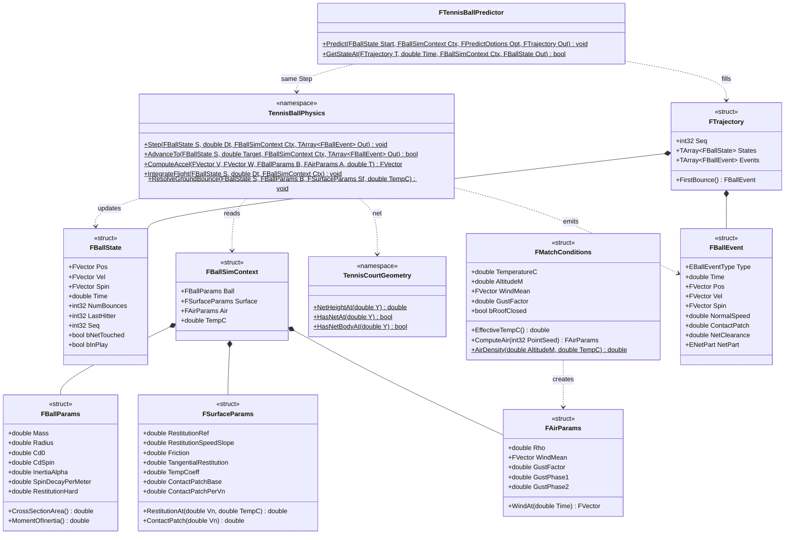
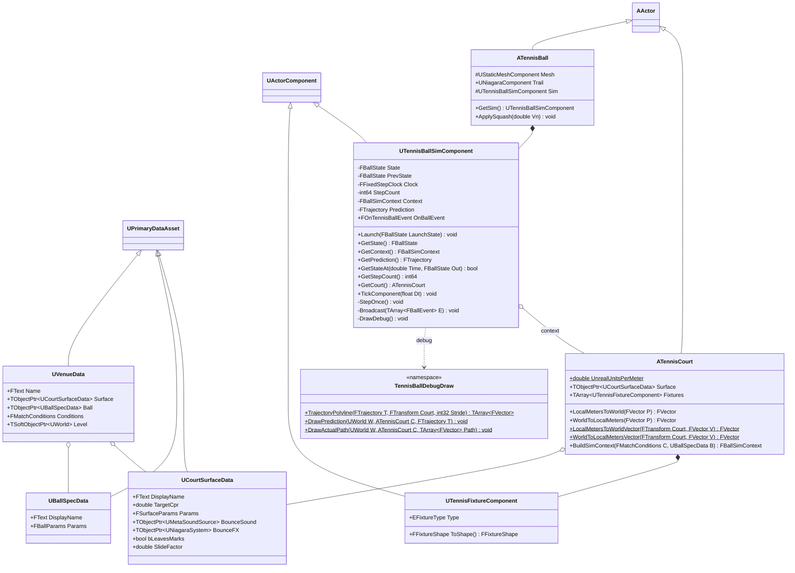
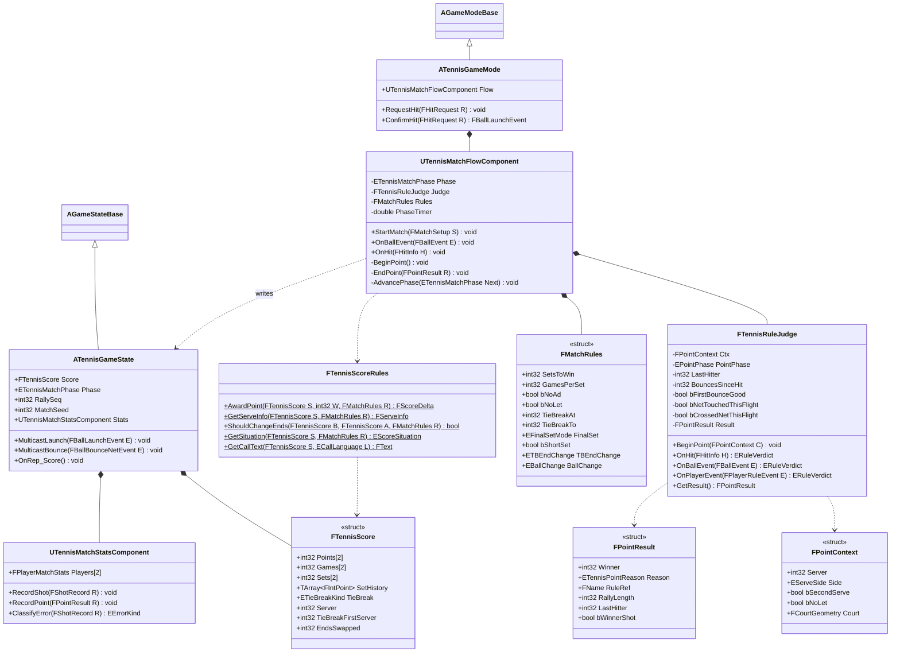
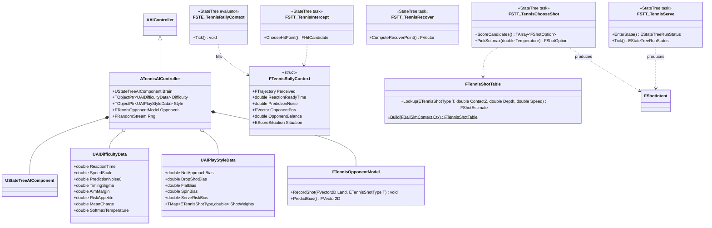
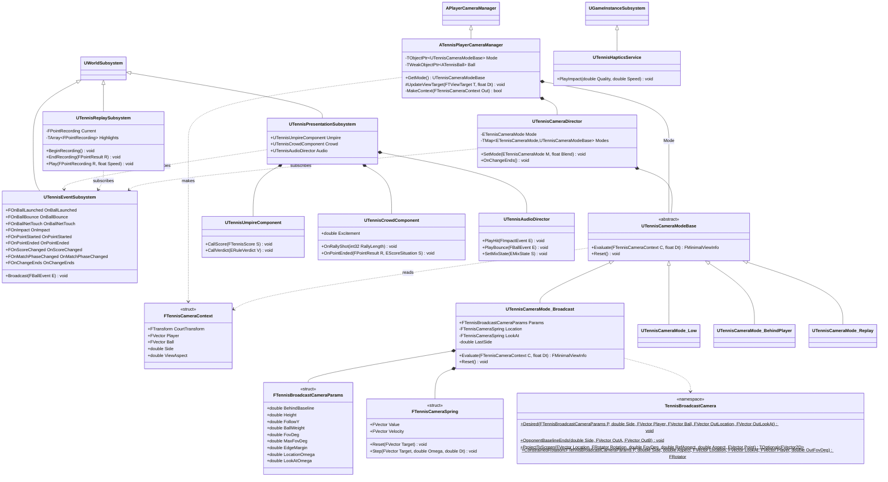
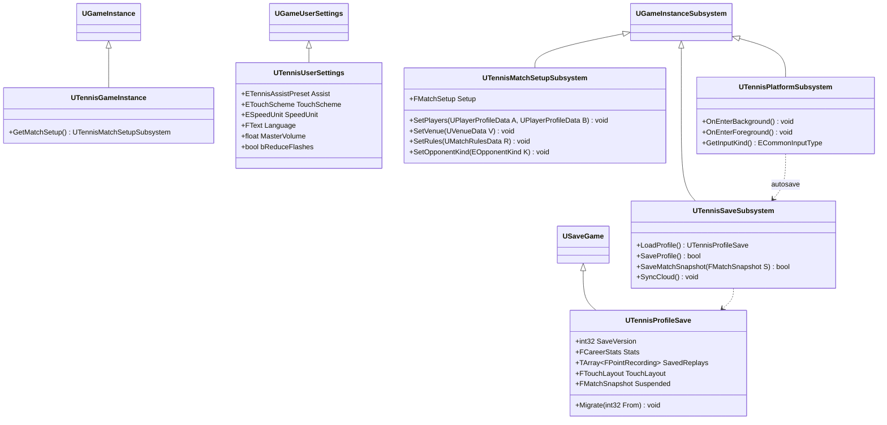
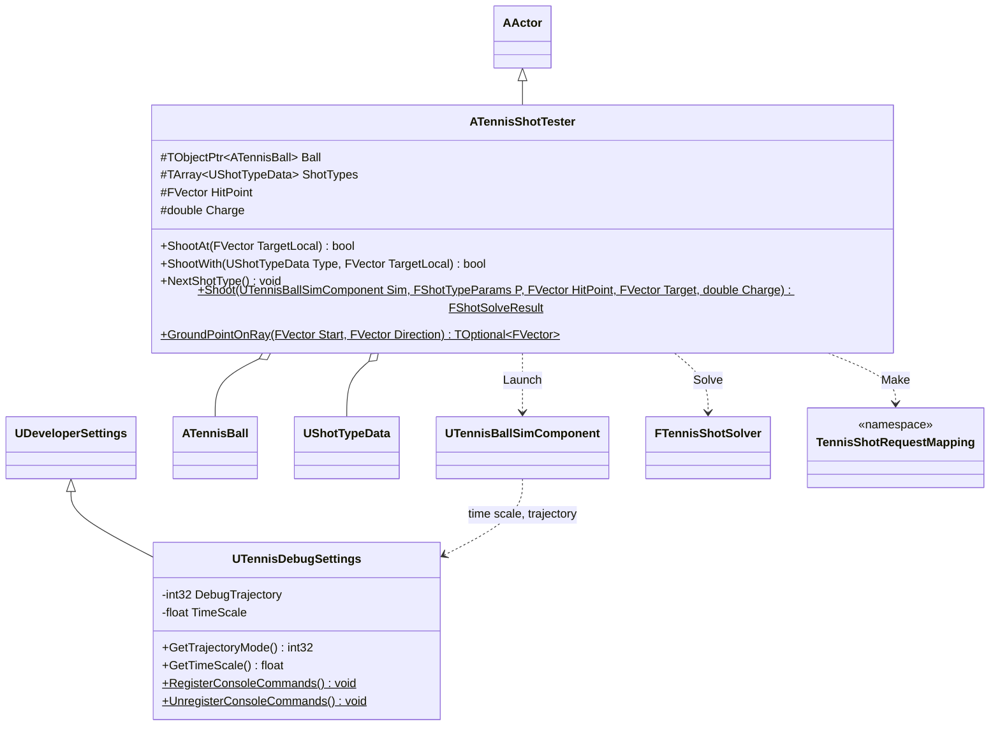

# UML-02：クラス図

| 項目 | 内容 |
|---|---|
| 文書 ID | UML-02 |
| 版 | 1.0（2026-11-04） |
| 表記 | Mermaid の classDiagram。`*--` = コンポジション（所有）、`o--` = 集約（参照）、`-->` = 関連、`..>` = 依存（使う）、`<|--` = 継承。`<<struct>>` は USTRUCT または素の C++ 構造体、`<<namespace>>` は関数の集まり |
| 関連 | [モジュール設計](../02_Architecture/02_Module_Package_Design.md)、[データモデル](../05_Data/01_Data_Model.md) |

> 図には主要なメンバーだけを書く。完全な定義はヘッダー（`Source/`）が正。

---

## 1. シミュレーション層：ボール（TennisSim）



- 規格値（コートの寸法・ネットの高さ・ポストの位置）は `TennisConstants.h` の `TennisConst`。図の型は値を持たず、そこを参照する
- ネット・ポスト・シングルススティックとの衝突は `TennisBallPhysics` の中（Private）で解く。`EBallEventType` は Bounce・NetCross・NetTouch・PostHit
- 後で足すもの：恒久施設（`FBallSimContext::Fixtures`、W-5.3。W-1.4 の残り）と選手の体（`Bodies`・`BodyHit`、W-5.3）、コートの区域の判定（`IsInside`・`ServiceBox`、M5 のルールの判定）

## 2. シミュレーション層：ショット（TennisSim）

```mermaid
classDiagram
    class ETennisShotType {
        <<enumeration>>
        Flat
        Topspin
        HeavyTopspin
        Slice
        Lob
        SliceLob
        Drop
        Volley
        HalfVolley
        Smash
        ServeFlat
        ServeSlice
        ServeKick
        ServeUnderarm
    }
    class FShotIntent {
        <<struct>>
        +ETennisShotType Type
        +FVector2D AimTarget
        +TOptional~double~ ChargeStartTime
        +TOptional~double~ ReleaseTime
        +bool bAutoReleased
        +double PowerMod
        +double ControlMod
        +EInputDevice Device
        +int32 PlayerId
    }
    class FShotQualityInputs {
        <<struct>>
        +double TimingError
        +double ImpactDistance
        +double RunSpeedRatio
        +double StretchRatio
        +double IncomingSpeed
        +double IncomingSpin
        +double ContactHeight
        +double Stamina
        +double PressureFactor
    }
    class FShotQualityResult {
        <<struct>>
        +double Quality
        +ETimingGrade Grade
        +double SigmaDepth
        +double SigmaSide
        +double AimPull
        +TArray~EMissCause~ Causes
    }
    class FTennisShotQuality {
        +Evaluate(FShotQualityInputs In, FShotTypeParams T, FPlayerShotSkill Skill)$ FShotQualityResult
    }
    class FTennisErrorModel {
        +ApplyError(FVector2D Target, FShotQualityResult Q, FRandomStream Rng, FVector2D Dir)$ FVector2D
        +MakeSeed(int32 MatchSeed, int32 RallySeq, int32 ShotIndex)$ int32
    }
    class FShotRequest {
        <<struct>>
        +FVector Origin
        +FVector Target
        +double Time
        +ESolverConstraint Constraint
        +double ConstraintValue
        +double Speed
        +double MinSpeed
        +double MaxSpeed
        +double InitialElevationDeg
        +double Rpm
        +double SpinAxisDeg
    }
    class FShotTypeParams {
        <<struct>>
        +double MinSpeed
        +double MaxSpeed
        +double BaseRpm
        +double SpinAxisDeg
        +ESolverConstraint Constraint
        +double ConstraintAtCharge0
        +double ConstraintAtCharge1
        +double InitialElevationDeg
        +double BaseSigma
        +double PaceReuseFactor
    }
    class TennisShotRequestMapping {
        <<namespace>>
        +Make(FShotTypeParams Params, FVector Origin, FVector Target, double Time, double Charge, ETennisHandedness Handedness, double SideInput)$ FShotRequest
        +ChargeAtImpact(FShotIntent Intent, double ChargeTime)$ double
    }
    class FShotSolveResult {
        <<struct>>
        +bool bSolved
        +FBallState Launch
        +FVector PredictedLanding
        +double ResidualRange
        +double ResidualConstraint
        +double PredictedNetClearance
        +double PredictedFlightTime
        +int32 Iterations
        +EShotFallback Fallback
    }
    class FTennisShotSolver {
        -FBallSimContext Context
        +Solve(FShotRequest Request) FShotSolveResult
        +SimulateToFirstBounce(FBallState Launch) FFlight
        +MakeLaunch(FShotRequest Request, double Azimuth, double Speed, double Elevation)$ FBallState
    }
    class FFlight {
        <<struct>>
        +bool bLanded
        +FVector LandPos
        +bool bReachedNet
        +double NetClearance
        +double Apex
        +double FlightTime
    }
    class ETennisHandedness {
        <<enumeration>>
        Right
        Left
    }
    class TennisShotSpin {
        <<namespace>>
        +AxisDeg(double RightHandedAxisDeg, ETennisHandedness Handedness, double SideInput)$ double
    }
    class TennisShotInitialGuess {
        <<namespace>>
        +Estimate(FShotRequest Request, double Azimuth, double ConstraintValue, FBallSimContext Ctx)$ FGuess
    }
    class UPrimaryDataAsset
    class UShotTypeData {
        +ETennisShotType Type
        +FShotTypeParams Params
    }
    UPrimaryDataAsset <|-- UShotTypeData
    UShotTypeData *-- FShotTypeParams
    UShotTypeData ..> ETennisShotType
    FShotIntent ..> ETennisShotType
    FTennisShotQuality ..> FShotQualityInputs : reads
    FTennisShotQuality ..> FShotQualityResult : returns
    FTennisErrorModel ..> FShotQualityResult : uses sigma
    TennisShotRequestMapping ..> FShotTypeParams : reads
    TennisShotRequestMapping ..> FShotRequest : makes
    TennisShotRequestMapping ..> TennisShotSpin
    TennisShotSpin ..> ETennisHandedness
    TennisShotSpin ..> FShotRequest : SpinAxisDeg
    FTennisShotSolver ..> FShotRequest : input
    FTennisShotSolver ..> FShotSolveResult : output
    FTennisShotSolver ..> FFlight
    FTennisShotSolver ..> TennisShotInitialGuess : initial value
    TennisShotInitialGuess ..> TennisBallPhysics : ComputeAccel
    FTennisShotSolver ..> TennisBallPhysics : same Step
    class TennisBallPhysics {
        <<namespace>>
    }
```



- `UShotTypeData` は `DA_Shot_*`（球種ごとに 1 つ）。`FFlight` は `FTennisShotSolver::FFlight`。`TennisShotInitialGuess` は Private（抗力とマグヌスを入れた放物線の近似。DD-02 §7.3）
- 後で足すもの：`FShotIntent` の `AimTarget`・`PowerMod`・`ControlMod`（M4。W-4.2）と `Device`・`PlayerId`（今あるのは `Type`・`ChargeStartTime`・`ReleaseTime`・`bAutoReleased`）。M4 で `FShotTypeParams` の `BaseSigma`・`PaceReuseFactor`、`FShotQualityInputs`・`FShotQualityResult`・`FTennisShotQuality`・`FTennisErrorModel`（W-4.1）

## 3. ゲームプレイ層：ボールとコート（Tennis）



- `UTennisBallSimComponent` に後で足すもの：トス（`Toss`、サーブ W-3.7）と選手の体（`SetBodies`、W-5.3）
- 今の `ATennisCourt` は座標の変換（コート局所の m ↔ ワールドの cm）だけを持つ。面のデータ（`Surface`）・恒久施設（`Fixtures`・`UTennisFixtureComponent`、W-5.3）・物理の条件を作る `BuildSimContext` は後で足す（今の `UTennisBallSimComponent` の条件は既定値）。寸法は `TennisConst`、幾何は `TennisCourtGeometry`（§1）
- 後で足すもの：`ATennisBall` の `Trail`・`ApplySquash`（W-7.6）、`UCourtSurfaceData` の `BounceSound`〜`SlideFactor`（M7）、`UVenueData`（会場のデータ。W-9.3）

## 4. ゲームプレイ層：選手・入力・アニメーション（Tennis）

```mermaid
classDiagram
    class ACharacter
    class APlayerController
    class UCharacterMovementComponent
    class UAnimInstance
    class UAnimNotify
    class ATennisCharacter {
        +float CapsuleRadius$
        +float CapsuleHalfHeight$
        +FName RacketHandSocket$
        +int32 PlayerIndex
        +int32 CourtSide
        +ETennisHandedness Handedness
        +EBackhandStyle Backhand
        +TObjectPtr~UPlayerProfileData~ Profile
        +GetTennisMovement() UTennisMovementComponent
        +GetReach() UTennisReachComponent
        +GetRacket() UTennisRacketComponent
        +GetFollowers() TArray~USkeletalMeshComponent~
        +GetGrooms() TArray~UGroomComponent~
        +GetAppearance() UTennisPlayerAppearance
        +ApplyAppearance(UTennisPlayerAppearance A) bool
        +SubmitShotIntent(FShotIntent I) void
        +CancelShotIntent() void
        +GetShotIntent() FShotIntent
        +GetPlannedHit() FHitCandidate
        +FollowBall(UTennisBallSimComponent B) void
        +OnHitCandidateFound FSimpleMulticastDelegate
        +OnStrokeEnded FSimpleMulticastDelegate
        +OnStrokeImpact FSimpleMulticastDelegate
        +GetSweetSpotWorld() FVector
        +GetBodyCapsule() FPlayerCapsule
    }
    class UTennisMovementComponent {
        +FMovementParams Params
        #TObjectPtr~ATennisCourt~ Court
        -FMovementStepper Stepper
        -FMovementModifiers Modifiers
        -double SideSign
        +double AssistWeight
        +StartBoost() void
        +AdvanceWorldVelocity(FTransform Court, FVector Location, FVector Velocity, FVector Input, double Side, FMovementStepper S, FMovementParams P, double FrameTime, double TimeScale, FMovementModifiers Mods)$ FVector
        +GetCourt() ATennisCourt
        +GetSideSign() double
        +GetMoveState() FMovementState
        +PredictWorldPath(TConstArrayView~double~ Times) TArray~FVector~
        #CalcVelocity(float Dt, float Friction, bool bFluid, float Braking) void
        +TriggerSplitStep(double OpponentImpactTime) void
        +SetAutoMoveTarget(FVector2D CourtTarget, double TimeLeft, double SettleTime) void
        +ClearAutoMoveTarget() void
        +IsAutoMoving() bool
        +SetFollowThrough(bool bOn) void
        +GetModifiers() FMovementModifiers
        +GetMaxSpeed() float
    }
    class TennisMovement {
        <<namespace>>
        +Step(FMovementState S, FVector2D Input, double SideSign, FMovementModifiers M, FMovementParams P, double Dt)$ FMovementState
        +AdvanceFrame(FMovementStepper S, FVector2D Position, FVector2D Input, double SideSign, FMovementModifiers M, FMovementParams P, double FrameTime, double TimeScale)$ FVector2D
        +AutoMoveInput(FVector2D Position, FAutoMoveTarget A, double SideSign, FMovementParams P)$ FVector2D
        +ClampToArea(FVector2D Pos, FVector2D Vel, double SideSign)$ void
        +IsBackpedal(FVector2D Dir, double SideSign)$ bool
        +MakeParams(double Speed, double Acceleration)$ FMovementParams
        +StartBoost(FMovementState S, FMovementParams P)$ void
        +PredictPath(FMovementState S, FVector2D Position, TOptional~FAutoMoveTarget~ A, FVector2D Input, double SideSign, FMovementModifiers M, FMovementParams P, TConstArrayView~double~ Times)$ TArray~FVector2D~
    }
    class UTennisReachComponent {
        +FReachParams Params
        +OnCandidateFound FOnHitCandidateFound
        -TWeakObjectPtr~UTennisBallSimComponent~ Ball
        +SetBall(UTennisBallSimComponent B) void
        +StartSearching() void
        +StopSearching() void
        +IsSearching() bool
        +FindBest(FHitCandidate Out) bool
        +MakeQuery(FReachQuery Out) bool
    }
    class TennisReach {
        <<namespace>>
        +TimeToReach(FReachQuery Q, FVector2D Target, FMovementParams M)$ double
        +FindCandidates(FTrajectory T, FReachQuery Q, FMovementParams M, FReachParams P, TArray~FHitCandidate~ Out)$ void
        +RefineForStroke(FTrajectory T, FHitCandidate C, FVector SweetSpotOffset, FVector2D AimPoint, FReachQuery Q, FMovementParams M, FReachParams P, FStrokeSyncParams S)$ FHitCandidate
    }
    class FReachQuery {
        <<struct>>
        +FVector2D Position
        +FVector2D Velocity
        +double BoostTimeLeft
        +double SideSign
        +ETennisHandedness Handedness
        +EBackhandStyle Backhand
        +double Now
        +double ReactionTime
        +double PrepTime
    }
    class FHitCandidate {
        <<struct>>
        +double Time
        +FVector BallPos
        +FVector BallVel
        +FVector2D BodyTarget
        +EStrokeSide Side
        +EHitKind Kind
        +bool bStretch
        +double TimeToReach
        +double Score
    }
    class TennisStrokeTiming {
        <<namespace>>
        +WrapAngle(double Angle)$ double
        +NeutralAim(double SideSign, FStrokeSyncParams P)$ FVector2D
        +PlanStart(double ImpactTime, double Available, FStrokeSyncParams P)$ FStrokeStartPlan
        +CorrectPlayRate(double Rate, double Position, double ImpactTime, double Available, double Elapsed, FStrokeSyncParams P)$ double
        +FacingYaw(FVector2D HitPoint, FVector2D AimPoint, double SideSign, FStrokeSyncParams P)$ double
        +BodyTarget(FVector2D BallPos, double YawRad, FVector2D SweetSpotOffset)$ FVector2D
        +ReturnYaw(double Yaw, double TargetYaw, double RateRad, double Dt)$ double
    }
    class FStrokeSyncParams {
        +double MinPlayRate
        +double MaxPlayRate
        +double ReplanInterval
        +double MaxRateChangePerSecond
        +double HitRefineWindow
        +double MaxFacingDeg
        +double NeutralAimDepth
        +double ImpactReach
        +double SwingLead
        +double LowerBodyBlendTime
        +double ReturnYawRateDeg
    }
    class TennisStrokeImpact {
        <<namespace>>
        +HandedOffset(FVector SweetSpotOffset, ETennisHandedness Hand)$ FVector
        +BodyAt(FVector2D FrameStartPos, FVector2D Velocity, double FrameStartTime, double T)$ FVector2D
        +SweetSpotAt(FVector2D BodyPos, double YawRad, FVector Offset)$ FVector
        +IsWithinReach(double Distance, FStrokeSyncParams P)$ bool
    }
    TennisStrokeImpact ..> FStrokeSyncParams
    class FStrokeImpact {
        <<struct>>
        +double Time
        +FVector SweetSpot
    }
    UTennisStrokeComponent ..> FStrokeImpact : OnImpact
    UTennisStrokeComponent ..> TennisStrokeImpact : T のスイートスポット
    ATennisCharacter ..> TennisStrokeImpact : 判定
    ATennisCharacter ..> FTennisShotSolver : M3 の打球
    class FStrokeStartPlan {
        +double Delay
        +double StartPosition
        +double PlayRate
    }
    TennisStrokeTiming ..> FStrokeSyncParams
    TennisStrokeTiming ..> FStrokeStartPlan
    UTennisStrokeComponent ..> TennisStrokeTiming
    class TennisStrokeStep {
        <<namespace>>
        +Begin(FStrokeStepper S, FStrokeClip C, double Available, double StartYaw, double TargetYaw, FStrokeSyncParams P)$ bool
        +Advance(FStrokeStepper S, int32 NumSteps, double AvailableAtEnd, double NetYaw, FStrokeSyncParams P)$ FStrokeStepEvents
        +Cancel(FStrokeStepper S)$ bool
        +LowerBodyLocomotionAlpha(FStrokeStepper S, FStrokeSyncParams P)$ double
    }
    class FStrokeStepper {
        <<struct>>
        +EStrokeState State
        +FStrokeClip Clip
        +double Delay
        +double StartPosition
        +double Position
        +double PlayRate
        +int32 StepsSinceReplan
        +double StartYaw
        +double TargetYaw
        +double Yaw
    }
    class FStrokeClip {
        <<struct>>
        +double ImpactTime
        +double RecoverTime
    }
    class FStrokeStepEvents {
        <<struct>>
        +bool bImpact
        +double ImpactLead
        +bool bEnded
    }
    TennisStrokeStep ..> FStrokeStepper
    TennisStrokeStep ..> FStrokeStepEvents
    TennisStrokeStep ..> TennisStrokeTiming
    FStrokeStepper *-- FStrokeClip
    UTennisStrokeComponent ..> TennisStrokeStep
    class UTennisStrokeComponent {
        +FStrokeSyncParams Sync
        -TObjectPtr~UStrokeData~ Stroke
        -FStrokeStepper Stepper
        -FHitCandidate Hit
        -int64 LastStepCount
        -FVector ImpactOffset
        +FOnStrokeImpact OnImpact
        +OnFinished FSimpleMulticastDelegate
        +PlayStroke(FHitCandidate C, ETennisShotType Type) bool
        +CancelStroke() bool
        +IsStroking() bool
        +GetStepper() FStrokeStepper
        +GetPlannedHit() FHitCandidate
        +GetStroke() UStrokeData
        -ApplyToBody() void
    }
    class UTennisStaminaComponent {
        +double Stamina
        +Consume(EStaminaUse U, double Amount) void
        +RecoverBetweenPoints(double Seconds) void
        +GetSpeedFactor() double
        +GetSigmaFactor() double
    }
    class UTennisPlayerAttributesComponent {
        +FPlayerAttributes Attr
        +GetShotSkill(ETennisShotType T) FPlayerShotSkill
        +GetMoveParams() FMoveParams
    }
    class UTennisRacketComponent {
        +FName GripSocket$
        +FName SweetSpotSocket$
        +SetRacketMesh(UStaticMesh M) bool
        +GetSweetSpotWorld() FVector
    }
    class UTennisPlayerAppearance {
        +TSoftObjectPtr~USkeletalMesh~ Body
        +TArray~TSoftObjectPtr_USkeletalMesh~ Followers
        +TArray~TSoftObjectPtr_UGroomBindingAsset~ GroomBindings
        +TArray~FTennisStrokeFit~ StrokeFits
        +FTennisReachBody ReachBody
        +FindStrokeFit(UStrokeData S) FTennisStrokeFit
    }
    class UTennisPlayerSettings {
        +TSoftObjectPtr~UTennisPlayerAppearance~ Appearance
        +TSoftClassPtr~UAnimInstance~ AnimClass
        +TSoftObjectPtr~UStaticMesh~ RacketMesh
        +TSoftObjectPtr~UChooserTable~ StrokeChooser
        +TArray~TSoftObjectPtr_UShotTypeData~ ShotTypes
        +FindShotType(ETennisShotType Type) UShotTypeData
    }
    class UTennisAnimInstance {
        +FTransformTrajectory Trajectory
        +float LowerBodyLocomotionAlpha
        +NativeUpdateAnimation(float DeltaSeconds) void
    }
    class UAnimNotify_TennisImpact {
        +Notify(USkeletalMeshComponent M, UAnimSequenceBase A, FAnimNotifyEventReference R) void
    }
    class FStrokeSelectRow {
        <<struct>>
        +EStrokeSide Side
        +TArray~EBackhandStyle~ BackhandStyles
        +TArray~EStrokeHeightBand~ Heights
        +TArray~EStrokeReach~ Reaches
        +TArray~EStrokeFamily~ Families
        +TArray~EStrokeStance~ Stances
        +bool bHasHitHeightMin
        +double HitHeightMin
        +bool bHasHitHeightMax
        +double HitHeightMax
    }
    class FTennisStrokeChooserInput {
        <<struct>>
        +EStrokeSide Side
        +EBackhandStyle BackhandStyle
        +EStrokeHeightBand Height
        +double HitHeight
        +EStrokeReach Reach
        +EStrokeFamily Family
        +EStrokeStance Stance
        +float TimeBudget
    }
    class TennisStrokeSelect {
        <<namespace>>
        +HeightBandOf(double Z)$ EStrokeHeightBand
        +FamilyOf(EHitKind K, ETennisShotType T, double TimeBudget, double BlockTimeBudget)$ EStrokeFamily
        +ReachOf(bool bStretch)$ EStrokeReach
    }
    class UAnimNotify_TennisRecoverStart
    class UTennisStrokeMetaBaker {
        <<TennisEditor>>
        +Bake(UStrokeData S, FString OutError)$ bool
        +BakeStrokeFit(UStrokeData S, USkeletalMesh Body, UStaticMesh R, FTransform OutSweetSpot, FString OutError)$ bool
        +BakeAppearance(UTennisPlayerAppearance A, TArray~UStrokeData~ Strokes, UChooserTable Table, UStaticMesh R, FString OutError)$ bool
    }
    class UTennisStrokeChooserBuilder {
        <<TennisEditor>>
        +Rebuild()$ int32
    }
    class UTennisLocomotionDatabaseBuilder {
        <<TennisEditor>>
        +CreateSchema(FString PackageName, USkeleton Skeleton)$ UPoseSearchSchema
        +CreateDatabase(FString PackageName, UPoseSearchSchema Schema)$ UPoseSearchDatabase
        +SetAnimations(UPoseSearchDatabase Database, TArray~UAnimSequence~ Sequences)$ int32
    }
    class UStrokeData {
        +TObjectPtr~UAnimMontage~ Montage
        +TArray~FStrokeSelectRow~ SelectRows
        +double ImpactTime
        +double WindupTime
        +double ReleaseLeadTime
        +double ChargeTime
        +double FollowThroughLock
    }
    class ATennisPlayerController {
        -UTennisShotInputComponent ShotInput
        +GetShotInput() UTennisShotInputComponent
        +StickToWorldDirection(FVector2D Stick, double ForwardYawDegrees)$ FVector
        +NetwardYawDegrees(double CourtYawDegrees, double Side)$ double
        #OnPossess(APawn P) void
        #OnUnPossess() void
        -OnMove(FInputActionValue V) void
        +ApplyInputPhase(ETennisInputPhase P) bool
    }
    class UTennisShotInputComponent {
        -FTennisShotInputMachine Machine
        -TArray~FShotButtonTypes~ ButtonTypes
        +BindInput(UEnhancedInputComponent Input) void
        +OnShotPressed(int32 Button) void
        +OnShotReleased(int32 Button) void
        +OnTechnique(bool bHeld) void
        +Cancel() void
        +BindCharacter(ATennisCharacter C) void
        +GetState() EShotInputState
        -Publish(bool bChanged, TCHAR What) void
        -OnCandidateFound() void
        -OnStrokeEnded() void
        -OnStrokeImpact() void
        +AimFromStick(FVector2D S, int32 Side) FVector2D
    }
    class FTennisShotInputMachine {
        +double DefaultBufferSeconds$
        -double BufferSeconds
        -EShotInputState State
        -FShotIntent Intent
        -int32 HeldButton
        -FShotButtonTypes HeldTypes
        -bool bTechniqueHeld
        +Press(int32 Button, FShotButtonTypes T, double Now) bool
        +Release(int32 Button, double Now) bool
        +SetTechnique(bool bHeld) bool
        +CandidateFound(double Now) bool
        +Impact() bool
        +StrokeEnded() bool
        +Update(double Now) bool
        +Cancel() bool
        +GetState() EShotInputState
        +GetIntent() FShotIntent
    }
    class EShotInputState {
        <<enumeration>>
        Idle
        Buffered
        Charging
        Released
        Committed
    }
    class FShotButtonTypes {
        <<struct>>
        +ETennisShotType Plain
        +ETennisShotType WithTechnique
    }
    class UTennisInputSettings {
        +TSoftObjectPtr~UInputMappingContext~ RallyContext
        +FTennisPhaseContext GlobalContext
        +TMap PhaseContexts
        +int32 RallyContextPriority
        +TSoftObjectPtr~UInputAction~ MoveAction
        +TArray~FTennisShotButton~ RallyShotButtons
        +TSoftObjectPtr~UInputAction~ TechniqueAction
        +double InputBufferSeconds
    }
    class FTennisShotButton {
        <<struct>>
        +TSoftObjectPtr~UInputAction~ Action
        +ETennisShotType Type
        +ETennisShotType TechniqueType
    }
    class UTennisSwipeRecognizer {
        +Begin(FVector2D P, double T) void
        +Add(FVector2D P, double T) void
        +End(double T) FSwipeResult
    }
    class UStaticMeshComponent
    class UDeveloperSettings
    class UTennisBallSimComponent
    class ATennisCourt
    ACharacter <|-- ATennisCharacter
    UCharacterMovementComponent <|-- UTennisMovementComponent
    APlayerController <|-- ATennisPlayerController
    UStaticMeshComponent <|-- UTennisRacketComponent
    UDeveloperSettings <|-- UTennisPlayerSettings
    UPrimaryDataAsset <|-- UTennisPlayerAppearance
    UTennisPlayerSettings ..> UTennisPlayerAppearance : default
    UDeveloperSettings <|-- UTennisInputSettings
    UAnimInstance <|-- UTennisAnimInstance
    UAnimNotify <|-- UAnimNotify_TennisImpact
    UAnimNotify <|-- UAnimNotify_TennisRecoverStart
    UTennisStrokeMetaBaker ..> UStrokeData : Bake
    UStrokeData *-- FStrokeSelectRow
    UTennisStrokeChooserBuilder ..> UStrokeData : reads SelectRows
    UTennisStrokeComponent ..> FTennisStrokeChooserInput : PlayStroke
    UTennisStrokeComponent ..> TennisStrokeSelect
    ATennisCharacter *-- UTennisMovementComponent
    UTennisMovementComponent ..> TennisMovement : CalcVelocity
    UTennisReachComponent ..> TennisReach : FindCandidates
    UTennisReachComponent o-- UTennisBallSimComponent : prediction
    UTennisMovementComponent o-- ATennisCourt : court
    ATennisCharacter ..> UTennisPlayerSettings : appearance
    ATennisCharacter ..> UTennisPlayerAppearance : body and followers
    TennisReach ..> FHitCandidate
    TennisReach ..> TennisStrokeTiming : RefineForStroke
    TennisReach ..> TennisStrokeImpact : HandedOffset
    TennisReach ..> FStrokeSyncParams
    ATennisCharacter *-- UTennisReachComponent
    ATennisCharacter *-- UTennisStrokeComponent
    ATennisCharacter *-- UTennisStaminaComponent
    ATennisCharacter *-- UTennisPlayerAttributesComponent
    ATennisCharacter *-- UTennisRacketComponent
    ATennisPlayerController *-- UTennisShotInputComponent
    UTennisShotInputComponent *-- FTennisShotInputMachine
    UTennisShotInputComponent ..> UTennisInputSettings : BindInput
    UTennisInputSettings *-- FTennisShotButton
    FTennisShotInputMachine ..> EShotInputState
    FTennisShotInputMachine ..> FShotButtonTypes
    ATennisPlayerController ..> ATennisCharacter : AddMovementInput
    UTennisShotInputComponent o-- UTennisSwipeRecognizer
    UTennisShotInputComponent ..> ATennisCharacter : SubmitShotIntent
    UTennisStrokeComponent ..> UTennisReachComponent
    UTennisStrokeComponent o-- UStrokeData
    UTennisStrokeComponent ..> FTennisShotQuality
    UTennisStrokeComponent ..> FTennisShotSolver
    class FTennisShotQuality
    class FTennisShotSolver
```

- 今の流れ：`ATennisCharacter` が `UTennisReachComponent` に探させ（`StartSearching`）、見つかったら `OnHitCandidateFound` で入力に知らせてから、`UTennisStrokeComponent::PlayStroke` で振り始める（選び直した打点に入る位置へ自動移動。選べなければ終える）。インパクトでは、ストロークが T のスイートスポットを渡し（`FStrokeImpact`）、選手が判定して打ち（M3：球種のデータ `UTennisPlayerSettings::ShotTypes` で、ニュートラルの狙いへ。DD-03 §6.4）、最後に `OnStrokeImpact` で入力に知らせ、RecoverStart で `OnStrokeEnded` を知らせる（ST-05）。離した意図は記録するだけ（振っていなければすぐ終える）。取り消すと、インパクトの前ならストロークも止める（DD-03 §2.3・§6.6）
- ロコモーション（DD-03 §6.5）：`UTennisAnimInstance`（`ABP_TennisPlayer` の親）が、毎フレーム、軌跡（過去の履歴・今・`UTennisMovementComponent::PredictWorldPath`）と下半身の重み（ストロークのステッパから）を作る。取り消した後は、`UTennisStrokeComponent` が体の向きをネットへ戻す
- 選手の側（−1／+1）は、今は `UTennisMovementComponent::GetSideSign`（プレイの開始時の位置で決める）。ラケットは `UTennisRacketComponent`（手のソケット `RacketHandSocket` に付ける。DD-03 §7）
- 後で足すもの：`ATennisCharacter` の `PlayerIndex`・`CourtSide`・`Handedness`・`Backhand`・`Profile`・`GetSweetSpotWorld`・`GetBodyCapsule`、`UTennisMovementComponent` の `AssistWeight`（W-4.3）・`TriggerSplitStep`・`GetMaxSpeed`、`AimFromStick`（W-4.2）。`UTennisAnimInstance` のスプリットステップの合図（そのクリップができてから）と手の IK の目標（腕の微調整：M9）、`UTennisPlayerAttributesComponent`（W-6.1）、`UTennisStaminaComponent`（W-6.7）、`UTennisSwipeRecognizer`（W-10.4）

## 5. ゲームプレイ層：ルール・試合・統計（Tennis ＋ TennisSim）



- 今の `ATennisGameMode` は、既定のポーン（`ATennisCharacter`）とコントローラー（`ATennisPlayerController`）を決めるだけ。図のほか（試合の流れ・ルール・スコア）は M5（W-5.1〜W-5.8）、統計は W-7.9 で足す

## 6. ゲームプレイ層：AI（Tennis）



## 7. プレゼンテーション層（Tennis）



- 中継カメラの基本（W-3.8）では、`ATennisPlayerCameraManager` が `UTennisCameraMode_Broadcast` を 1 つだけ（`Mode`）持ち、操作する選手・コート・ボールから `FTennisCameraContext`（コート局所の m）を作って評価する。選手が替わったら `Reset` する。選手かコートがなければ、エンジンの既定の視点にする（警告は `LogTennisCamera`）
- 中継カメラの計算（目標の位置と注視点、ばね、画面への投影、相手のベースラインと選手を画面に入れる向きと FOV の制約）は `TennisBroadcastCamera`（DD-07 §1.1）。演出の値なので、フレームの DeltaTime を使う
- 後で足すもの：モードの切り替え（`UTennisCameraDirector`。`Mode` はここへ移す）とエンドチェンジの反転は W-5.10、`UTennisCameraMode_Low`・`_BehindPlayer` は W-7.1、`_Replay` は W-7.2。`UTennisEventSubsystem` と演出・リプレイ・振動の型も、まだない

## 8. ゲームインスタンス・セーブ・プラットフォーム（Tennis）



## 9. 開発用（Tennis）



- `ATennisShotTester` は打球ツール（FR-DBG-003）。PIE でクリックしたコートの地点へ、選んだ球種で打つ。テストマップに置き、MCP からは `ShootWith` を呼ぶ（Tools/Unreal の `shoot_ball`）
- `UTennisDebugSettings` は Project Settings の Tennis Debug。コンソールコマンド `tennis.Debug.Trajectory`・`tennis.TimeScale` は、このプロパティを直接読み書きする（ARCH-04 §3.1）
