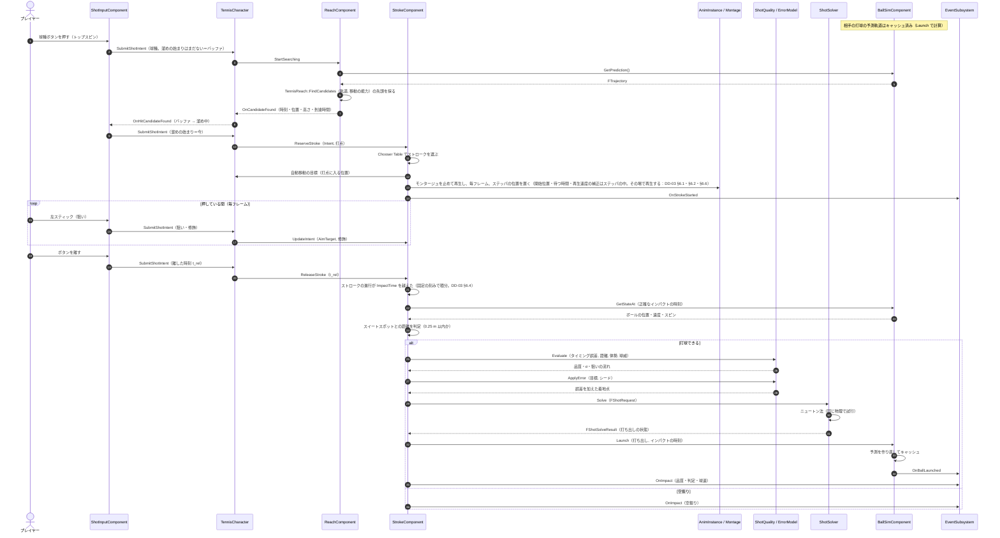
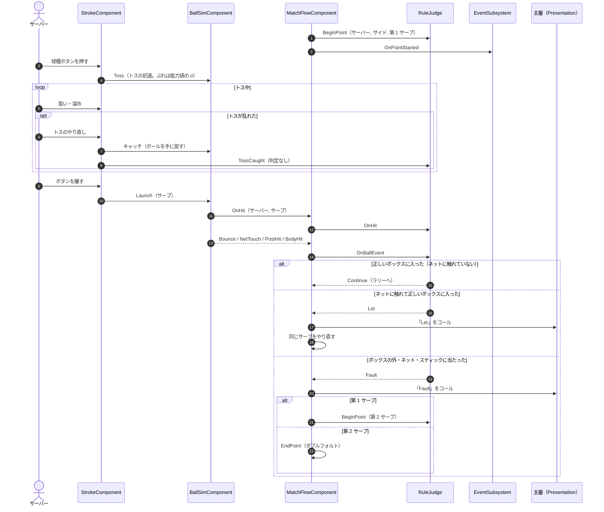
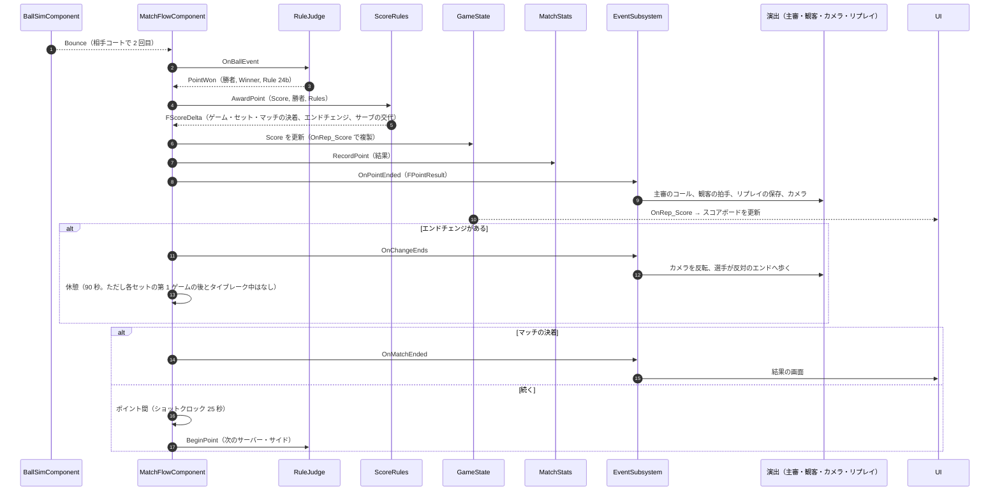
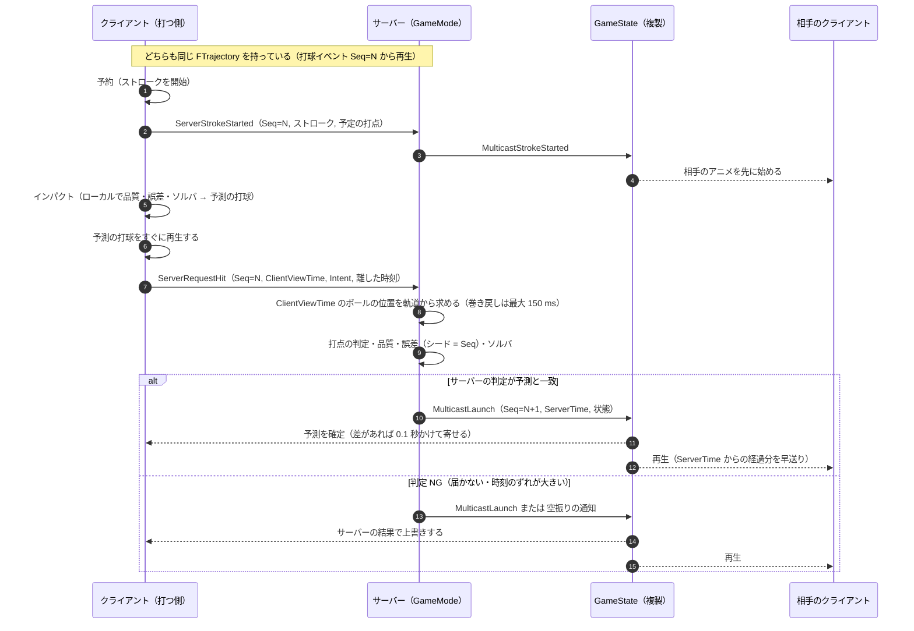
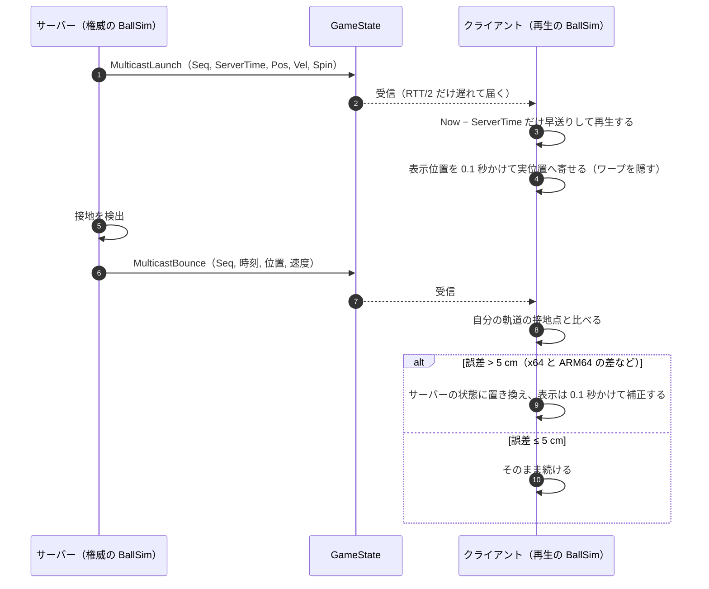
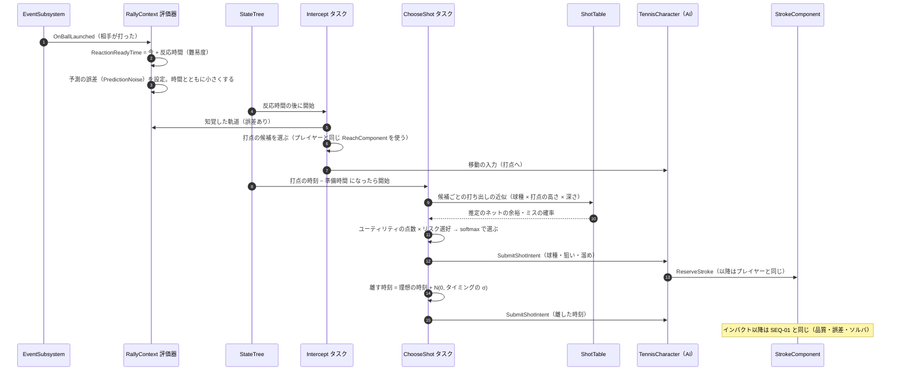
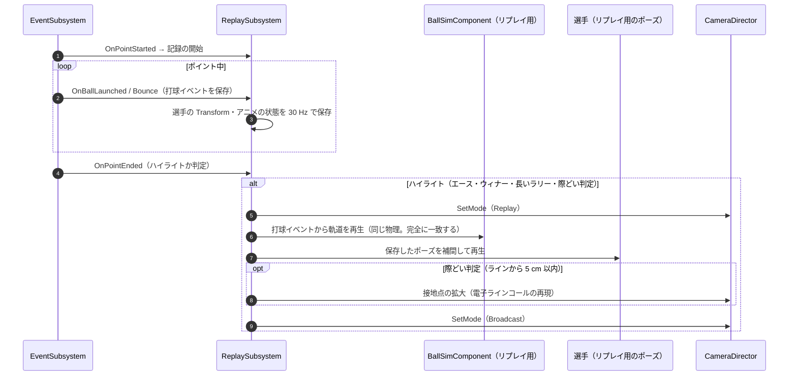
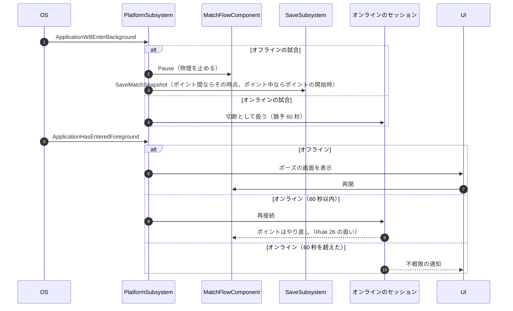
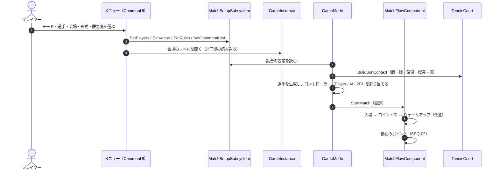

# UML-03：シーケンス図

| 項目 | 内容 |
|---|---|
| 文書 ID | UML-03 |
| 版 | 1.0（2026-11-04） |
| 関連 | [システム構成](../02_Architecture/01_System_Architecture.md) §4〜6、[クラス図](02_Class_Diagrams.md) |

---

## SEQ-01 ラリーの 1 打（オフライン、プレイヤー）

- 今の実装（W-3.5）：1〜9（入力から打点の候補まで）はある。押した瞬間に候補が見つかれば、同じフレームで溜め中になる（ST-05）。自動移動（選び直した打点の体の位置へ）はストロークの `PlayStroke` が始める（#142・#153）。ストローク（`SK`。`UTennisStrokeComponent`）は、候補が見つかると振り始め（選手の `HandleCandidateFound`）、インパクトで判定して打ち（M3 の打球：押した球種のデータで、ニュートラルの狙いへ誤差なしで。DD-03 §6.4。#169〜#171・#173）、そのあと入力に知らせ、RecoverStart で終わる（W-3.5。#153・#154）。狙い・修飾と品質・誤差は M4（W-4.1・W-4.2）で足す

## SEQ-02 サーブ（トス → 判定）

## SEQ-03 ポイントの終了 → スコア → 次のポイント

## SEQ-04 オンライン：クライアントが打つ（遅延補償）

## SEQ-05 オンライン：受ける側の再生とバウンドの補正

## SEQ-06 AI の 1 打

## SEQ-07 リプレイの記録と再生

## SEQ-08 スマートフォン：アプリの中断と再開

## SEQ-09 試合の開始（メニュー → コート）

