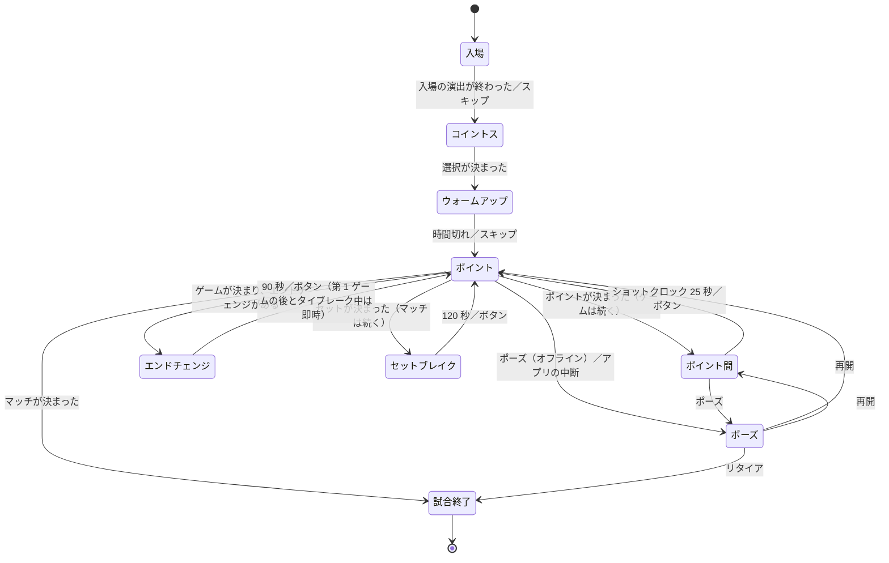
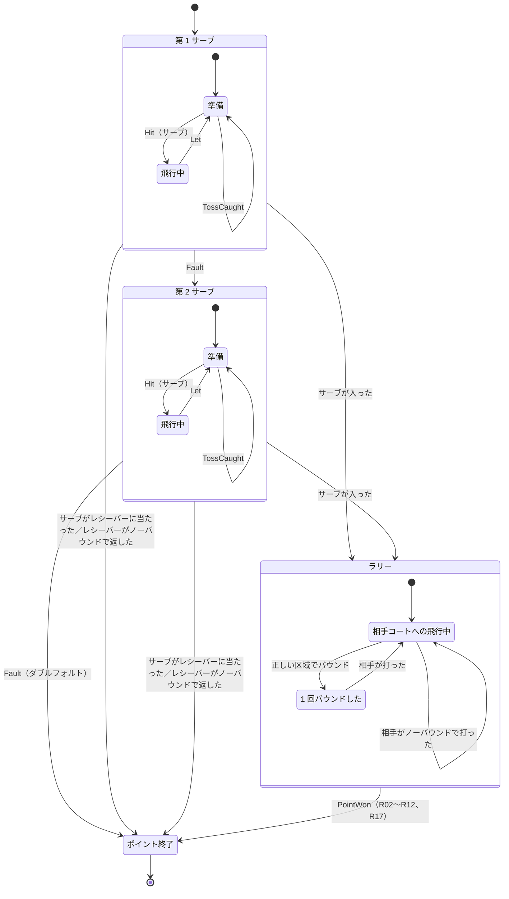
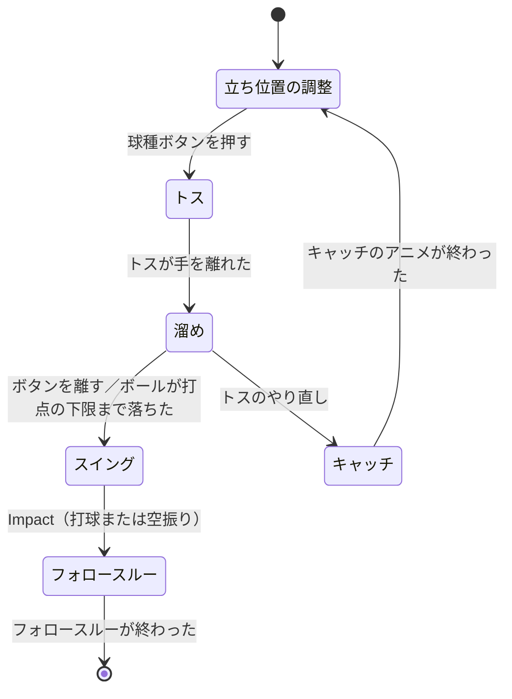
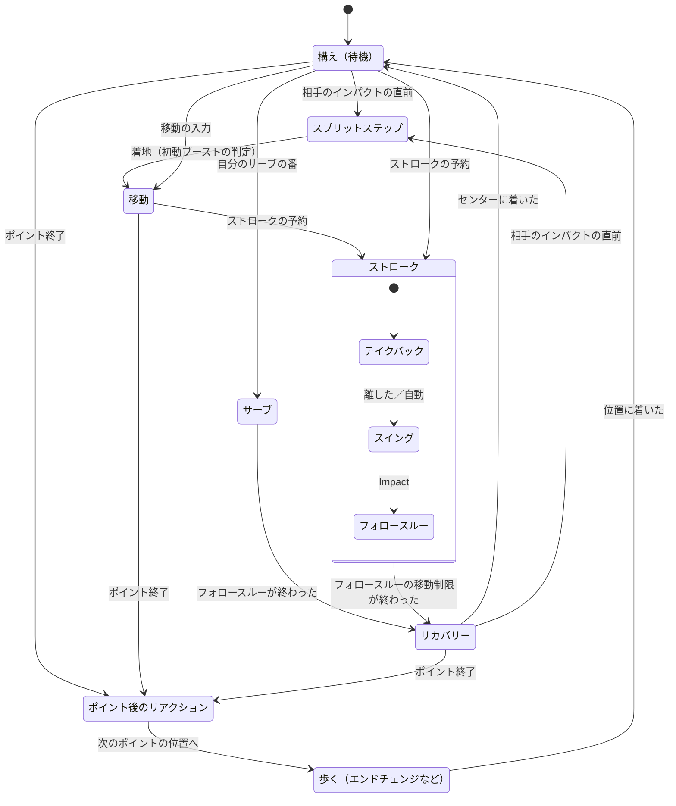
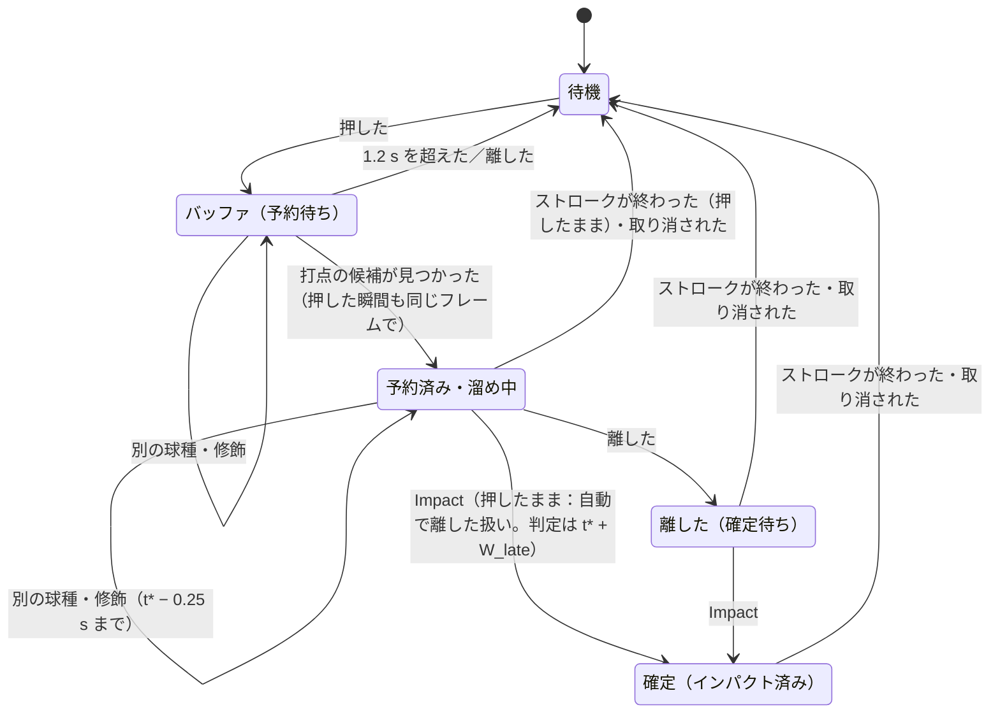
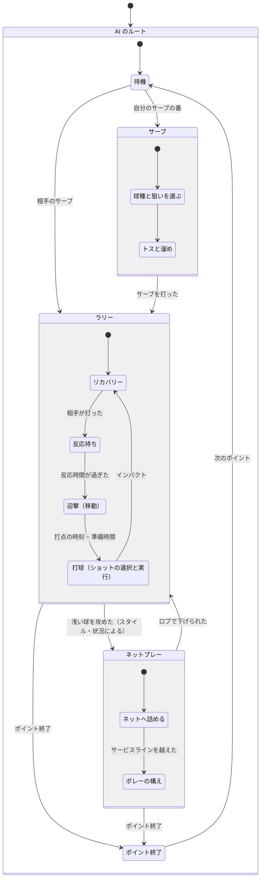
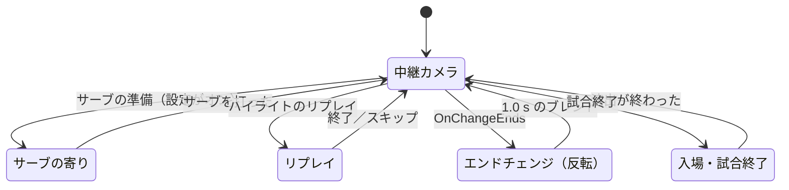
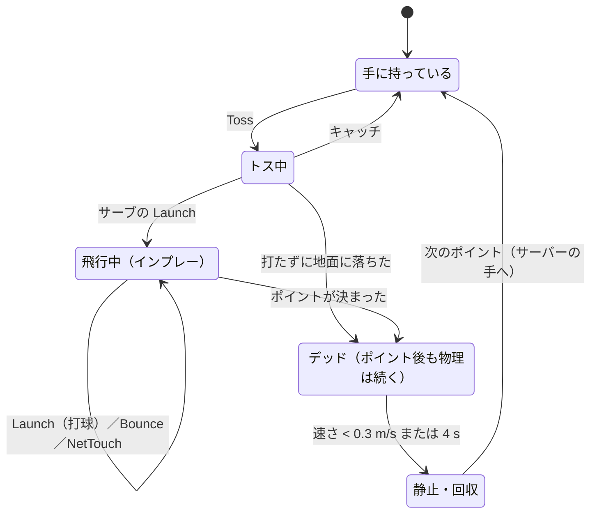
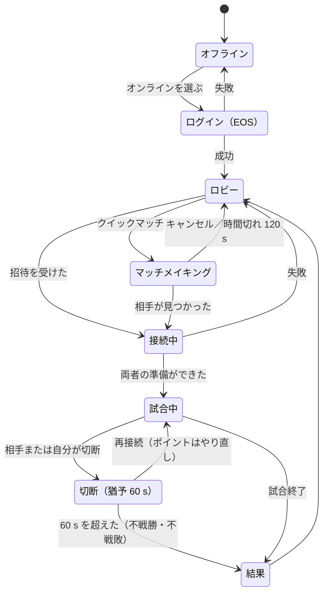

# UML-04：状態図

| 項目 | 内容 |
|---|---|
| 文書 ID | UML-04 |
| 版 | 1.0（2026-11-04） |
| 関連 | [ルール判定仕様](../01_Specification/05_Rules_Specification.md)、[操作仕様](../01_Specification/04_Controls_Specification.md)、[画面遷移](../06_UI_UX/01_Screen_Flow.md) |

> 各状態機械には**時間切れ（タイムアウト）**を必ず設ける（NFR-QUAL-003：試合が進まなくなる不具合を防ぐ）。時間切れの値は各図の下の表に書く。

---

## ST-01 試合の進行（`UTennisMatchFlowComponent`／`ETennisMatchPhase`）

| 状態 | 時間切れ | 時間切れの動作 |
|---|---|---|
| 入場 | 20 s | コイントスへ |
| コイントス | 15 s | 既定の選択（勝者がサーブ） |
| ウォームアップ | 300 s（Rule 29e） | ポイントへ |
| ポイント | 60 s（ボールが静止しない異常） | ルールエンジンに「やり直し」を出させ、ログに残す |
| ポイント間 | 25 s（設定で無制限） | 次のポイントへ |

## ST-02 ポイントの判定（`FTennisRuleJudge`）

各遷移の条件の詳細は、[ルール判定仕様](../01_Specification/05_Rules_Specification.md) の S01〜S16・R01〜R19 を参照。

## ST-03 サーブの動作（`UTennisStrokeComponent`、サーブ時）

| 状態 | 時間切れ | 動作 |
|---|---|---|
| 立ち位置の調整 | 25 s（ショットクロック。設定でオフ） | 警告（オンラインでは時間の違反） |
| 溜め | ボールが打点の 0.6 m 下まで落ちた | 自動でスイング（判定は Late） |
| キャッチ | 2 回を超えた | 警告を表示する |

## ST-04 選手の行動（`ATennisCharacter`）

## ST-05 ショットの入力（`FTennisShotInputMachine`。`UTennisShotInputComponent` が持つ）

- 入力は、意図が変わるたびに選手へ渡す（`ATennisCharacter::SubmitShotIntent`）。待機に戻ったら取り消す（`CancelShotIntent`）
- 打点の候補が見つかったら（押した瞬間に見つかった場合も）、選手が入力に知らせる（`ATennisCharacter::OnHitCandidateFound` → `OnCandidateFound`）。候補を知らせる経路を 1 つにするため、`SubmitShotIntent` は値を返さない
- ストロークが終わった・取り消されたら、選手が入力に知らせる（`OnStrokeEnded`）。ストロークが終わるのは、Notify「Tennis Recover Start」の時刻（DD-03 §6.6）。押したまま（溜め中）でも、ストロークが終わったら待機に戻り、次の押下が効く。離しても、ストロークは終わらない（離した時刻を記録するだけ）。振っていないときに離したら、選手はすぐ終えて知らせる。インパクトは、選手が判定と打球の後に入力へ知らせる（`ATennisCharacter::OnStrokeImpact` → `Impact`：離した → 確定、溜め中 → 自動で離した扱いで確定。空振りでも知らせる：DD-03 §6.4 の 8）
- 入力は、コントローラーが選手を操作する間だけ、その選手の出来事を購読する（`BindCharacter`）
- 球種は、押しているボタンと技の修飾の組み合わせで決まる（操作仕様 §3.1）。意図（`FShotIntent`）には、溜めの始まり（予約できた時刻）と離した時刻、押したままインパクトが来た印（`bAutoReleased`。離した時刻は記録しない）を記録する。溜め（0〜1）は、ストロークの ChargeTime を使ってストロークの側で求める
- 時刻はゲームの時刻（ワールドの秒。ポーズとスローで止まる・遅くなる）
- t* はボールのシミュレーション時刻で決まる（DD-03 §6.1）。入力の時刻（ワールドの秒）では測らず、押したまま（溜め中）インパクトが来たら、入力はそこで自動で離したことにして確定へ進む（判定は t* + W_late に離したもの＝Late の端、溜めは最大。操作仕様 §4.1。利用者の判断、2026-11-14。`ReleaseLeadTime` ≤ 0.15 s < `W_late` 0.200 s なので、t* + W_late はいつもインパクトより後）。その後に離しても何も起きない。球種の変更の期限（t* − 0.25 s）は、球種を途中で変えられるようにするとき（W-4.2）に同じ経路で足す。インパクト（`Impact`）は、ストロークが選手を通して知らせる（`OnStrokeImpact`。#154）

| 状態 | 時間切れ | 時間切れの動作 |
|---|---|---|
| バッファ | 押してから 1.2 s（入力バッファ。DATA-02 §5） | 待機へ（予約を取り消す） |
| 溜め中 | インパクト（ストロークが知らせる：DD-03 §6.6） | 自動で離した扱いで確定へ（判定は t* + W_late＝Late の端、溜めは最大。操作仕様 §4.1） |
| 離した・確定 | ストロークの時間切れ（ST-04） | 待機へ |
| どの状態でも | 入力の段階が変わった（操作仕様 §3.2。段階の切り替えは W-3.7）・操作する選手が替わった | 待機へ（予約を取り消す。`Cancel`） |

## ST-06 AI（StateTree：`ST_TennisAI`）

## ST-07 カメラ（`UTennisCameraDirector`）

- 今（W-3.8）は中継カメラだけで、切り替えはない（`ATennisPlayerCameraManager` がモードを直接持つ：UML-02 §7）。`UTennisCameraDirector` は W-5.10、ほかのモードは W-7.1・W-7.2 で足す

## ST-08 ボール（`UTennisBallSimComponent`）

## ST-09 オンラインのセッション

