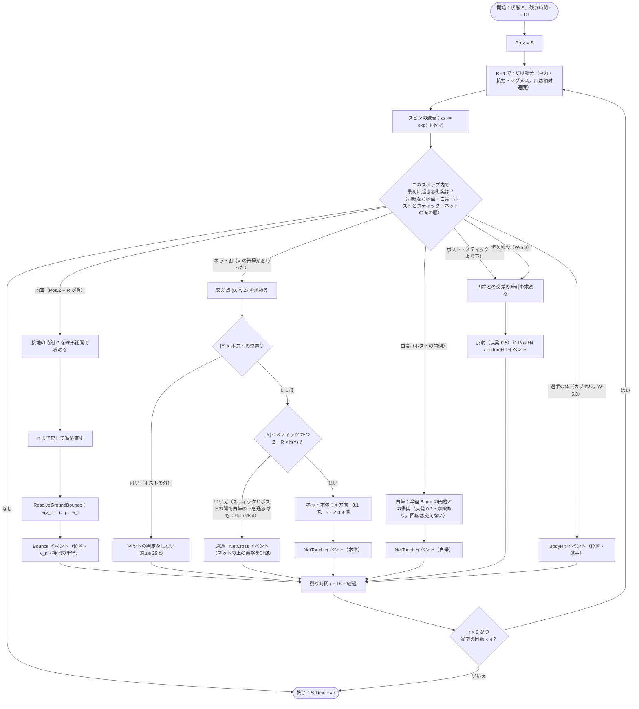
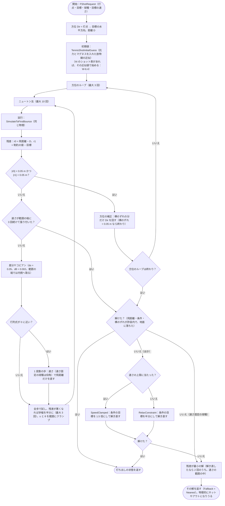
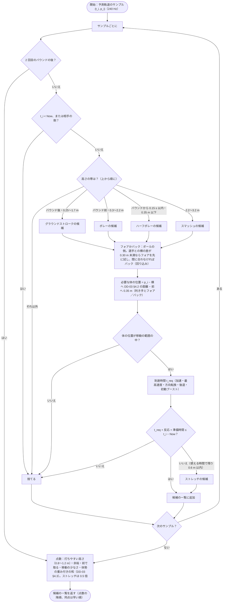
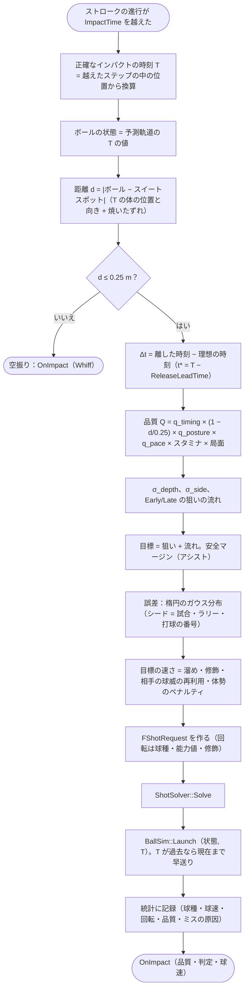
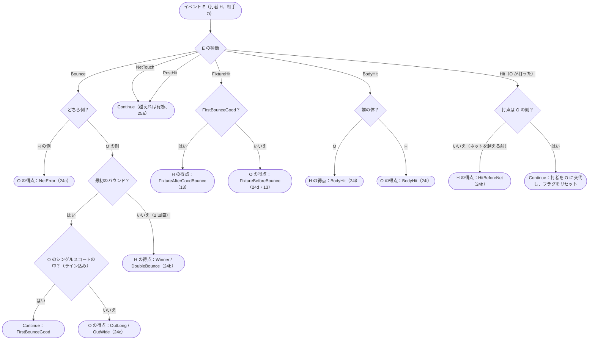
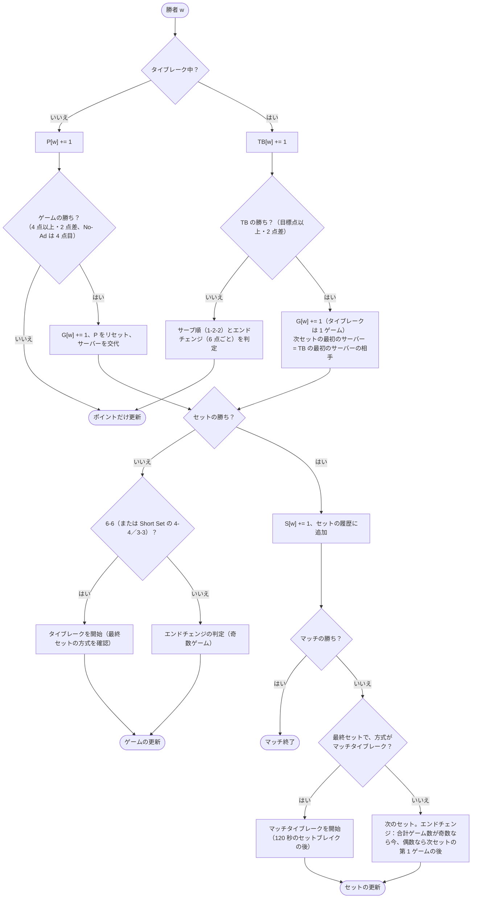
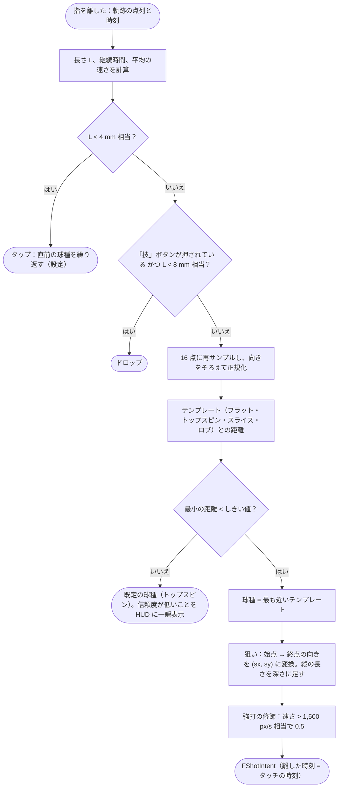

# UML-05：アクティビティ図

| 項目 | 内容 |
|---|---|
| 文書 ID | UML-05 |
| 版 | 1.0（2026-11-04） |
| 表記 | Mermaid の flowchart。ひし形 = 分岐、角丸 = 開始・終了 |
| 関連 | [ボール物理 詳細](../04_DetailedDesign/01_BallPhysics_Detail.md)、[ショット 詳細](../04_DetailedDesign/02_ShotSystem_Detail.md)、[移動とストローク 詳細](../04_DetailedDesign/03_Player_Movement_Stroke_Detail.md) |

---

## ACT-01 ボールの 1 ステップ（`TennisBallPhysics::Step`、Dt = 1/240 s）

**ポイント**：1 ステップの中で複数の衝突（例：白帯 → 地面）が起きても、時刻の順に処理する。どの衝突も、その時刻まで戻して進め直してから解く。衝突の回数の上限（4 回）は無限ループを防ぐためのもので、超えたら残りは衝突を解かずに進め、地面より下に入らないようにする（遅い接地 v_n < 0.1 m/s も同じ）。

## ACT-02 ショットソルバ（`FTennisShotSolver::Solve`）

## ACT-03 打点の探索（`TennisReach::FindCandidates`。`UTennisReachComponent::FindBest` が呼ぶ）

## ACT-04 インパクトの処理（`UTennisStrokeComponent`。DD-03 §6.4）

## ACT-05 ラリーのイベントの判定（`FTennisRuleJudge::OnBallEvent`、Phase = Rally）

## ACT-06 スコアの更新（`FTennisScoreRules::AwardPoint`）

## ACT-07 スワイプの判別（`UTennisSwipeRecognizer::End`）

