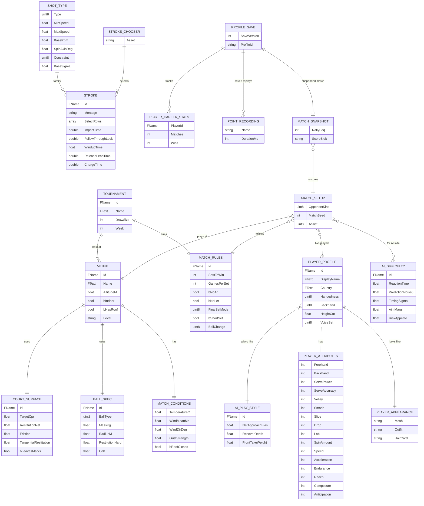

# DATA-01：データモデル

| 項目 | 内容 |
|---|---|
| 文書 ID | DATA-01 |
| 版 | 1.0（2026-11-04） |
| 関連 | [パラメータ表](02_Parameter_Tables.md)、[セーブデータと設定](03_SaveData_Settings.md)、[クラス図](../03_UML/02_Class_Diagrams.md) |

---

## 1. 方針

| 種類 | 使う場面 | 例 |
|---|---|---|
| `UPrimaryDataAsset` | 1 つのまとまった設定。参照で組み合わせる | 球種、コート面、球、選手、難易度、スタイル、試合の規則、会場 |
| Chooser Table | 多条件の選択 | ストロークの選択 |
| `UDataTable` | 同じ形の行がたくさんある表 | ストロークのメタデータの一覧（ツールの出力）、主審のコールの対応表、トーナメントのカレンダー |
| `UDeveloperSettings` | プロジェクト全体の定数 | `UTennisSimSettings`（シミュレーションの周期、既定のアセット） |
| `UCurveFloat` | 非線形の写像 | 能力値の写像を曲線にしたい場合 |
| `USaveGame` | 進行の保存 | [DATA-03](03_SaveData_Settings.md) |

- DataAsset は Asset Manager に登録し（Primary Asset Type）、非同期に読み込む
- 数値には `meta=(Units="...", ClampMin, ClampMax, ToolTip="出典：…")` を付ける（NFR-MAINT-003）

## 2. ER 図

## 3. スキーマ

### 3.1 `UShotTypeData`（`DA_Shot_*`）

ソルバに渡す項目（速さの範囲・回転・条件・初期の仰角）は、TennisSim の `FShotTypeParams` にまとめて持つ（Engine に依存しない。リクエストへの写し方は [DD-02 §4.1](../04_DetailedDesign/02_ShotSystem_Detail.md)）。σ・球威の再利用・打点の高さ・能力値の項目は、使う M4 で加える。

| フィールド | 型 | 単位 | 範囲 | 説明 |
|---|---|---|---|---|
| Type | `ETennisShotType` | — | — | 球種 |
| MinSpeed / MaxSpeed | double | m/s | 5〜70 | 速さの範囲 |
| BaseRpm | double | rpm | −4,000〜4,500 | 正 = トップスピン |
| SpinAxisDeg | double | deg | −90〜90 | 軸の傾き（右利き基準。[DD-02 §3](../04_DetailedDesign/02_ShotSystem_Detail.md)） |
| Constraint | `ESolverConstraint` | — | NetClearance / Apex / FixedSpeed | ソルバの 2 つ目の条件 |
| ConstraintAtCharge0 / ConstraintAtCharge1 | double | m | 0〜12 | 溜め 0 と 1 のときの条件の目標 |
| BaseSigma | double | m | 0.1〜3 | 深さ方向の基本の σ |
| SideSigmaRatio | double | — | 0.3〜1 | σ_s / σ_d（既定 0.6） |
| PaceReuseFactor | double | — | 0〜0.5 | 相手の球威の再利用 |
| InitialElevationDeg | double | deg | −25〜60 | ソルバの初期値 |
| HeightBandPreferred | FFloatRange | m | — | 打ちやすい打点の高さ |
| SkillAttribute | `EPlayerAttribute` | — | — | σ に効く能力値 |

### 3.2 `UCourtSurfaceData`（`DA_Surface_*`）

| フィールド | 型 | 単位 | 説明 |
|---|---|---|---|
| DisplayName | FText | — | 「クレー」など |
| TargetCpr | double | — | 目標の CPR（検証用） |
| Params | `FSurfaceParams` | — | [DD-01 §2](../04_DetailedDesign/01_BallPhysics_Detail.md) |
| SlideFactor | double | — | 減速の距離の倍率（クレー 0.8） |
| bLeavesMarks | bool | — | ボールマークが残るか |
| BounceSound / FootstepSound / SlideSound | `UMetaSoundSource` | — | 音 |
| BounceFX / SlideFX | `UNiagaraSystem` | — | エフェクト |
| CourtMaterial | `UMaterialInterface` | — | コートの見た目 |
| RecommendedBall | `UBallSpecData` | — | 推奨の球（Appendix I） |

### 3.3 `UBallSpecData`（`DA_Ball_*`）

| フィールド | 型 | 単位 | Type 2 の値 |
|---|---|---|---|
| BallType | `EBallType` | — | Type2 |
| Mass | double | kg | 0.0577 |
| Radius | double | m | 0.0335（Type 3 は 0.03575） |
| RestitutionHard | double | — | 0.775（ドロップテストで 135〜147 cm） |
| Cd0 | double | — | 0.55 |
| CdSpin | double | — | 0.0 |
| InertiaAlpha | double | — | 0.55 |
| SpinDecayPerMeter | double | 1/m | 0.005 |
| WearCdLoss / WearRestitutionLoss | double | — | 0.03 / 0.01（9 ゲームでの変化） |

### 3.4 `UPlayerProfileData`（`DA_Player_*`）

| フィールド | 型 | 説明 |
|---|---|---|
| Id、DisplayName、ShortName、Country | FName／FText | 架空の選手 |
| Handedness | `EHandedness` | Right / Left |
| Backhand | `EBackhandStyle` | OneHanded / TwoHanded |
| HeightCm | double | 170〜205 |
| Attributes | `FPlayerAttributes` | 16 項目（0〜100）。ER 図の PLAYER_ATTRIBUTES |
| PlayStyle | `UAIPlayStyleData` | AI のときの振る舞い |
| Appearance | `FPlayerAppearance` | メッシュ・服・髪・ラケットの色 |
| VoiceSet | uint8 | 声の組（0〜11） |
| UmpireNameCue | `USoundBase` | 主審が名前を呼ぶ音声 |

### 3.5 `UAIDifficultyData`・`UAIPlayStyleData`

[DD-05 §6](../04_DetailedDesign/05_AI_Detail.md) の表の列をそのままフィールドにする。

### 3.6 `UMatchRulesData`（`DA_Rules_*`）

| フィールド | 型 | 説明 |
|---|---|---|
| Rules | `FMatchRules` | SetsToWin、GamesPerSet、bNoAd、bNoLet、TieBreakAt、TieBreakTo、FinalSet（`EFinalSetMode`）、bShortSet、ShortSetTieBreakAt、TBEndChange（Every6 / OneThenEvery4）、BallChange（None / Every7 / Every9 / EachSet） |
| ClockMode | `EClockMode` | RealTime / Skippable / None |
| bElectronicLineCalling | bool | 既定 true（false で線審モード：C 要件） |
| ChallengesPerSet | int32 | 線審モードのチャレンジの数 |

### 3.7 `UVenueData`（`DA_Venue_*`）

| フィールド | 型 | 説明 |
|---|---|---|
| Name、City（架空） | FText | — |
| Surface、Ball | 参照 | — |
| Conditions | `FMatchConditions` | 気温・標高・風・屋根 |
| TimeOfDay | `ETimeOfDay` | Day / Evening / Night |
| Capacity | int32 | 観客の数（音と見た目の規模） |
| Level | `TSoftObjectPtr<UWorld>` | 会場のレベル |

### 3.8 `UStrokeData`（`DA_Stroke_*`）

[DD-03 §5.2](../04_DetailedDesign/03_Player_Movement_Stroke_Detail.md)。自動で生成するフィールド（ImpactTime・WindupTime・FollowThroughLock）は、エディタで読み取り専用にする。インパクトのスイートスポットは体ごとに違うので、選手の見た目のデータ（`UTennisPlayerAppearance` の `StrokeFits`。DD-03 §7）に焼く。

### 3.9 `UTennisSimSettings`（Project Settings → Game → Tennis）

| フィールド | 既定 | 説明 |
|---|---|---|
| SimHz | 240 | 固定ステップの周期（変更には全テストの再実行が必要） |
| MaxCollisionsPerStep | 4 | |
| PredictMaxTime / PredictMaxBounces | 4.0 s / 2 | |
| ImpactMaxDistance | 0.25 m | |
| PlayRateRange | 0.80〜1.25 | |
| DefaultVenue、DefaultRules、DefaultBall | 参照 | |
| ShotTableCacheDir | `Saved/ShotTables` | |

## 4. 列挙型の一覧

| 列挙型 | 値 |
|---|---|
| `ETennisShotType` | Flat, Topspin, HeavyTopspin, Slice, Lob, SliceLob, Drop, Volley, HalfVolley, Smash, ServeFlat, ServeSlice, ServeKick, ServeUnderarm |
| `ESolverConstraint` | NetClearance, Apex, FixedSpeed |
| `EBallType` | Type1, Type2, Type3, HighAltitude |
| `EFinalSetMode` | TieBreak7, Advantage, TieBreak10At6All, MatchTieBreak7, MatchTieBreak10 |
| `ETennisPointReason` | Ace, ServiceWinner, DoubleFault, ServeHitReceiver, ReceiverVolleyedServe, Winner, ForcedError, UnforcedError, DoubleBounce, NetError, OutLong, OutWide, FixtureBeforeBounce, FixtureAfterGoodBounce, BodyHit, NetContact, HitBeforeNet, TimeViolation |
| `ETennisMatchPhase` | Walkon, CoinToss, Warmup, Point, BetweenPoints, ChangeEnds, SetBreak, MatchEnd, Paused |
| `ETennisInputPhase` | PreServe, Serving, Receive, Rally, BetweenPoints, Replay, Menu（操作仕様 §3.2） |
| `EShotInputState` | Idle, Buffered, Charging, Released, Committed（ST-05） |
| `EStrokeSide` | Forehand, Backhand |
| `EHitKind` | Groundstroke, Volley, HalfVolley, Smash（DD-03 §4.5） |
| `EBackhandStyle` | OneHanded, TwoHanded |
| `EBallEventType` | Launch, Bounce, NetCross, NetTouch, PostHit, FixtureHit, BodyHit, Rest |
| `EMissCause` | Timing, Contact, Height, Posture, Pace, Risk, Pressure, Solver |
| `ETennisAssistPreset` | Simulation, Standard, Casual, Touch |
| `EOpponentKind` | AI, LocalHuman, Online, AIvsAI |

## 5. GameplayTags

| タグ | 用途 |
|---|---|
| `Tennis.Shot.*` | 球種（AI のスタイルの重み、統計） |
| `Tennis.Event.*` | イベントの種類（Visual Logger のカテゴリ） |
| `Tennis.Reason.*` | ポイントの理由（統計・UI の文言の検索） |
| `Tennis.Surface.*` | 面（音・エフェクトの選択） |
| `Tennis.Style.*` | プレースタイル |
