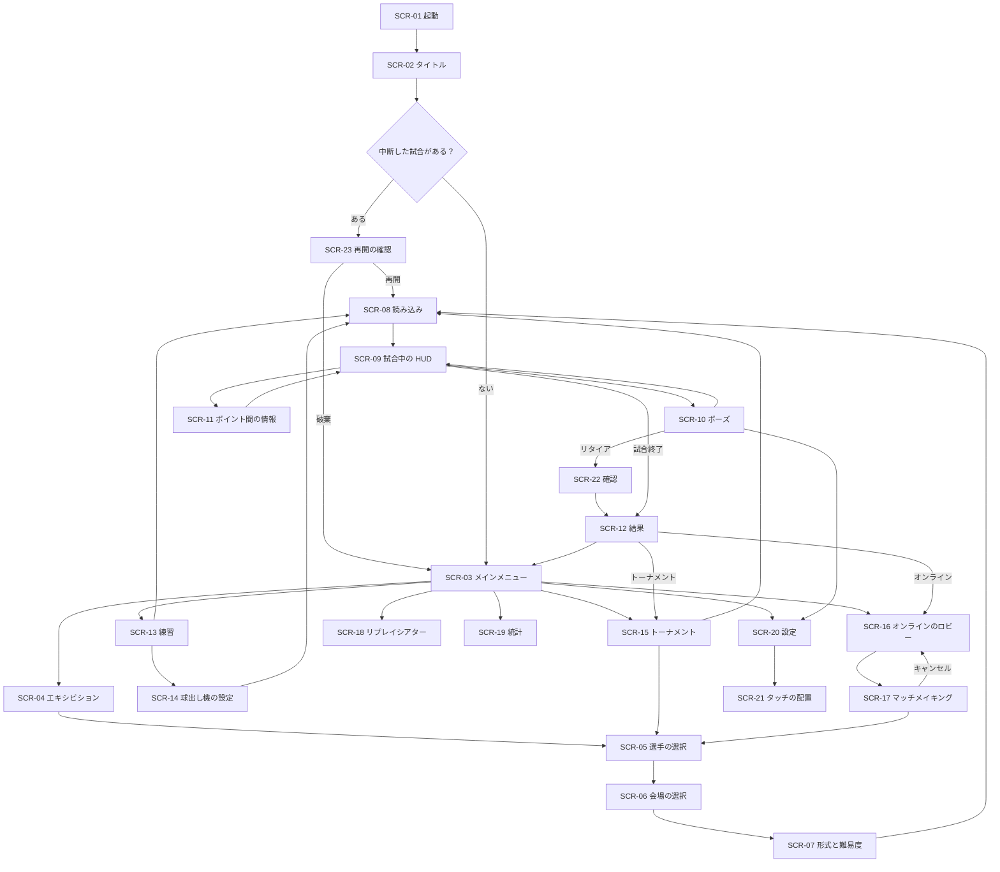

# UI-01：画面遷移

| 項目 | 内容 |
|---|---|
| 文書 ID | UI-01 |
| 版 | 1.0（2026-11-04） |
| 実装 | CommonUI（`UCommonActivatableWidget` のスタック）＋ UMG。ゲームパッド・キーボード・タッチのどれでも全画面を操作できる（FR-UI-007） |
| 関連 | [HUD ワイヤーフレーム](02_HUD_Wireframes.md)、[ゲーム仕様書](../01_Specification/01_Game_Specification.md) §3 |

---

## 1. 画面の一覧

| ID | 画面 | 層（CommonUI） | 内容 |
|---|---|---|---|
| SCR-01 | 起動・注意書き | Modal | ロゴ、健康上の注意、自動保存の説明 |
| SCR-02 | タイトル | Menu | 「ボタンを押してください」。オンラインのログインを裏で始める |
| SCR-03 | メインメニュー | Menu | エキシビション／練習／トーナメント／オンライン／リプレイ／統計／設定／終了 |
| SCR-04 | エキシビションの設定 | Menu | 対戦の形（AI・2 人・AI 対 AI）→ SCR-05 → SCR-06 → SCR-07 |
| SCR-05 | 選手の選択 | Menu | 24 人の一覧、能力値のレーダー図、スタイル、利き手。2 人分 |
| SCR-06 | 会場の選択 | Menu | 会場の一覧（面・球・標高・気温・風・時間帯） |
| SCR-07 | 試合形式と難易度 | Menu | プリセット（ツアー標準など）とカスタム、AI の難易度、アシスト |
| SCR-08 | 読み込み | Modal | 会場の絵、操作のヒント、ショット表の作成の進み具合 |
| SCR-09 | 試合中の HUD | Game | [UI-02](02_HUD_Wireframes.md) |
| SCR-10 | ポーズ | Menu（Game の上） | 再開／設定／操作の説明／リタイア（オンラインでは「降参」） |
| SCR-11 | ポイント間・エンドチェンジの情報 | Game の上の Overlay | スコア、統計の要約、ショットクロック |
| SCR-12 | 試合の結果 | Menu | 勝敗、セットのスコア、統計、ハイライトの再生、リプレイの保存 |
| SCR-13 | 練習のメニュー | Menu | 球出し機／サーブ練習／ラリー練習／状況練習 |
| SCR-14 | 球出し機の設定 | Menu（練習中も開ける） | 球種・コース・速さ・間隔・ランダム |
| SCR-15 | トーナメント | Menu | 大会の一覧、ドロー（8／16／32）、次の試合 |
| SCR-16 | オンラインのロビー | Menu | クイックマッチ、フレンドの招待、ログインの状態、入力の種類 |
| SCR-17 | マッチメイキング中 | Modal | 待ち時間、キャンセル |
| SCR-18 | リプレイシアター | Menu | 保存したリプレイの一覧、自由カメラでの再生 |
| SCR-19 | 統計 | Menu | 通算、選手ごと、面ごと |
| SCR-20 | 設定 | Menu | 映像／音／操作／ゲーム／アクセシビリティ（[DATA-03 §5](../05_Data/03_SaveData_Settings.md)） |
| SCR-21 | タッチの配置の編集 | Menu（スマートフォン） | ボタンをドラッグして配置、大きさ・透明度、左右反転 |
| SCR-22 | 確認のダイアログ | Modal | リタイア・上書き・終了などの確認 |
| SCR-23 | 中断した試合の再開 | Modal | 起動時に `Suspended` があれば「再開しますか」 |

## 2. 遷移図

## 3. 画面ごとの仕様（主要なもの）

### SCR-05 選手の選択

| 要素 | 内容 |
|---|---|
| 一覧 | 3 段 × 8 列のカード（顔・名前・国旗の代わりの架空の地域の印・総合値） |
| 詳細 | 能力値のレーダー図（6 軸：ストローク・サーブ・ネット・回転・身体・精神）、16 項目の数値、スタイル、利き手、バックハンド、身長 |
| 操作 | 十字キー・スティックで移動、A で決定、B で戻る。2 人対戦では左右に分かれて同時に選ぶ |
| 比較 | Y で、相手の候補との能力値の差を表示 |

### SCR-07 試合形式と難易度

| 要素 | 内容 |
|---|---|
| プリセット | ツアー標準／グランドスラム（男子・女子）／ショート／マッチタイブレーク／クイック／カスタム |
| カスタム | セット数、ゲーム数、タイブレーク（有無・点数）、No-Ad、No-Let、最終セットの方式、ボール交換、ショットクロック、電子ラインコール／線審 |
| AI | 難易度（Easy〜Legend） |
| アシスト | プリセット（シミュレーション・スタンダード・カジュアル・タッチ向け）と、個別の調整への入口 |
| 推定の時間 | 「約 25 分」（AI 対 AI の統計から、形式ごとの平均の試合時間を出す） |

### SCR-12 試合の結果

| 要素 | 内容 |
|---|---|
| スコア | セットごとのゲーム数（タイブレークの点を小さく） |
| 統計 | 2 列の比較（エース、DF、第 1 サーブの確率と得点率、ウィナー、凡ミス、ネットでの得点、ブレークポイント、最速のサーブ、走行距離） |
| ハイライト | 自動で選んだ最大 8 ポイント（[DD-07 §2.2](../04_DetailedDesign/07_Camera_Presentation_Detail.md)）を再生、保存 |
| 次へ | メインメニュー／もう一度／（トーナメント）次の試合 |

## 4. 共通の規則

| 項目 | 規則 |
|---|---|
| 戻る | B／Esc／Android の戻る操作で、1 つ前の画面へ（CommonUI のスタック） |
| 決定 | A／Enter／タップ |
| 焦点 | 画面を開いたら、既定の焦点を必ず置く（ゲームパッドで操作できなくなるのを防ぐ） |
| 入力の案内 | 現在の入力の種類（ゲームパッド・キーボード・タッチ）に合わせてボタンの絵を切り替える（CommonInput） |
| 文字 | すべて String Table（`ST_UI`）。日本語と英語 |
| セーフエリア | テレビの端とスマートフォンのノッチを避ける（`USafeZone`） |
| 読み込み | 1 秒を超える処理は、必ず進み具合を表示する |
| 音 | 移動・決定・戻る・エラーの 4 種類の UI の音 |
