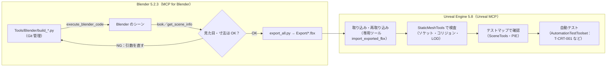

# ART-03：制作パイプライン（Blender MCP → UE）

| 項目 | 内容 |
|---|---|
| 文書 ID | ART-03 |
| 版 | 1.6（2026-11-18：テニスウェアを組み立てた体の殻として作る：§6 の手順 5。1.5 は同じ日：選手の体ごとにスイートスポットを焼く。体格・ソケット・共通のフォルダの決まり：§6・§7。1.4 は同じ日：選手の髪は Groom のまま、見た目のデータに Binding を持たせる：§6。1.3 は 2026-11-12：センターコート A のスタジアムの仮の形のスクリプトと、取り込みの設定を足した） |
| 前提 | 既存設計 §14 を基に、接続中の MCP（MCP for Blender v1.8、Unreal MCP）に合わせて更新した（RES-05 指摘 24） |
| 関連 | [アセット一覧](01_Asset_List.md)、[アニメーション一覧](02_Animation_List.md)、[RES-04 §5](../00_Research/04_UE58_Technology_Assessment.md) |

---

## 1. 全体の流れ

## 2. 役割の分担

| 作業 | 道具 | MCP に任せるか |
|---|---|---|
| 寸法の決まったもの（コート・ネット・ボール・ラケットの土台） | bpy のスクリプト | **任せる**（スクリプトを `execute_blender_code` で実行。会話で形を作らせない） |
| 見た目の確認 | `look`（ビューポートの画像） | 任せる |
| 寸法・トポロジーの検査 | `get_scene_info`（size・topology・materials）、`validate_dimensions.py` | 任せる |
| 背景の小物 | Poly Haven（`search_assets`・`import_asset`）、AI 生成（`generate_3d`） | 任せる（**現在はどちらもオフ**。使うときに Blender のアドオン設定で有効にする。台帳に記録） |
| 選手・顔・髪 | MetaHuman Creator（UE のエディタ内） | **任せる**（Python の API を専用のツールから呼ぶ。§6）。Core Data の導入、Epic アカウントのサインインと利用規約への同意は利用者 |
| 選手の服 | Blender のスクリプト（組み立てた体に合わせ、体のウェイトを写す） | **任せる**（§6） |
| 仮の選手（M3〜M8。[ART-01 §3](01_Asset_List.md) A-CHR-004・005） | bpy のスクリプト（UE から書き出した Manny・Quinn の体に、服・靴・髪・顔の形を足す。骨格・参照姿勢は変えない） | **任せる**（スクリプトを `execute_blender_code` で実行。会話で形を作らせない） |
| スキニング・アニメーション | モーションキャプチャ＋手作業 | 任せない（MCP はボーン名の検査とスクリーンショットだけ） |
| UE への取り込み（FBX → アセット） | プロジェクト専用のツール `Game.Tools.Unreal.tennis_toolset.tools.TennisTools.import_exported_fbx`（[Tools/Unreal](../../Tools/Unreal/README.md)）。`Export/` のファイル名だけを受け付け、取り込み先はアセット名で決まる。再取り込み（置き換え）と保存までを行う。標準の `StaticMeshTools.import_file` は新規の取り込みだけ（既存のアセットがあると失敗し、保存しない）なので、繰り返しの作業には使わない | 任せる |
| UE での配置・マテリアル・検査 | Unreal MCP（SceneTools・MaterialTools・MaterialInstanceTools・StaticMeshTools・AssetTools） | 任せる |

## 3. Blender 側の共通設定

| 項目 | 設定 |
|---|---|
| 単位 | Metric、Unit Scale 1.0（1 BU = 1 m） |
| 前方 | UE の +X を前にする。`export_all.py` は `axis_forward='X'`・`axis_up='Z'`。矢印のメッシュ `SM_AxisTest`（`build_axis_test.py`）を UE に取り込んで向きを確かめ、結果をここに記録する（**確認済み 2026-11-04**：MCP の `StaticMeshTools.get_bounds` で `SM_AxisTest` の境界は X 0〜+100 cm・Y −40〜+8 cm・Z 0〜+20 cm。**X と Z はそのまま、Y だけ反転**する。コート・ネット・ボールは左右対称なので影響なし。左右非対称のアセット（ロゴ・文字・キャラクター）は、Blender で −Y を UE の +Y として作るか、取り込み後に確認する） |
| 原点 | ボール＝中心、ラケット＝グリップエンド、コート＝ネット中央の地面（コート局所座標と一致）。コートサイドの小物（`SM_Prop_*`）＝接地面の中心で、+X＝正面。XZ の面について対称に作る（Y の反転で形が変わらない）。位置と向きは UE のアクタで決める |
| ラケットの原点と軸 | 原点＝グリップエンド（バットキャップの端面の中心）、+X＝グリップ → 先端（UE の前方）、Y＝フェイスの幅、Z＝フェイスの法線。理由：(1) 形で一意に決まる点なので、全長の検査が「X の 0〜0.686 m」のままでき、取り込み後の境界（X 0〜68.6 cm）でも確かめられる。(2) 握る位置は選手や握り方（短く持つなど）で変わるので、メッシュの原点にせず、ソケット `grip`（グリップエンドから 6 cm）で表す。手に付けるときは、骨のソケット `racket_attach` に `grip` を重ねる（相対の変換は `grip` の逆、つまり −X に 6 cm）。(3) 回転 0 で置くと、フェイスを上に向けて地面に寝た向きになる。(4) XY・XZ の面について対称に作るので、FBX で Y が反転しても（上の行）形は変わらない。ソケットの回転はメッシュの軸のまま（`racket_sweetspot` の +Z がフェイスの法線） |
| 命名 | `SM_`（Static）、`SK_`（Skeletal）、`UCX_SM_xxx_00`（凸包のコリジョン）、`SOCKET_xxx`（ソケットの Empty） |
| 適用 | エクスポートの前に Rotation と Scale を Apply（生成のスクリプトは頂点を直接その位置に作り、トランスフォームを単位のままにするので不要。`export_all.py` は単位でないものを書き出さない） |
| マテリアル | スロットの名前と確認用の色だけ（[`Tools/Blender/tennis_blender/materials.py`](../../Tools/Blender/tennis_blender/materials.py) の 1 か所）。色は FBX の拡散色として UE の仮のマテリアルに渡る。本番のシェーダーは UE で作る |
| 安全 | `execute_blender_code` は任意のコードを実行できる。実行前に `.blend` を保存し、作業用のファイルで行う |

## 4. スクリプトの一覧（`Tools/Blender/`）

| スクリプト | 内容 | 出力 |
|---|---|---|
| `build_court.py` | コートの面・余白・ライン（既存設計 §14.4 のコードを基にする） | `SM_Court_Surface`、`SM_Court_Inner`、`SM_Court_Lines` |
| `build_net.py` | ネット（横 64 × 縦 12、頂点カラー R＝揺れの重み）、白帯、ポスト、シングルススティック | `SM_Net`、`SM_NetBand`、`SM_NetPost`、`SM_SinglesStick` |
| `build_ball.py` | UV Sphere（32 × 16）と LOD1（16 × 8）、Type 3 用の大きい球 | `SM_Ball`、`SM_Ball_LOD1`、`SM_Ball_Large` |
| `build_practice_court.py` | 練習コートのフェンス（支柱・横桟・網の面）・ベンチ・照明柱（形は `tennis_blender/practice_court.py`。寸法は [ART-01 §4.1](01_Asset_List.md)） | `SM_Practice_Fence`、`SM_Practice_Bench`、`SM_Practice_LightPole` |
| `build_court_props.py` | コートサイドの小物（箱と柱だけの仮の形。形は `tennis_blender/court_props.py`。寸法は [ART-01 §4.2](01_Asset_List.md)）と、球出し機のソケットの Empty | `SM_Prop_UmpireChair`、`SM_Prop_BallMachine`、`SM_Prop_BallCan`、`SM_Prop_Cooler`、`SM_Prop_ServeTarget`、`SM_Prop_Scoreboard`、`SOCKET_muzzle` |
| `build_stadium_a.py` | センターコート A のスタジアムの仮の形：看板の壁・観客席（下の層・横の通路・上の層・手すり壁。外周の長方形に沿って断面を掃き出す）・床。観客席の LOD1（斜面）も作る（形は `tennis_blender/stadium_a.py`。寸法・席の数は [ART-01 §4.3](01_Asset_List.md)） | `SM_Stadium_A_Stands`、`SM_Stadium_A_Stands_LOD1`、`SM_Stadium_A_Barrier`、`SM_Stadium_A_Floor` |
| `build_racket.py` | 打球面の楕円の縁から外へ八角形の断面を一周させたフレーム、スロートの 2 本の腕、グリップ（バットキャップつき）とシャフト、ストリング 16 × 19、ソケットの Empty 2 つ（形は `tennis_blender/racket_shape.py`） | `SM_Racket`、`SOCKET_racket_sweetspot`、`SOCKET_grip` |
| `validate_dimensions.py` | 寸法の検査（許容 5 mm）。ラケットは全長 ≤ 0.737 m・幅 ≤ 0.317 m・打球面 ≤ 0.394 × 0.292 m（Appendix II）と、ソケットの親・位置・回転 | ログ |
| `build_axis_test.py` | FBX の軸の確認用の矢印（+X 1.0 m、+Y 0.4 m、+Z 0.2 m） | `SM_AxisTest` |
| `export_all.py` | FBX の一括書き出し（`Tennis_*` のコレクションの `SM_` を 1 つずつ。選手の `SKM_` は骨格（Armature）ごと。`apply_scale_options='FBX_SCALE_UNITS'`、頂点カラーはリニア、Mesh と Empty） | `Export/*.fbx` |
| `build_players.py` | 仮の選手 2 人：`Export/Base/` の `SKM_Manny_Simple.fbx`・`SKM_Quinn_Simple.fbx`（UE の `TennisTools.export_player_base_fbx` で書き出す。§5）を読み、体をボクセルで 1 つの面に作り直してウェイトを写し、頭と首を作り直し、服・靴・髪・顔の部品を足す（形は `tennis_blender/` のモジュール。仕様は [ART-01 §3](01_Asset_List.md)） | `SKM_Player_Male01`、`SKM_Player_Female01`（それぞれ骨格の `Armature` の子） |

寸法の定数・配置の計算などの共通の処理は `Tools/Blender/tennis_blender/` にまとめる（単体テストつき）。MCP からの実行の方法と規約は [Tools/Blender/README.md](../../Tools/Blender/README.md) にある。

**MCP での指示の例**：

> `Tools/Blender/build_court.py` を execute_blender_code で実行し、真上と斜めから look で確認して。続けて `validate_dimensions.py` を実行し、結果を表にして。NG があれば止めて報告して。

## 5. UE 側の取り込み

| 項目 | 設定 |
|---|---|
| フォルダ | `Content/Tennis/Art/{Court,Net,Ball,Racket,Stadium,Props,Crowd}`。選手は `Content/Tennis/Characters/{Base,Players,Animations}`（[ARCH-02 §4](../02_Architecture/02_Module_Package_Design.md)） |
| 取り込み | Interchange。Combine Meshes をオフ。コリジョンは `UCX_` を使う。`UCX_` がないと Interchange が全体を覆う凸包を自動で付けるので、コリジョンなしと決めたアセット（ラケット・練習コートの小物）からは、取り込みのツールが消す（規則は `import_rules.DESTINATIONS`。[Tools/Unreal](../../Tools/Unreal/README.md)） |
| コート | コリジョンは見た目用（ボールは自前の物理）。選手の接地用に単純な Box を 1 枚 |
| ネット | Nanite オフ、Two Sided の Masked マテリアル、WPO（頂点カラー R × 衝突のパラメータ） |
| ボール | Nanite オフ。フェルトのノーマル |
| ラケット | Nanite オフ（ART-01 §1）。コリジョンなし（打球はスイートスポットとボールの距離で決め、ボールは自前の物理）。ソケット `racket_sweetspot`・`grip`（FBX の `SOCKET_` の Empty から。位置だけを FBX から取り、回転 0・スケール 1 は取り込みのツールが整える：Interchange はソケットに軸と単位の変換の逆を掛けるため。[Tools/Unreal](../../Tools/Unreal/README.md)） |
| スタジアム | Nanite オン（PC）。**通常の LOD も生成する**（モバイル用。NFR-MOB-002） |
| センターコート A の仮の形（`SM_Stadium_A_*`） | `Content/Tennis/Art/Stadium/`。コート局所座標なので原点に置く。計 7,024 三角形の仮の形なので Nanite オフ（仕上げで細かくしたら、上の行のとおり Nanite オン）。`SM_Stadium_A_Stands_LOD1` は観客席の LOD1 として作った（外形とスロットの番号は LOD0 と同じ）。取り込みのツールが `SM_Stadium_A_Stands` の LOD1 に入れて、LOD 用のアセットを消す（`import_rules.LOD_MERGE_PREFIXES`。`StaticMeshEditorSubsystem.set_lod_from_static_mesh`）。看板の壁と床は LOD0 だけ。**コリジョンなし**（自動の凸包は観客席の輪の全体を覆い、コートの上の選手が落ちる。練習コートのフェンスと同じ）。ボールが当たる看板の壁は、恒久施設としてシミュレーションの側に簡易な形で登録する（FR-CRT-007）。取り込みの規則は `import_rules.DESTINATIONS` の `SM_Stadium_` の行（Stadium、Nanite なし、コリジョンなし）。寸法・LOD・コリジョンなしは自動テスト `Tennis.Game.Data.ArtAssets.StadiumA_HasItsSizeLodsAndNoCollision` が確かめる。床の仮のマテリアル `M_Court_Out` は Stadium のフォルダにも作られる（Court のものと同じ色。仕上げ（W-7.13）で本番のマテリアルに替える） |
| 練習コートの小物 | 三角形が少ない（計 1,408）ので Nanite オフ・LOD 1 つ。コート局所座標なので原点に置く。フェンスの網（`M_Fence_Net`）は Masked・Two Sided。コリジョンなし（ボールは自前の物理。フェンスに自動の凸包が付くと、コート全体を覆って選手が落ちる） |
| コートサイドの小物（`SM_Prop_*`） | `Content/Tennis/Art/Props/`。Nanite オフ（計 648 三角形）・LOD 1 つ・コリジョンなし（審判台は、恒久施設としてシミュレーションの側に簡易な形で登録する：FR-CRT-007）。自分の局所座標（+X＝正面）なので、位置と向きはアクタで決める（審判台は y = ±7.299 m でコートの方を向ける：[ART-01 §4.2](01_Asset_List.md)）。球出し機のソケット `muzzle` が球の出る点。仮のマテリアルは 5 つを共有する（`M_Prop_*`） |
| 仮の選手（`SKM_Player_*`） | `Content/Tennis/Characters/Players/Interim/`。骨格は既存の `SK_TennisPlayer_Base`（新しい骨格を作らない）、物理アセットは `PA_Mannequin`。骨の名前・数・参照姿勢が元の Manny・Quinn と同じであること（UE → Blender → UE の往復で変わらないこと）を、取り込み後に自動テストで確かめる。LOD は UE で 4 つ作る（NFR-MOB-002）。Nanite なし（Skeletal）。Blender の入力の体は `TennisTools.export_player_base_fbx` が `Export/Base/` に書き出す（`Export/` の直下ではないので、取り込みの対象にならない） |
| 取り込み・再取り込み | Blender から同じファイル名で書き出し → MCP から `Game.Tools.Unreal.tennis_toolset.tools.TennisTools.import_exported_fbx` を呼ぶ（同じ名前のアセットは置き換えて保存する）。FBX のマテリアルのスロットから仮のマテリアル（`M_*`）が作られ、取り込み直すたびに FBX の値（Blender の確認用の色）に合わせ直される。Nanite は上の行の規則どおりに設定される（Interchange の既定は Nanite オン。[Tools/Unreal](../../Tools/Unreal/README.md)）。本番のマテリアルは UE で作り、差し替える |
| 検査（Unreal MCP） | `StaticMeshTools` でソケットの有無（ラケットの `racket_sweetspot`）、三角形の数、LOD の数を確認し、[アセット一覧 §1](01_Asset_List.md) の予算と比べる。ラケット（全長・幅・ソケットの位置と軸）と練習コートの小物（高さ・左右の対称）は、コリジョンがないこととあわせて、自動テスト `Tennis.Game.Data.ArtAssets` が取り込んだアセットで確かめる（取り込み直すたびに CI で分かる） |

## 6. 選手（MetaHuman → ゲームのキャラクター）

M3〜M8 は、Blender で作った仮の選手（[ART-01 §3](01_Asset_List.md) A-CHR-004・005。§4 の `build_players.py`）を使う。本番の選手は MetaHuman で作る。そのうち男女の 2 人（A-CHR-010・011）は、利用者の依頼で M3 に前倒しする。残りの 22 人は M9 で作る。

| 手順 | 内容 | 誰が |
|---|---|---|
| 0. 前提 | Epic Games Launcher で UE 5.8 に「MetaHuman Creator Core Data」を入れる（肌のテクスチャの合成のモデル・髪・服の素材）。プロジェクトで MetaHuman Creator のプラグインを有効にする。Epic アカウントにサインインし、MetaHuman の利用規約に同意する（顔の自動リグはクラウドで動く） | 利用者（プラグインの有効化は Claude） |
| 1. 作る | 専用のツール（MCP の `build_metahuman_player`。値は `Tools/Unreal/tennis_toolset/metahuman_players.py`。1 回の呼び出しで 1 段階ずつ進め（クラウドの自動リグとテクスチャの取り寄せは終わるまで待つ）、段階 `rigged`・`textures`・`done` を返すので、`done` まで呼び直す）が MetaHuman Character（`MetaHuman/MHC_Player_<M01・F01>`）を作り、値（純粋なデータ）を当てる：顔は Core Data のプリセット（男性 M01 は Kelvin、女性 F01 は Celeste。利用者の判断、2026-11-14）を写したもの、体は Parametric Body の測定値（身長・肩幅・胸・腰・筋肉・体脂肪・男女の度合い。リグと組み立ての前に当てる。プリセットの体のままにしない）、肌（色・テクスチャの合成）、目、眉・まつげ、髪（Core Data の髪）。服は外して組み立てる（体を欠けのない形で組み立て、テニスウェアは手順 5 で作る）。顔は架空（実在の人物に似せない。NFR-LEGAL-001） | Claude（MCP） |
| 2. リグ | 顔の自動リグ（クラウド。関節だけ）。肌のテクスチャの元（高解像度）を取り寄せる（組み立てに要る：エンジンの `CanBuildMetaHuman` が、ないと組み立てを止める。2026-11-18 に確かめた） | Claude（MCP。サインインは利用者） |
| 3. 組み立て | Optimized の組み立て（品質 Medium）で、`Content/Tennis/Characters/Players/MetaHuman/<名前>/` に静的なアセットとして書き出す。共通のアセット（骨格・コントロールリグ・マテリアルなど。1 人で約 250 MB）は、全員で 1 つの `Content/Tennis/Characters/Players/MetaHuman/Common/` にする（人ごとに写さない）。実行時に MetaHuman Creator に依存しない。編集用の MetaHuman Character もコミットする（作り直しのため。利用者の判断、2026-11-18：2 人で LFS が約 700 MB 増える） | Claude（MCP） |
| 4. 骨格 | 体の骨格 `metahuman_base_skel` は UE5 Manny と同じ名前の骨（＋補正の骨）を持つ。ラケットのソケット `racket_attach_r`・`racket_attach_l` を、`SK_TennisPlayer_Base` と同じ位置と向きで、体のメッシュに足す（[ART-01 §3.1](01_Asset_List.md)。組み立てのたびに、ツールが同じ結果になるように足し直す。共通の骨格には足さない：エンジンの `AddSocket` は骨格に足すとメッシュにも入れ、両方にできてどちらが使われるか分かりにくくなる）。共通の骨格は `SK_TennisPlayer_Base` を互換の骨格に持つ。今のアニメーション（`SK_TennisPlayer_Base`）は、互換の骨格（Compatible Skeletons）として再生する（2026-11-18 に PIE でフォアを振れることを確かめた）。手首の参照姿勢が Manny と違うので、ラケットの面の向きは体ごとに違う（グリップは手のひらにある）。打つ位置の差は、手順 7 の焼き直しで合わせる | Claude（MCP） |
| 5. 服 | テニスウェア（A-CHR-040〜043）を、**組み立てた体の殻**として作る（仮の選手と同じ作り方：§4 の `build_players.py`・`tennis_blender`）。(1) UE の MCP のツールが、組み立てた体の LOD0 を骨格ごと FBX に書き出す（`Export/Base/`）。(2) Blender のスクリプトが、体の頂点を法線の向きに少しずらした殻で服の部品（シャツ・ショートパンツ・袖なしのトップ・スカート・靴下・シューズ・リストバンド・ヘッドバンド）を作り、ウェイトは元の体の頂点から 1 対 1 で写す（体と同じに動くので、体の面を消さなくても突き抜けない）。部品の分け方（どこまでがシャツか）は、骨の名前と目印で決める（`player_regions`）。MetaHuman の体の骨は、Manny と同じ名前の骨に補助の骨（`*_twistCor_*`・`calf_knee_*`・`clavicle_pec_*`・足の指など）が加わる（M01 の体では、頂点の約 24% で補助の骨がいちばん重い）ので、頂点は、いちばん重い骨をたどって最初に当たる Manny の骨（親をたどる）で分ける。体の FBX には頭がない（首まで）ので、目印（首の軸・襟の高さ）は骨の位置から決める。体のメッシュは UV の継ぎ目で頂点が分かれているので、つないでから殻を作る（分かれたままだと継ぎ目の両側で法線が違い、殻が割れて肌が見える）。靴は足の頂点をずらした点の凸包を均等な面に作り直したもの（殻のままだと足の指の形が出る）。襟ぐりは体の首の穴の縁（顔のメッシュの首がふさぐ）にする（体には組み立ての灰色の下着が焼き込まれているので、それより下を切らない）。クルーネックの襟とヘッドバンド（A-CHR-043）は頭と首の形（顔のメッシュ）に合わせるので、後に足す。スクリプトは `Tools/Blender/build_metahuman_wear.py`。(3) 服だけを 1 つの Skeletal Mesh（`SKM_Wear_<M01・F01>`）として、共通の骨格 `metahuman_base_skel` に取り込む（新しい骨格・物理アセットを作らない）。LOD の数は体と同じ 3 つ（UE で作る）。**体の面は消さない**：試合中（中継カメラ、約 15 m）は、体は画面の 0.13 で LOD0、顔は体の LOD に従って LOD0、髪・ひげの Groom は画面の 0.04 で LOD4（カード）と LOD5（メッシュ）の間になる（2026-11-18 の計測）。服を足した試合中の三角形の上限（T-CHR-003。Groom はカードの元のメッシュで数える）は M01 で 44,041、F01 で 34,365（服は M01 7,887・F01 7,597）で、60k に収まる。UE → Blender → UE の往復（形を変えない）で、骨 342 本が同じ順、参照姿勢の差は 0.0004 cm・0.14°（2026-11-18） | Claude（Blender MCP・MCP） |
| 6. 見た目のデータ | 体・顔・服・髪を、選手の見た目のデータ（DD-03 §7）にまとめる。顔・服は体の骨に追従する（Leader Pose）。追従する部品（顔と、あれば服 `SKM_Wear_<名前>`）の一覧は `build_metahuman_player` が書く（作り直しで服が外れないように、服のメッシュの場所は `metahuman_players.py` に書く）。組み立ての後に服を取り込んだら、`apply_metahuman_wear` が追従する部品を顔と服にし直す（組み立てはしない）。髪・眉・ひげは、組み立てが作る Groom の Binding（対象は顔のメッシュ）を書く | Claude（C++・MCP） |
| 7. 焼く | 見た目のデータに、その体のスイートスポットと探索の体の位置を焼く（DD-03 §5.4・§7。MCP のツール）。体（測定値・プリセット）を変えたら、焼き直し、服（手順 5）も合わせ直す | Claude（MCP） |
| 8. 検査 | 自動テスト：骨格とソケット、試合中の LOD の三角形の数（60k 以下）、見た目のデータの参照、焼いた値が焼き直した値と合う（T-STRK-010・011）。PIE で待機とラケットとストローク | Claude |

- 髪は、試合中はヘアカード（Optimized の組み立てが作る Groom のアセットの、カードとメッシュの LOD）。カードも Groom のアセットに入っているので、`GroomComponent` で描く（DD-03 §7）。ストランドはリプレイのアップだけ（M9 以降）
- 服は ChaosCloth を使わない（M9 で見直す。モバイルでは無効にする）

## 7. アニメーション

1. 収録（[ART-02 §6](02_Animation_List.md)）→ Retarget → Foot Lock → Notify を打つ
2. Blender で手付けする場合は、インパクトとリカバーの時刻を JSON（`Export/AS_*.json`）に書き出し、Unreal MCP のツール（仮のストロークは `build_placeholder_strokes`：[Tools/Unreal](../../Tools/Unreal/README.md)）が読んで Notify を打つ
3. `StrokeMetaBaker` を実行して `UStrokeData`（時刻）と、すべての選手の見た目のデータ（その体のスイートスポット：DD-03 §7）を更新する
4. `DA_Stroke_*` の `SelectRows` に選ばれる条件を書き、`rebuild_stroke_chooser` で Chooser Table（`CHT_StrokeSelect`）を作り直す（表は手で編集しない：[DD-03 §5.3](../04_DetailedDesign/03_Player_Movement_Stroke_Detail.md)）
5. 自動テスト T-STRK-002（Chooser の網羅）・T-STRK-003（インパクトの距離）を実行する

## 8. マイルストーンへの組み込み

| MS | アセット |
|---|---|
| M0 | コート・ネット・ボール（スクリプトで生成、半日） |
| M3 | ラケット、仮の選手（Manny）、ストロークの仮のモンタージュ（FH・BH・サーブ） |
| M7 | センターコート A、観客、主審・ボールパーソン、エフェクト、サウンド |
| M9 | 選手 24 人、服、残りの会場 4 つ、ストロークの全セット |
