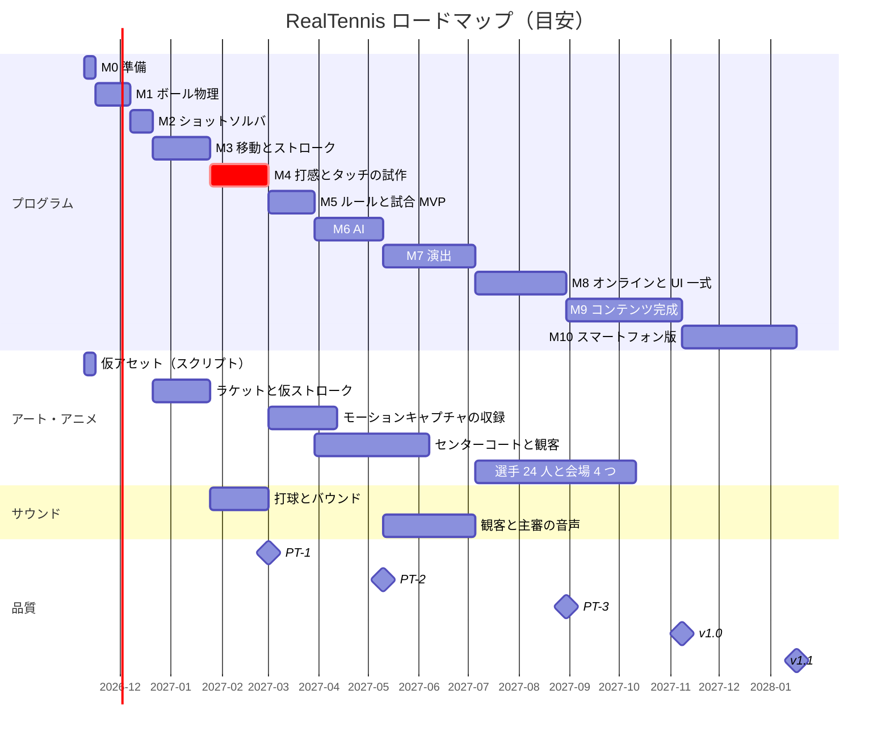

# PM-01：ロードマップ・WBS

| 項目 | 内容 |
|---|---|
| 文書 ID | PM-01 |
| 版 | 1.1（2026-11-11：M5〜M10 の WBS を、M4 までと同じ粒度にした） |
| 前提 | プログラマー 1 人（フルタイム）＋アートとサウンドは外注・素材の購入を併用、と仮定した目安。期間は休暇を含まない。体制が決まったら見直す |
| 関連 | [機能仕様書](../01_Specification/02_Functional_Specification.md)（各要件の MS）、[リスク表](02_Risk_Register.md)、[テスト計画](../08_QA/01_Test_Plan.md) |

---

## 1. マイルストーン

| MS | 名前 | 期間（目安） | 完了の条件 | 主な要件 |
|---|---|---|---|---|
| **M0** | 準備 | 1 週 | C++ の 4 モジュールがビルドでき、雛形のテストが Unreal MCP から通る。コート・ネット・ボールの仮アセットが寸法どおり（T-CRT-001） | FR-CRT-001、FR-DBG-001 |
| **M1** | ボール物理 | 3 週 | T-BALL-001〜050 がすべて合格。仮想 CPR 試験のツールで 5 面を校正。手で投げて自然に見える | FR-BALL-*、FR-CRT-002〜008、FR-DBG-004 |
| **M2** | ショットソルバ | 2 週 | 打球ツールでクリックした地点に 5 cm 以内で落ちる（T-SHOT-001）。球種で軌道の違いが見える | FR-SHOT-001〜004、FR-DBG-003 |
| **M3** | 移動とストローク | 5 週 | 打点に向かって振ると、ラケットにボールが当たって見える（T-STRK-003 の平均 < 5 cm。M3 は中くらいの高さのグラウンドストロークで測る：[DD-03 §12.1](../04_DetailedDesign/03_Player_Movement_Stroke_Detail.md)）。サーブが打てる | FR-MOVE-*、FR-STRK-*、FR-INP-001〜003、FR-CAM-001 |
| **M4** | 打感（最重要） | 5 週 | PT-1 に合格（「狙ったところに打てた」4/5 以上）。球出し機の練習。タッチ操作の試作（PC で模擬） | FR-SHOT-005〜012、FR-INP-004〜005・008（試作）、FR-MOVE-005、FR-MODE-002、FR-UI-002〜004 |
| **M5** | ルールと試合（MVP） | 4 週 | 1 セットを最後までプレイできる。ルールとスコアの全テストに合格 | FR-RULE-*、FR-SCR-*、FR-MATCH-001〜005、FR-UI-001 |
| **M6** | AI | 6 週 | 5 難易度・6 スタイル。AI 対 AI の KPI が 7/8 以上。PT-2 に合格 | FR-AI-*、FR-DBG-006 |
| **M7** | 演出 | 8 週 | 中継カメラ・リプレイ・電子ラインコールの再現・観客・主審・エフェクト・サウンド・統計。センターコート A | FR-CAM-*、FR-PRES-*、FR-SND-*、FR-STAT-*、FR-ENV-003・004 |
| **M8** | オンラインと UI 一式 | 8 週 | EOS で 2 台の PC が対戦できる（RTT 150 ms で T-NET-002）。全画面・設定・セーブ・日英。PT-3 に合格 | FR-NET-001〜006、FR-UI-005〜008、FR-SAVE-*、FR-INP-006 |
| **M9** | コンテンツ完成 → **v1.0** | 10 週 | 選手 24 人・会場 5・ストロークの全セット・トーナメント。リリースの基準（QA-01 §10）を満たす | FR-MODE-004、ART-01 の M9 のアセット |
| **M10** | スマートフォン版 → **v1.1** | 10 週 | iOS・Android の実機で全モード。タッチの 2 方式。クロスプレイ（T-NET-006）。ストアの審査に通る | M¹ の要件すべて |

**優先順位の考え方**（既存設計 §13 を継承）：M1〜M4 で「打って気持ちいい」状態を作るのが最重要。ここが固まる前にルールや AI を作り込むと、後の調整がやり直しになる。

## 2. ガントチャート

## 3. WBS

### M0 準備

| ID | 作業 | 成果物 | 完了の条件 | 結果（2026-11-04） |
|---|---|---|---|---|
| W-0.1 | C++ の 4 モジュールを追加（[ARCH-02 §5](../02_Architecture/02_Module_Package_Design.md)） | `Source/`、`.uproject` の Modules | ビルドが通り、CI の `check_project.py` が合格 | **完了**。`TennisSim`・`Tennis`・`TennisTests` の 3 つ（UBT でビルド、`check_project.py` が合格）。`TennisEditor` は、最初の C++ のエディタのツールと同じ PR で追加する（YAGNI。[ARCH-02 §5](../02_Architecture/02_Module_Package_Design.md)） |
| W-0.2 | プラグインを有効化（[RES-04 §4.3](../00_Research/04_UE58_Technology_Assessment.md)） | `.uproject` | エディタが起動する | **後回し**（YAGNI）。有効なのは `ModelContextProtocol`・`AllToolsets` と、本番の選手（W-3.10）のための `MetaHumanCharacter`（MetaHuman Creator、Beta）と `HairStrands`（Groom。選手の髪を C++ のモジュールが使うので明示する。`MetaHumanCharacter` も依存する）、ストロークの選択（W-3.4）のための `Chooser`、ロコモーションの Motion Matching（W-3.6）のための `PoseSearch`（依存の `AnimationWarping`・`MotionWarping`（Beta）も有効になる）。ほかのプラグインは、使うマイルストーンで有効化する |
| W-0.3 | 雛形のテスト（CQTest）と、Unreal MCP からの実行 | `TennisTests` | `Tennis.` のテストが通る | **完了**。MCP の `RunTestsByFilter("StartsWith:Tennis.")` で 10 件が合格（`Tennis.Sim.Court` 4 件、`Tennis.Game.Debug` 6 件） |
| W-0.4 | Blender のスクリプト（court・net・ball）と寸法の検査 | `Tools/Blender/` | `validate_dimensions.py` が OK | **完了**。`validate_dimensions.py` が 21/21 項目 OK（許容 5 mm） |
| W-0.5 | テストマップ `L_TestCourt`（Unreal MCP で構築） | マップ | コートが寸法どおりに表示される（`CaptureViewport` のグリッドで確認） | **完了**。`SceneTools` にはレベルの作成・保存がないため、専用のツール `build_test_court_level` で構築した。寸法は `StaticMeshTools.get_bounds`、見た目はエディタの画面（真上・斜め）で確認した（[ARCH-04 §3.4](../02_Architecture/04_Unreal_MCP_Workflow.md)） |
| W-0.6 | Unreal MCP 用の専用ツールセットを Python で作り、最初のツール `import_exported_fbx` を追加する（[ARCH-04 §4](../02_Architecture/04_Unreal_MCP_Workflow.md)） | `Tools/Unreal/` | MCP の `list_toolsets` に表示され、Blender の FBX を取り込める | **完了**。`build_test_court_level`・`reload_tennis_toolset` も追加した。Interchange の既定（Nanite が有効、再取り込みでマテリアルを更新しない）はツールで直す |
| W-0.7 | `UTennisDebugSettings`（コンソールコマンドと値を共有する Project Settings） | `Tennis/Core/` | MCP の `ConfigSettingsToolset` から切り替えられる | **完了**。値の同期には CVar ではなくコンソールコマンド `tennis.*` を使う（`FConsoleVariableRef` は値を別に持ち、2 か所になるため）。MCP の `ConfigSettingsToolset` で切り替えられることを確かめ、リフレクションで書いた値をコマンドが読むことを自動テストにした |

> **M0 の判定（2026-11-04）**：完了の条件（§1：雛形のテストが Unreal MCP から通る、仮のアセットが寸法どおり＝T-CRT-001）を満たした。C++ のモジュールは 3 つで始め（W-0.1）、プラグインの有効化は後回しにした（W-0.2）。次は M1。

### M1 ボール物理

| ID | 作業 | 完了の条件 | 進み具合（2026-11-04） |
|---|---|---|---|
| W-1.1 | `TennisConstants`・`FBallState` などの型 | 単体テスト | **完了**（#35） |
| W-1.2 | `ComputeAccel`・RK4・スピン減衰 | T-BALL-005〜008・011 | **完了**（#36） |
| W-1.3 | 地面のバウンド v2 | T-BALL-001〜004・010 | **完了**（#37・#38） |
| W-1.4 | ネット・ポスト・スティック・恒久施設 | T-BALL-030〜035 | **ネットまわりは完了**（#39〜#41）。恒久施設は会場のデータを作る作業で加える |
| W-1.5 | 予測・`GetStateAt`・過去の時刻からの打ち出し | T-BALL-020〜023 | **完了**（#42。T-BALL-020 は #44、T-BALL-022 の `Launch` は #45） |
| W-1.6 | `UTennisBallSimComponent`・`ATennisBall`・`ATennisCourt` | ボールが画面で動く | **完了**（#43〜#46。Simulate でネットを越えてコートの中に落ちることをログで確認） |
| W-1.7 | 環境（ρ・気温・風） | T-BALL-009・040・041 | **完了**（#47・#49） |
| W-1.8 | デバッグの描画（CVar）と Visual Logger | 目視 | **完了**（#52。画面は `Docs/Screenshots/2026-11-04/game-ball-debug-draw/`） |
| W-1.9 | `CourtPaceCalibrator`（仮想 CPR 試験・ドロップテストのツール） | 5 面を校正 | **完了**（#53・#55・#56）。`DA_Surface_*` 5 面が目標の CPR ±2、`DA_Ball_*` 4 種類がドロップテストの範囲に入ることを、自動テスト `Tennis.Game.Data` で確かめる（MCP で実行） |
| W-1.10 | CI にセルフホストのランナーを追加（C++ のビルドと L1） | PR で単体テストが走る | **完了**（#73、2026-11-05）。利用者が登録したランナー `tennis-pc`（この PC）で、PR ごとに UBT で TennisEditor をビルドし、`Tennis.` の自動テストを画面なしで実行する（C++ ビルド用ワークフロー（非公開））。PR の前の MCP でのテスト（開発ルール集（非公開） §7 の 2）も続ける |

> **M1 の途中の記録（2026-11-04）**：Unreal MCP の自動テストは 80 件すべてが合格（`Tennis.Sim` 68 件、`Tennis.Game` 12 件）。まだ扱っていないもの：転がりの抵抗と `Rest` のイベント、恒久施設、データアセットをボールのコンポーネントに渡すこと（試合の準備の作業で行う。今のボールは DATA-02 の初期値で動く）。
>
> **セッションの判断（開発ルール集（非公開） §2）**：W-1.1〜W-1.8 は 1 つのセッションで順に進める。どれも同じ C++ のモジュールを順に変え、UBT のビルドとエディタ（1 度に 1 つのセッションだけが書き込める：§2 の 3）を共有し、前の作業の結果をすぐ次に使うため（§2 の「分けない」）。W-1.10（セルフホストのランナー）は独立していて長い待ちがあるので分ける候補だったが、利用者の PC に常駐のランナーを入れる判断（セキュリティ：開発ルール集（非公開） §5）を確かめた結果、一度は保留にした（2026-11-04）。2026-11-05 に利用者がランナーを登録したので再開し、ワークフローの初回の実行（長い待ち）を裏で待ちながら、ほかの作業を進めた。

### M2 ショットソルバ

| ID | 作業 | 完了の条件 | 進み具合（2026-11-04） |
|---|---|---|---|
| W-2.1 | `FTennisShotSolver`（2 変数・1 変数・方位） | T-SHOT-001・002 | **完了**（#59・#60）。ランダムな 1,000 件のすべてが 5 cm 以内、1 打の P99 0.36 ms（この PC の Development Editor。MCP で実行） |
| W-2.2 | フォールバック | T-SHOT-004 | **完了**（#60）。T-SHOT-004 の条件は、物理で解けない打点（ネットの 0.5 m 手前・高さ 0.2 m）に直した（DD-02 §10） |
| W-2.3 | 回転の軸（サーブ） | T-SHOT-005 | **完了**（#62）。利き手の反転と横の入力の傾きは `TennisShotSpin::AxisDeg`。入力の層（画面の向きから打者の左右へ）は M3 の W-3.2・W-3.7 で作る |
| W-2.4 | 打球ツール（`ATennisShotTester`。ARCH-02 §3 で Tennis の `Debug/` に置いた） | クリックした地点に打てる | **完了**（#65・#66）。テストマップに置き、PIE のクリック（Tab で球種）と MCP の `shoot_ball` で打つ。画面は `Docs/Screenshots/2026-11-04/game-shot-tester-level/` |
| W-2.5 | `UShotTypeData` 14 種 | DataAsset | **完了**（#63・#64）。`Content/Tennis/Data/Shots/DA_Shot_*` 14 個。どれも典型の打点から解けることを `Tennis.Game.Data.ShotTypeData` で確かめる |

> **M2 の判定（2026-11-04）**：完了の条件（§1：打球ツールでクリックした地点に 5 cm 以内で落ちる＝T-SHOT-001、球種で軌道の違いが見える）を満たした。ランダムな 1,000 件のすべてが 5 cm 以内、1 打の P99 0.36 ms（T-SHOT-002）。打球ツールは Simulate で `shoot_ball` から打ち、トップスピンは外れ 0.000 m、ロブは 0.028 m（画面は W-2.4 の欄）。**クリックの操作**は、PIE でマウスの入力（Windows の SetCursorPos と mouse_event）をビューポートに送って確かめた：Flat はクリックした (6.91, 0.06) m に外れ 0.043 m、Tab で Topspin に切り替えて (9.97, 3.69) m に外れ 0.000 m（画面は `Docs/Screenshots/2026-11-04/pie-click-check/`）。T-SHOT-003 は、置いた `DA_Shot_*` の値で「ネットの上の余裕・最高点・バウンドの後の高さは HeavyTopspin > Topspin > Flat > Slice、速さは Flat が最大」を確かめる形に直して実施した（当初の「… > Slice > Flat」は、スライスが低く滑るという性質と §2 の値に合わないため、試験の側を直した：DD-02 §10）。

### M3 移動とストローク

| ID | 作業 | 完了の条件 | 進み具合（2026-11-05） |
|---|---|---|---|
| W-3.1 | `ATennisCharacter`・`UTennisMovementComponent`（加速・ブースト・方向転換・ネットの手前で停止） | T-MOVE-001〜003 | **完了**（#68・#69・#71、PIE の確認は #74）。移動のモデルは TennisSim の `TennisMovement`、CMC 派生の `UTennisMovementComponent` が使う |
| W-3.2 | Enhanced Input（Action・Context）と `UTennisShotInputComponent` | T-INP-002（T-INP-001 は W-3.7 へ） | **完了**：移動の入力（`IA_Move`・`IMC_Rally`）は #74（向きは、中継カメラ（#105）の後にコートに対する向きへ変えた：#106 とこの対応）。球種の入力（ST-05 の状態機械 `FTennisShotInputMachine`、ボタン `IA_Shot_*`・技の修飾 `IA_Mod_Technique`、選手への `SubmitShotIntent`）は #76・#77。段階ごとの Context の切り替え（T-INP-001）は、W-3.7 の行を参照。打点の候補（バッファから溜め中へ）は W-3.3、押したままのインパクトの自動の離しは W-3.5（#155・#156）、球種の変更の期限は W-4.2、強打・コントロールの修飾は W-4.2 でつなぐ |
| W-3.3 | 打点の探索 `UTennisReachComponent` | T-STRK-001 | **完了**：設計と到達時間は #88（T-STRK-007）、候補の探索は #89（T-STRK-001：1 回 0.015〜0.018 ms、T-STRK-008）、選手と入力へのつなぎこみは #94（押した瞬間に候補が見つかれば溜め中）。PIE の確認は #98（テストマップを練習コートにして、相手の側から球を出す。画面は `Docs/Screenshots/2026-11-11/practice-court-test-map/`）。ストロークが受け取って振るのは W-3.4 |
| W-3.4 | Chooser Table と `UStrokeData`、`StrokeMetaBaker` | T-STRK-002・T-STRK-009・T-STRK-010 | **完了**：UE 5.8 の API の調査は #118（RES-06）、設計は #127（入力の決め方、`UStrokeData` の条件から表を作る道具、高さの帯のすき間を埋める）。位置合わせは、その場のモンタージュと移動のモデルに決めた（#134、DD-03 §6.2）。選択の入力の決め方は #128（T-STRK-009）、`UStrokeData` と選択は #129、表を作る道具は #130、仮のストロークの動き（フォア・片手のバック）は #132・#133・#135、`StrokeMetaBaker` は #136（T-STRK-010）、アセットを作るツール `build_placeholder_strokes` は #137。仮のストロークのアセット・表の設定 `StrokeChooser`・T-STRK-002 はこの PR。ストロークを振る処理（モンタージュの再生・インパクト）は W-3.5 |
| W-3.5 | アニメの同期（再生速度・自動移動での位置合わせ・インパクトの判定）。移動を固定の刻みで進める。Slot だけの最小の `ABP_TennisPlayer` | T-STRK-003・004 | **完了**：設計は #134（位置合わせを Motion Warping から「その場のモンタージュ＋移動のモデル」に変えた：DD-03 §6.2）。着手：移動を固定の刻みで進める（`TennisMovement::AdvanceFrame`、T-MOVE-005）は #139。最小の `ABP_TennisPlayer`（待機 → Slot → 出力。設定 `AnimClass`）と、Slot で再生したモンタージュのスイートスポットが焼いた値と合うテスト（T-STRK-010）は #140。インパクトの判定に使うスイートスポットの位置 `UTennisRacketComponent::GetSweetSpotWorld` は #109。自動移動（打点の候補が見つかったら打点に入る位置へ、止まっていたい時間の前に止まるように向かう。T-MOVE-006）は #142。`PlayStroke`・インパクト・ストロークの終わりの設計（時計はボールの時刻、M3 の打球はニュートラルの狙いへ誤差なし、自動の離しは t* + 0.200 s、終わりは RecoverStart：DD-03 §6.1・§6.4・§6.6）は #143、打点の時刻の選び直し（スイートスポットの高さへ）と、インパクトの時刻とスイートスポットを計算で求める設計は #146。同期の計算（`TennisStrokeTiming`、T-STRK-012）は #145、打点の時刻の選び直し（`TennisReach::RefineForStroke`、T-STRK-013）は #147、ストロークの進行（`TennisStrokeStep`、T-STRK-014）は #148、ストロークをボールのステップの通し番号で進める設計（DD-03 §6.1、DD-01 §3.3、T-BALL-024）は #149、離す時刻の先行時間 `UStrokeData::ReleaseLeadTime`（仮のストロークに入れた）は #150、ボールのステップの通し番号 `GetStepCount`（T-BALL-024）は #151、ストロークのつなぎこみの準備（探索の問い合わせ `MakeQuery`、フォロースルーの移動の制限 `SetFollowThrough`、押したままストロークが終わったら入力を待機へ）は #152、ストロークを振る `UTennisStrokeComponent`（ステッパ・止めたモンタージュ・体の向き・フォロースルー。T-STRK-015）は #153、選手の打点の候補から振るつなぎこみ（離してもストロークは続き RecoverStart で終わる、インパクトを入力に知らせる）は #154。押したままのインパクトを自動で離した扱いにする設計（操作仕様 §4.1・ST-05）は #155、その実装（`FTennisShotInputMachine::Impact`・`FShotIntent::bAutoReleased`）は #156。その後：インパクトの判定と打球（決まっていなかった点の設計：#169。DD-03 §6.4 の 5〜8。溜めの時間 `UStrokeData::ChargeTime`：#170。判定と溜めの純粋な関数 `TennisStrokeImpact`・`ChargeAtImpact`（T-STRK-016）：#171。つなぎこみ（インパクトで判定して打ち返す。設定の `ShotTypes`。T-STRK-017）：#173）、T-STRK-003 の計測（2026-11-18：平均 11.6 cm。高さの成分 11.2 cm が大半で、低い打点に今のストロークの高さが届かない → 低く打つ変種 `Dip` のストロークを足す：利用者の判断、2026-11-19。設計は #175。打点の高さの範囲の列 `HitHeight`：#177。Dip の動き：#176。Dip のアセットと境界（フォア 0.93 m・バック 0.97 m）：#178）。T-STRK-004 の測り方（すぐ押す打はどれも開始を遅らせる始め方になるので、押す時刻を遅らせた打でも測る）：#179。T-STRK-003・004 の計測のテスト：#180（2026-11-19：T-STRK-003 は平均 2.31 cm・p90 6.27 cm・最大 13.86 cm・0.25 m 超え 0。T-STRK-004 の時刻の誤差は最大 1.5e-11 s で、押す時刻を遅らせた打で 3 つの始め方（範囲の中 135・遅らせた 597・途中から 50 打）を通した） |
| W-3.6 | Motion Matching のロコモーション（仮のデータ） | 目視 | **完了**：仮の選手（Manny）にラケットを持たせ、待機のアニメーション 1 つを繰り返す（#109。指定は Project Settings の Tennis Player：DD-03 §7。画面は `Docs/Screenshots/2026-11-12/player-mesh-racket/`）。最小の `ABP_TennisPlayer`（待機 → `DefaultSlot` → 出力）は W-3.5（#140）。Motion Matching の設計（体は既定の M01、M3 の仮のデータ 17 本、軌跡は C++、ストローク中は下半身の重み 1 つ：DD-03 §6.5）：#181。TennisSim の関数（軌跡の予測 `PredictPath`・下半身の重み・取り消した後の向きの戻し。T-MOVE-007・T-STRK-018・019）：#182。プラグイン `PoseSearch`：#183。`UTennisAnimInstance`（軌跡・下半身の重み。T-MOVE-008）と取り消した後の向きの戻し：#184。Motion Matching のスキーマとデータベースを作る道具 `build_locomotion_database`（`UTennisLocomotionDatabaseBuilder`）：#185。アセット（`PSS_Locomotion`・`PSD_Locomotion`）と `ABP_TennisPlayer` の作り直し（Motion Matching → Pose History → Slot、腰と脚と上半身を重みで混ぜる。ストロークの外でモンタージュが動いている間は全身）：#186（画面は `Docs/Screenshots/2026-11-19/w36-locomotion-abp/`）。ワープ・歩き出しや止まりのクリップは本番のデータ（M9）で |
| W-3.7 | サーブ（トス・溜め・インパクト）と、段階ごとの入力の Context の切り替え（`ApplyInputPhase`） | T-STRK-006・T-INP-001 | 着手：ローカル選手の PreServe・Serving・Receive・Rally の切り替えと Menu への引き渡し、共通 Context の維持、ラリー入力の取り消し（SPEC-04 §3.2、T-INP-001）。トス・溜め・インパクトと試合進行からの呼び出しは未実装 |
| W-3.8 | 中継カメラ（基本） | T-CAM-001 | **完了**：設計は #103・#104（FOV の定義、相手のベースラインと操作する選手を画面に入れる制約。距離は利用者の判断で 15 m 後ろ・高さ 6 m に変えた）、実装は #105（`ATennisPlayerCameraManager` と `UTennisCameraMode_Broadcast`。T-CAM-001 は乱数の 1,000 打で代える）。画面は `Docs/Screenshots/2026-11-11/broadcast-camera/`。モードの切り替え（`UTennisCameraDirector`）とエンドチェンジは W-5.10、ほかのモードは W-7.1 |
| W-3.9 | 仮の選手のモデル（男性・女性の 1 体ずつ。[ART-01 §3](../07_Art_Animation/01_Asset_List.md) A-CHR-004・005） | 取り込み後の自動テスト（骨格・参照姿勢・LOD・三角形の数）と PIE の目視 | **完了**：設計は #110、道具（UE ⇄ Blender の FBX の往復、既存の骨格への取り込み、LOD）は #111、形の関数は #112〜#115、Blender の組み立ては #116、取り込みと既定の選手（男性）への切り替えはこの PR。2 人とも骨格 `SK_TennisPlayer_Base` のまま、参照姿勢は元の体と同じ（自動テスト `InterimPlayers_KeepTheSkeletonAndReferencePoseOfTheirBase`）、LOD0 は約 54k 三角形・LOD 4 つ。画面は `Docs/Screenshots/2026-11-12/interim-players/` |
| W-3.10 | 本番の選手（MetaHuman、男女の 1 体ずつ。[ART-01 §3](../07_Art_Animation/01_Asset_List.md) A-CHR-010・011、服 A-CHR-040〜043。手順は [ART-03 §6](../07_Art_Animation/03_Pipeline_Blender_UE.md)） | 自動テスト（骨格とソケット・試合中の LOD の三角形・見た目のデータ）と PIE の目視 | 着手：設計は #119。体の測定値の API が Core Data なしで動くことを確かめた（身長 135〜220 cm などの 30 項目）。見た目のデータ（`UTennisPlayerAppearance`：体と追従する部品。仮の選手 2 人の `DA_Appearance_Player_*`）は #124。肌・髪・顔のリグは、利用者の前提の作業（Core Data・サインイン）の後。髪・眉・ひげ（Groom）は、見た目のデータの Binding（`GroomBindings`）で、選手が Binding の対象の部品（顔）に付ける：#157（設計）・#158。スパイク（2026-11-18。Kelvin の写しをクラウドの自動リグ → Optimized で組み立て、PIE でフォアを振った）で、スイートスポットが仮の男性の焼いた値から 15.5〜17.3 cm ずれた（仮の女性は 4.5 cm）→ 体ごとに焼く（DD-03 §7。設計は #159）。見た目のデータに焼いた値（`StrokeFits`・`ReachBody`）と焼く道具 `BakeAppearance`・ツール `bake_player_appearances`：#160。本番の切り替え（`UTennisStrokeComponent` と探索がその選手の値を使う。`UStrokeData::SweetSpotOffset` を消し、`Bake` は時刻だけ。探索の前の距離の既定 0.35 → 0.38 m）：#161。MetaHuman の選手を作るツール `build_metahuman_player`：#162。M01（Kelvin）・F01（Celeste ＋ポニーテール）のアセット（服なしで組み立て。共通は `MetaHuman/Common` の 1 つ。LFS で約 620 MB）と T-CHR-002：#163。テニスウェア（A-CHR-040〜043）：設計 #165、UE の道具（体の書き出し・`SKM_Wear_` の取り込み・`apply_metahuman_wear`）#166、Blender のスクリプト `build_metahuman_wear.py` #167、服のアセット `MetaHuman/Wear/SKM_Wear_M01`・`F01` と T-CHR-003（試合中の三角形の上限 M01 44,041・F01 34,365）#168。残り：ヘッドバンドとクルーネックの襟（頭と首の形：顔のメッシュが要る）、既定の選手は MetaHuman の M01 に替えた（利用者の判断、2026-11-18：#164） |

### M4 打感とタッチの試作

| ID | 作業 | 完了の条件 |
|---|---|---|
| W-4.1 | 品質・誤差・ミスの原因 | T-SHOT-010〜014 |
| W-4.2 | タイミングの判定・Early／Late・修飾キー | 操作仕様 §4 |
| W-4.3 | アシストの 3 段階と、移動のアシスト | 設定で切り替わる |
| W-4.4 | HUD（狙い・溜め・タイミング・ミスの理由） | 目視 |
| W-4.5 | 練習：球出し機 | FR-MODE-002 |
| W-4.6 | 打球音とバウンド音（仮）・振動 | 目視・聴取 |
| W-4.7 | タッチの試作（ボタン方式。PC でマウスを使って模擬） | PT-1 で評価 |
| W-4.8 | 調整（打感の反復） | PT-1 に合格 |

### M5 ルールと試合（MVP）

| ID | 作業 | 完了の条件 |
|---|---|---|
| W-5.1 | `FTennisRuleJudge`：サーブの判定（イン／フォルト／レット、スティック・ポストに当たる、サーバーに当たる、ダブルフォルト）。判定に ITF の条番号を付ける（[DD-04 §3](../04_DetailedDesign/04_Rules_Match_Detail.md)） | T-RULE-S01〜S16（FR-RULE-001・002・004・007） |
| W-5.2 | `FTennisRuleJudge`：ラリーの判定（2 バウンド・アウト・ネット・体に当たる・恒久施設・ネットを越える前に打つ・レシーバーのノーバウンド返球）、ラインの境界、同じステップの複数のイベント | T-RULE-R01〜R19・010・020（FR-RULE-003） |
| W-5.3 | ボールと体・恒久施設の衝突のイベント（`BodyHit`・`FixtureHit`）。恒久施設（フェンス・審判台）を簡易な形で登録する（W-1.4 の残り） | カプセルとの距離・登録した形への衝突がイベントになる（FR-BALL-007、FR-CRT-007） |
| W-5.4 | `FTennisScoreRules`：標準ゲーム・タイブレーク・セット・マッチ、エンドチェンジ、サーブの位置、局面（ブレークポイントなど）の判定（[DD-04 §4](../04_DetailedDesign/04_Rules_Match_Detail.md)） | T-SCR-001〜016（FR-SCR-001〜003・005・006・008） |
| W-5.5 | 代替方式（No-Ad・Short Set・Match TB・Final Set TB・1-4-4 のエンドチェンジ）と、試合形式のプリセット | T-SCR-020：全プリセットで、ランダムな 10 万試合の不変条件（FR-SCR-004） |
| W-5.6 | スコアのコールの文字列（英語・日本語）と、コールの音声の選択 | 全スコアで正しいコール（FR-SCR-007） |
| W-5.7 | `UTennisMatchFlowComponent`：試合の状態遷移（ST-01）、コイントスと選択、ショットクロック・エンドチェンジ・セットブレイクの時間（[DD-04 §2・§7・§8](../04_DetailedDesign/04_Rules_Match_Detail.md)） | T-MATCH-001：状態図の全遷移（FR-MATCH-001〜003） |
| W-5.8 | ポイントを試合につなぐ：サーブの位置に立つ → サーブ → ラリー → 判定 → スコア → 次のポイント。トスのやり直し（1 ポイントに 2 回まで） | 1 ゲームが最後まで進む。キャッチしてもフォルトにならない（FR-STRK-011） |
| W-5.9 | スコアボード（中継風：セット・ゲーム・ポイント・サーバー）と、ポーズ（オフラインのみ。物理が止まる） | 目視。ポーズ中はボールの時刻が進まない（FR-UI-001、FR-MATCH-005） |
| W-5.10 | エンドチェンジでカメラを反転し、ローカルのプレイヤーを手前にする（2 人対戦では固定） | T-CAM-002（FR-CAM-002） |
| W-5.11 | エキシビション（2 人対戦と、仮の AI）。メニューは最小限（開始・試合形式の選択・ポーズ・結果） | 1 セットを最後までプレイできる（FR-MODE-001、FR-UI-007 の一部） |
| W-5.12 | 再現用のコマンド（ボールの状態を設定してポイントを開始する） | 不具合の報告の状態から同じポイントを再現できる（FR-DBG-007） |

### M6 AI

| ID | 作業 | 完了の条件 |
|---|---|---|
| W-6.1 | 選手の能力値で、誤差 σ・最大球速・最大回転を補正する。利き手（右／左）とバックハンドの打ち方（片手／両手）でアニメを切り替える | 能力値 50 で補正 1.0、100 で σ × 0.7・球速 × 1.1。左利きの選手が全ストロークを正しい手で打つ（FR-SHOT-010、FR-STRK-009） |
| W-6.2 | `ST_TennisAI`（StateTree）の骨組み：サーブ・リターン・ラリー（リカバリー／迎撃／打球）・ネットプレー・ポイント終了。AI も `FShotIntent` を通して打つ（[DD-05 §2](../04_DetailedDesign/05_AI_Detail.md)） | T-AI-001・005（FR-AI-001・002） |
| W-6.3 | 知覚：反応遅延と、時間とともに減る予測の誤差 σ_pred(t)（DD-05 §3） | T-AI-002・003（FR-AI-003） |
| W-6.4 | ショット表（読み込み時に作る）と、ショットの選択 `FSTT_TennisChooseShot`（候補の点数 × リスク選好、softmax）（DD-05 §4） | T-AI-004・007、T-SHOT-020（FR-AI-004） |
| W-6.5 | サーブ・リターン・ネットプレーの判断（DD-05 §5） | AI 対 AI で、サーブからポイントの終わりまで止まらずに進む |
| W-6.6 | 難易度 5 段階（Easy〜Legend）とプレースタイル 6 種、局面（ブレークポイントなど）でのリスク選好の補正（DD-05 §6） | T-AI-006。難易度の表の値どおりに動く（FR-AI-005・006・008） |
| W-6.7 | スタミナ（移動・ダッシュ・スライド・サーブで消費し、ポイント間に回復する） | 15 球のラリーで 10〜20% 減る（FR-MOVE-007） |
| W-6.8 | ラバーバンド（任意。既定はオフ） | 設定でオン／オフ（FR-AI-009） |
| W-6.9 | AI 対 AI の自動対戦（画面なし・時間を加速）のコマンドと、KPI のレポート（[QA-01 §6](../08_QA/01_Test_Plan.md)） | 1 セットを 60 秒以内に実行できる（FR-DBG-006） |
| W-6.10 | エキシビションに AI 対戦と AI 対 AI を足す（選手・難易度の選択） | 5 難易度・6 スタイルを選んで 1 試合を最後までプレイできる（FR-MODE-001） |
| W-6.11 | 調整（KPI とプレイテストの反復） | AI 対 AI の KPI が 7/8 以上。PT-2 に合格 |

### M7 演出

| ID | 作業 | 完了の条件 |
|---|---|---|
| W-7.1 | カメラのモード（`UTennisCameraModeBase` の派生：中継（高）・中継（低）・選手の後方）、サーブとリターンの自動の寄り（[DD-07 §1](../04_DetailedDesign/07_Camera_Presentation_Detail.md)） | 設定で切り替わる（FR-CAM-003・004） |
| W-7.2 | リプレイ `UTennisReplaySubsystem`：ポイントの記録と再生、リプレイのカメラ（複数のアングル・自由カメラ）（DD-07 §2） | T-RPL-001：記録から再生した軌道が完全に一致する（FR-STAT-003、FR-CAM-005） |
| W-7.3 | 電子ラインコールの再現（ラインから 5 cm 以内の判定を、ポイント後に CG で見せる）（DD-07 §3） | 際どい判定の後に自動で再生し、スキップできる（FR-PRES-005） |
| W-7.4 | 主審のコール `UTennisUmpireComponent` と主審の音声（英語、スコアの全組み合わせ）、主審・ボールパーソン（A-CHR-080）、選手のリアクション（[DD-04 §5](../04_DetailedDesign/04_Rules_Match_Detail.md)、DD-07 §4・§7） | T-PRES-001：判定から 0.3 s 以内にコール（FR-PRES-004・007、FR-SND-005） |
| W-7.5 | 観客 `UTennisCrowdComponent`：盛り上がり（ラリーの長さ・ポイントの価値）、PCG での座席への配置、近景と遠景（A-CRW-001・002）（DD-07 §5） | サーブ前は静かで、ポイント後に拍手と歓声が出る（FR-PRES-006） |
| W-7.6 | Niagara（軌跡・バウンドのつぶれ・土煙・ボールマーク・Perfect の演出：A-FX-001〜010）と、ネットの揺れ（`M_Net` の WPO：A-NET-003）（DD-07 §6） | 目視（FR-PRES-001〜003・008） |
| W-7.7 | MetaSounds：打球音（球速・品質・球種・面上の位置）、バウンド音（面・速さ）、ネット・ポスト・シューズ・選手の声（[DD-08 §2〜§4](../04_DetailedDesign/08_Audio_Detail.md)） | 4 つのパラメータが打球音に反映される（FR-SND-001〜003） |
| W-7.8 | 観客の音（ざわめき・期待・拍手・歓声・ため息）と、ミックスの状態（Modulation のダッキング）（DD-08 §5・§7） | 聴取（FR-SND-004） |
| W-7.9 | 統計 `UTennisMatchStatsComponent`（凡ミスと強制されたミスの判定を含む）と、表示（球速、ポイント間・エンドチェンジの統計）（DD-04 §6） | T-STAT-001・002（FR-STAT-001・002、FR-UI-005・006） |
| W-7.10 | 環境を試合につなぐ：風（平均＋ゆらぎ。ソルバは平均だけを使う）、クレーと芝のスライド、ボールの摩耗とボール交換 | 平均 3 m/s の横風でラリーの球が 0.2〜0.8 m 流れる。9 ゲーム後に C_d −3%（FR-ENV-003・004、FR-MOVE-004、FR-BALL-011、FR-MATCH-004） |
| W-7.11 | 腕の微調整（Control Rig でワープの残差を吸収）と、ゲームパッドの振動（品質と球速で強さを変える） | ラケットとボールの距離の平均 < 2 cm（FR-STRK-005、FR-INP-007） |
| W-7.12 | 練習：サーブ練習（的）・ラリー練習・状況練習 | 練習のメニューから 3 つを始められる（FR-MODE-003） |
| W-7.13 | センターコート A（A-STD-010）と小物（A-PRP）、コートとボールのマテリアル（A-CRT-010〜014、A-BAL-002）、ラケットの色（A-RKT-002）、照明と時間帯（DD-07 §8） | 性能予算（[QA-02](../08_QA/02_Performance_Budget.md)）の中で表示できる。すべてのメッシュに通常の LOD がある（NFR-MOB-002） |

### M8 オンラインと UI 一式

| ID | 作業 | 完了の条件 |
|---|---|---|
| W-8.1 | EOS：ログイン、ロビー、フレンドの招待とクイックマッチ（[DD-06 §10](../04_DetailedDesign/06_Network_Detail.md)） | 2 台の PC で対戦を始められる（FR-NET-006） |
| W-8.2 | サーバー権威（リッスンサーバー）の構成、打球イベントの同期と量子化、スコアと試合の状態の複製（DD-06 §1〜§3） | T-NET-001・007：1 打 100 バイト未満、平均 10 KB/s 以下（FR-NET-001・004、NFR-NET-002） |
| W-8.3 | 打つ側の遅延補償（上限 150 ms）と時刻の同期、不正な要求の拒否（DD-06 §4・§6） | T-NET-002・004（FR-NET-002、NFR-NET-004） |
| W-8.4 | 受ける側の見え方、バウンドの補正、移動とストロークの複製（DD-06 §5・§7・§8） | T-NET-003：パケットロス 5% で試合が破綻しない（FR-NET-003、NFR-NET-003） |
| W-8.5 | 切断・再接続・妨害（ポイント中の切断はやり直し、60 秒で不戦勝）（DD-06 §9） | T-NET-005（FR-NET-005、FR-RULE-006） |
| W-8.6 | 全画面（CommonUI）：SCR-01〜14・16〜20・22・23（[UI-01](../06_UI_UX/01_Screen_Flow.md)。SCR-15 は M9、SCR-21 は M10） | ゲームパッドだけ・キーボードだけで全画面を操作できる（FR-UI-007） |
| W-8.7 | 設定 `UTennisUserSettings`（映像・音・操作・ゲーム・アクセシビリティ）と音量（[DATA-03 §5](../05_Data/03_SaveData_Settings.md)） | T-SAVE-003（FR-SAVE-001、FR-SND-006、NFR-ACC-002〜005・007） |
| W-8.8 | キーの割り当ての変更 | 全アクションを変更でき、保存される（FR-INP-006、NFR-ACC-001） |
| W-8.9 | セーブ `UTennisProfileSave`（進行・生涯の統計）、版と移行、`.bak` からの復元（DATA-03 §2〜§4） | T-SAVE-001・002（FR-SAVE-002・003、FR-STAT-005） |
| W-8.10 | 試合の途中保存と再開 `FMatchSnapshot`（オフライン、ポイント間のみ）（DD-04 §9） | T-MATCH-002、T-SAVE-004（FR-MATCH-006、FR-SAVE-004） |
| W-8.11 | 日本語と英語の切り替え（文字列テーブル） | 全文字列がテーブルにある（FR-UI-008） |
| W-8.12 | オンライン対戦をモードにつなぐ（ロビー → 試合 → 結果）と、遅延の警告の表示 | EOS で 2 台の PC が 1 セットを最後まで対戦できる（FR-MODE-005、NFR-NET-001）。PT-3 に合格 |

### M9 コンテンツ完成 → v1.0

| ID | 作業 | 完了の条件 |
|---|---|---|
| W-9.1 | 選手 24 人（MetaHuman → 静的なアセット：A-CHR-010〜033）、髪（A-CHR-070）、選手のデータ（能力値・スタイル・利き手） | 24 人を選手の選択に出せる。LOD0〜3 がある |
| W-9.2 | 服（A-CHR-040〜063。各 4 色、ChaosCloth は LOD0 のみ） | 24 人に服の組み合わせを割り当てられる |
| W-9.3 | 会場 4 つ（クレー B・芝 C・室内 D・高地 E：A-STD-011〜014）と、会場ごとの面・球・環境のデータ、小物（A-PRP） | 5 会場を選べる。会場ごとに面・標高・風が効く |
| W-9.4 | ストロークの全セット（[アニメーション一覧](../07_Art_Animation/02_Animation_List.md) の 111 本）と、`StrokeMetaBaker` でのメタデータの生成 | 全ストロークが T-STRK-003・004 に合格 |
| W-9.5 | トーナメント（8／16／32 人、大会ごとの面・球・環境）と SCR-15 | 1 大会を最後までプレイでき、進行が保存される（FR-MODE-004、FR-SAVE-002） |
| W-9.6 | ハイライトの自動選択（エース・ウィナー・長いラリー・際どい判定） | T-RPL-002（FR-STAT-004） |
| W-9.7 | フットフォールトと、相手の傾向を覚える AI（`FTennisOpponentModel`。[DD-05 §7](../04_DetailedDesign/05_AI_Detail.md)） | 足がベースラインに触れるとフォルト。20 ポイント後に予測の誤差が 10% 減る（FR-RULE-005、FR-AI-007） |
| W-9.8 | 性能の調整（推奨環境・最低環境：フレームレート・メモリ・読み込み・ヒッチ） | [QA-02](../08_QA/02_Performance_Budget.md) の予算を満たす（NFR-PERF-001〜010） |
| W-9.9 | 磨き：S1・S2 の不具合を 0 に、AI 対 AI 100 試合でクラッシュ・ソフトロック 0、ライセンスの台帳（ART-01 §8）を埋める | [QA-01 §10](../08_QA/01_Test_Plan.md) の各項目 |
| W-9.10 | PT-4 と、リリースの基準の確認 | PT-4 に合格（平均 4.0 / 5 以上）。QA-01 §10 のすべてを満たす → **v1.0** |

### M10 スマートフォン版 → v1.1

| ID | 作業 | 完了の条件 |
|---|---|---|
| W-10.1 | iOS・Android のビルドと署名、Device Profile と「Mobile」の品質の段。対象の端末と性能予算を決める（QA-02 §6） | 実機で起動し、試合が始まる（NFR-MOB-003） |
| W-10.2 | モバイルの描画の調整（通常の LOD、Lumen・Nanite・Groom に頼らない表示、演出の間引き） | 決めた性能予算を実機で満たす（NFR-MOB-002・004） |
| W-10.3 | タッチ操作（ボタン方式）の完成と、タッチ向けの UI（最小 44 pt／48 dp、セーフエリア、縦横比 16:9〜21:9） | 全操作をタッチだけで行える。代表的な 5 機種の解像度で UI が欠けない（FR-INP-008、FR-UI-009、NFR-ACC-009） |
| W-10.4 | タッチ操作（スワイプ方式）と、スワイプの判別（感度 3 段階） | T-INP-020：記録データ 1,000 本以上で 95% 以上（FR-INP-009、NFR-ACC-010） |
| W-10.5 | タッチの HUD の配置の編集（SCR-21：位置・大きさ・透明度・左右反転） | 設定が保存される（FR-UI-010） |
| W-10.6 | タッチの振動（iOS は Core Haptics、Android は振動 API）と、ゲームパッドの接続（Bluetooth） | 品質で振動の強さが変わる。接続するとタッチの UI が消える（FR-INP-011・012） |
| W-10.7 | アプリの中断（バックグラウンドで自動のポーズと保存。オンラインでは切断として扱う） | 着信・ホームボタンの後に、同じ状態から続けられる（FR-MATCH-007、T-SAVE-004） |
| W-10.8 | クロスプレイ（x64 と ARM64 の差をバウンドのイベントで補正）と、入力機器の公平性（クイックマッチの組み方） | T-NET-006（FR-NET-007・008） |
| W-10.9 | クロスセーブ（EOS のプレイヤーデータ） | T-SAVE-005（FR-SAVE-005） |
| W-10.10 | ストアの準備（説明・画像・年齢区分）と審査 | iOS・Android の実機で全モードをプレイできる。審査に通る → **v1.1** |

> **M5 以降の表の読み方（2026-11-11）**：各作業のマイルストーンは、[機能仕様書](../01_Specification/02_Functional_Specification.md) の各要件の MS に合わせた（例：ボールの摩耗とボール交換は M7）。完了の条件のテスト ID は、[テスト計画](../08_QA/01_Test_Plan.md) と各詳細設計のテストの節にある。作業の分け方と順番は目安で、そのマイルストーンに着手するときに、設計書と食い違いがないかを確かめてから見直す（食い違ったら設計書を先に直す：開発ルール集（非公開） §6）。進み具合の列は、着手したマイルストーンから足す。

## 4. 各マイルストーンの進め方

- マイルストーンの作業は、WBS の 1 行を 1 つ以上のブランチ・PR にする（[CONTRIBUTING](../../CONTRIBUTING.md)）
- マイルストーンの終わりに、完了の条件を確認し、この文書の表に結果（日付・合否）を追記する
- 期間が 20% 以上ずれたら、リスク表を更新し、後続のマイルストーンを見直す
